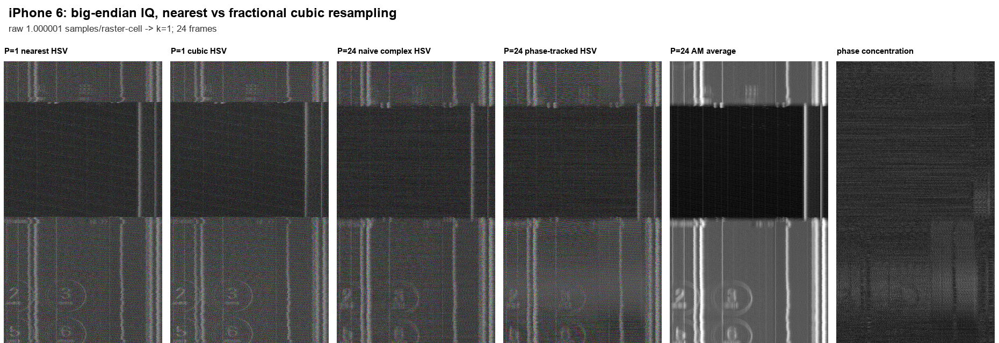
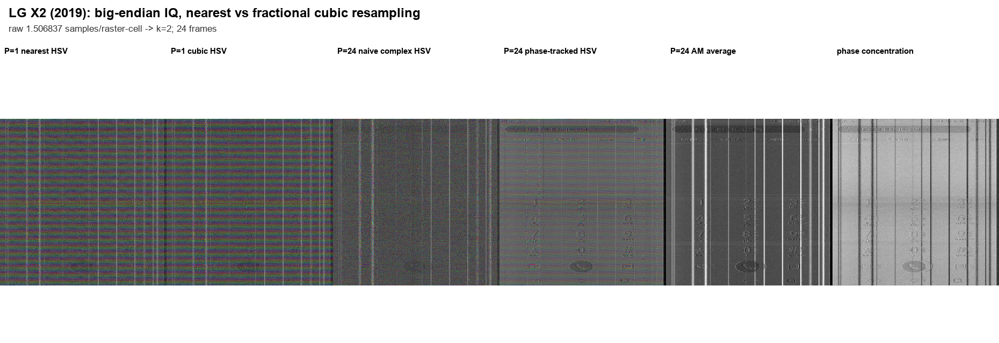
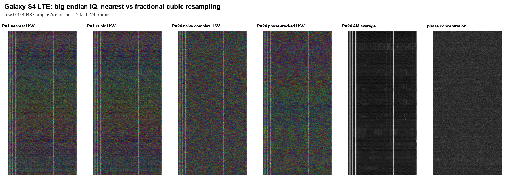
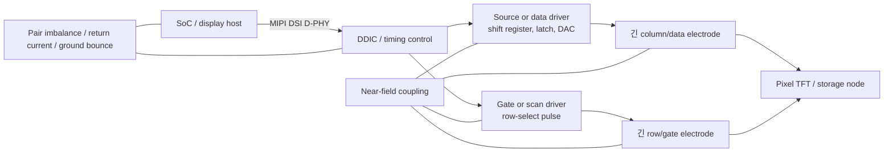

# 스마트폰 화면 누설 IQ의 coherent HSV 복원과 fractional resampling

> 이 파일은 중간 초안이다. 안테나 복원·line sweep·정정 STFT까지 반영한 [최종 분석본](LAB_MEETING_COHERENT_HSV_KR.md)을 사용한다.

랩미팅 초안 · 2026-09-23  
대상: iPhone 6, LG X2 (2019), Galaxy S4 LTE 및 안테나 측정 3개 파일

> **상태 표기**
>
> - **확인**: 원시 파일, 코드 또는 산출 수치로 직접 확인한 내용
> - **해석**: 확인된 결과와 양립하지만 발생원을 단정하지 않는 설명
> - **가설**: 추가 메타데이터나 대조 측정이 있어야 검증할 수 있는 주장

## 1. 이번 발표의 결론

1. **확인 — 바이트 순서 정정:** `.rIs`는 headerless **big-endian signed int16 I/Q interleaved** 형식이다. 실험실의 `RIS2IQ.m`이 `ieee-be`로 읽으며, 원시 바이트 분포도 이에 부합한다. 기존 Python 분석은 little-endian으로 읽었으므로 그 복원 화면, RPCA, matched-subspace, STFT, 위상 및 SNR 수치는 폐기해야 한다. [기존 RPCA 보고서](REPORT_KR.md)와 [기존 STFT 보고서](TF_DRIVER_STUDY_KR.md)에는 정정 문구를 넣었다.

2. **확인 — big-endian 재분석 결과:** 24 frame의 fractional-raster resampling과 frame별 선형 row-phase 추적을 적용했을 때, 평균 amplitude-normalized complex coherence는 LG X2에서 `0.186 → 0.535`로 **2.88배** 증가했다. iPhone 6은 `0.199 → 0.220`으로 1.11배, Galaxy S4 LTE는 `0.213 → 0.214`로 거의 변하지 않았다.

3. **확인 — 독립 반복성:** 홀수 frame 평균과 짝수 frame 평균의 가중 위상 일치도는 LG `0.902`, iPhone `0.063`, Galaxy `0.008`이다. 따라서 이번 자료에서 **복소 위상까지 반복 재현된 기종은 LG가 가장 명확**하다. iPhone과 Galaxy의 HSV 색을 곧바로 물리적 방사 위상으로 해석하면 안 된다.

4. **확인 — raster-cell당 원시 표본:** iPhone `1.0000`, LG `1.5068`, Galaxy `0.44495 sample/raster-cell`이다. 출력 격자는 각각 `k=1, 2, 1 sample/raster-cell`로 만들었다. 이는 복원 영상 좌표에 대한 값이며, MIPI lane의 UI나 실제 subpixel당 표본 수가 아니다.

5. **해석 — 세로선:** LG의 일부 세로선은 row를 가로질러 높은 phase-locking value(PLV)를 보인다. 매 line의 같은 intra-line time에서 반복되는 source/data driver, gate/scan driver, DSI packet/blanking 경계, DDIC PLL·charge-pump 활동 또는 수신기 spur가 모두 이런 세로선을 만들 수 있다. 현재 결과만으로 column driver 방사라고 식별하지 않는다.

6. **확인 — 안테나 파일의 한계:** 안테나 1–3 파일에는 sample rate, 중심주파수, 수신 대역폭이 들어 있지 않다. 따라서 세 파일의 instantaneous bandwidth는 파일만으로 결정할 수 없다. 안테나 1·2에는 약 1105–1106 sample의 반복 구조가 보이고, 안테나 3의 ADC RMS는 약 21 dB 낮다. iPhone 6과 같은 `124.085710 MS/s`라고 가정할 때만 이 구조가 약 `112.2 kHz` line-rate 및 약 60 Hz frame 계열과 양립한다.

---

## 2. 입력과 분석 범위

### 2.1 메타데이터가 있는 기존 스마트폰 캡처

| 기종 | 중심주파수 | 설정 complex BW | 저장 complex sample rate | line rate | 사용 raster |
|---|---:|---:|---:|---:|---:|
| iPhone 6 | 238.0 MHz | 60 MHz | 124.085710 MS/s | 112.805083 kHz | 1880 × 1100 |
| LG X2 (2019) | 344.8 MHz | 60 MHz | 136.565510 MS/s | 88.679653 kHz | 1478 × 1022 |
| Galaxy S4 LTE | 171.5 MHz | 20 MHz | 55.816790 MS/s | 116.153425 kHz | 1936 × 1080 |

`설정 complex BW`는 파일명과 기존 취득 설정에 기록된 수신 필터 대역이다. 저장 sample rate와 동일한 값이 아니며, 수신기의 평탄한 usable bandwidth라고 보려면 별도 교정이 필요하다.

### 2.2 새 안테나 캡처

| 파일 | 크기 | complex sample 수 | ADC RMS | 현재 확인된 내용 |
|---|---:|---:|---:|---|
| `안테나1.rIs` | 1,366,200,000 B | 341,550,000 | 281.2 | 553 sample 계열과 1106 sample 부근 AM 반복 |
| `안테나2.rIs` | 1,425,600,000 B | 356,400,000 | 281.7 | 553 sample 계열과 1105 sample 부근 AM 반복 |
| `안테나3.rIs` | 1,841,400,000 B | 460,350,000 | 24.37 | 안테나 1·2와 같은 반복 구조가 명확하지 않음 |

세 파일 모두 형식은 big-endian I/Q로 확인했다. ADC RMS는 원시 ADC count 단위이며, 안테나 이득·케이블 손실·수신 gain이 보정된 장세기 값이 아니다. 안테나 3의 RMS는 안테나 1·2보다 약 `20 log10(281/24.37) = 21.2 dB` 낮다.

---

## 3. 방법

### 3.1 논문의 coherent demodulation과 이번 구현의 차이

[Erdeljan & Kuhn, EMC Europe 2024](https://doi.org/10.1109/EMCEurope59828.2024.10722379)은 HDMI 방사에서 다음 흐름을 사용한다.

1. complex autocorrelation으로 frame period를 추정한다.
2. total raster가 `w_t × h_t`, frame rate가 `f_v`이면 raster pixel rate를 `f_p = w_t h_t f_v`로 둔다.
3. `f_s' = k f_p`가 되도록 fractional resampling한다.
4. 수신 중심주파수에 가장 가까운 harmonic `h = round(f_c/f_p)`를 택하고, `f_c-hf_p` 잔여 회전을 보상한다.
5. frame 간 timing과 phase를 반복 보정한 뒤 complex coherent average를 계산한다.

이번 재분석은 MIPI DSI common-mode 후보에 대한 **data-driven 실험**이다. `h f_p`에 해당하는 MIPI 물리 harmonic을 검증하지 못했으므로 HDMI 식을 그대로 적용하지 않았다. 대신 각 frame에 대해 다음 처리를 수행했다.

1. raster 좌표에서 4점 Catmull–Rom cubic fractional-delay 보간
2. column amplitude profile의 circular shift와 3점 포물선 보간으로 fractional column 정렬
3. 기준 frame과의 row별 complex cross-correlation 위상을 unwrap
4. 가중 최소제곱으로 `phi(r)=a+br`를 적합해 frame별 공통 위상과 선형 row-phase drift 제거
5. 1, 4, 16, 24 frame에서 AM, naive complex HSV, phase-tracked HSV, phase concentration 저장

따라서 아래 결과는 **완전한 MIPI carrier recovery**가 아니라, raster와 선형 위상 drift를 경험적으로 추적했을 때 복소 반복성이 얼마나 남는지를 보는 실험이다.

### 3.2 Fractional resampling

원시 sample rate `f_s`, line rate `f_H`, total raster width `W_t`에 대해

$$
\rho=\frac{f_s}{f_H W_t}
$$

를 원시 sample/raster-cell로 정의했다. 출력은 `k=ceil(rho)`를 사용해 `k f_H W_t` sample/s의 균일 raster 격자를 만들었다.

| 기종 | raw sample/line | raw sample/raster-cell `rho` | 출력 `k` | 출력 raster rate |
|---|---:|---:|---:|---:|
| iPhone 6 | 1100.0011 | **1.000001** | **1** | 124.085591 MS/s |
| LG X2 | 1539.9870 | **1.506837** | **2** | 181.261210 MS/s |
| Galaxy S4 LTE | 480.5436 | **0.444948** | **1** | 125.445699 MS/s |

`k`는 새 정보의 생성량이 아니다. cubic interpolation은 이미 측정된 대역제한 신호의 fractional-delay 값을 추정할 뿐이며, 원시 아날로그 대역폭이나 Nyquist 정보를 늘리지 않는다. 특히 Galaxy는 raster-cell당 원시 표본이 1개보다 적으므로 cell-scale 구조가 원시 취득 단계에서 이미 alias 또는 평균화되었을 가능성이 크다.

### 3.3 HSV와 위상 집중도

복소 평균 영상 `z(r,c)`에 대해 Hue는 `arg z`, Value는 log-magnitude의 1–99 percentile robust scaling, Saturation은 `235/255` 고정값으로 표시했다. 그림의 `phase concentration` panel은 한 픽셀에서의 unit-phasor concentration

$$
C_u(r,c)=\left|\frac{1}{N}\sum_{n=1}^{N}e^{j\theta_n(r,c)}\right|,\qquad 0\le C_u\le1
$$

로 계산했다. `C_u≈1`은 frame 간 위상이 모였다는 뜻이고, `C_u≈0`은 위상이 원형으로 흩어졌다는 뜻이다. 표의 `0.186 → 0.535` 값은 이 그림의 단순 공간평균과 다르며, 픽셀마다

$$
C_w(r,c)=\frac{|\sum_n z_n(r,c)|}{\sum_n|z_n(r,c)|}
$$

를 계산한 뒤 공간 평균한 **amplitude-normalized complex coherence**다. 높은 `C_u` 또는 `C_w`만으로 신호원이 DDIC나 DSI임이 증명되지는 않는다.

### 3.4 독립 반복성 검증

같은 frame을 정렬 기준과 평가에 모두 쓰면 coherent average가 좋아 보일 수 있다. 이를 견제하기 위해 홀수 frame 12장과 짝수 frame 12장을 각각 평균한 뒤 다음을 비교했다.

- log-magnitude correlation
- 수평 edge correlation
- 공통 scalar phase를 정렬한 weighted phase agreement
- weighted circular phase RMSE

이 독립 half 비교가 최종 HSV의 물리적 반복성을 판단하는 주 지표다.

---

## 4. 중간 및 최종 복원 화면

각 montage는 왼쪽부터 `P=1 nearest HSV`, `P=1 cubic HSV`, `P=N naive HSV`, `P=N phase-tracked HSV`, `P=N AM average`, `phase concentration` 순서다.

| 기종 | P=1 | P=4 | P=16 | P=24 |
|---|---|---|---|---|
| iPhone 6 | [열기](coherent_results/three_devices_big_endian/iphone6/progress_P001.png) | [열기](coherent_results/three_devices_big_endian/iphone6/progress_P004.png) | [열기](coherent_results/three_devices_big_endian/iphone6/progress_P016.png) | [열기](coherent_results/three_devices_big_endian/iphone6/progress_P024.png) |
| LG X2 | [열기](coherent_results/three_devices_big_endian/lgx2/progress_P001.png) | [열기](coherent_results/three_devices_big_endian/lgx2/progress_P004.png) | [열기](coherent_results/three_devices_big_endian/lgx2/progress_P016.png) | [열기](coherent_results/three_devices_big_endian/lgx2/progress_P024.png) |
| Galaxy S4 LTE | [열기](coherent_results/three_devices_big_endian/galaxy_s4_lte/progress_P001.png) | [열기](coherent_results/three_devices_big_endian/galaxy_s4_lte/progress_P004.png) | [열기](coherent_results/three_devices_big_endian/galaxy_s4_lte/progress_P016.png) | [열기](coherent_results/three_devices_big_endian/galaxy_s4_lte/progress_P024.png) |

### 4.1 iPhone 6, P=24

**확인:** big-endian AM 평균에서 버튼과 숫자에 대응하는 구조가 나타난다. phase tracking은 평균 complex coherence를 약 11% 높였다.  
**제한:** independent-half edge correlation이 `0.012`, phase agreement가 `0.063`이므로 미세 경계와 HSV 색은 독립적으로 재현되지 않았다. 화면의 존재를 정성적으로 보여 주는 AM 결과와 안정된 위상 복원을 구분해야 한다.

### 4.2 LG X2, P=24

**확인:** AM에서 키패드 구조가 나타나며, phase-tracked HSV와 phase-concentration에서도 대응 구조가 남는다. 전체 위상 집중도와 independent-half phase agreement가 세 기종 중 가장 높다.  
**해석:** 현재 세 자료 중 MIPI/panel 관련 common-mode 후보의 coherent 분석을 계속하기에 가장 적합한 캡처다.

### 4.3 Galaxy S4 LTE, P=24

**확인:** AM에서 키패드형 구조가 나타나지만, phase tracking 전후의 전체 complex coherence는 사실상 같다. independent-half phase agreement는 `0.008`이다.  
**제한:** 일부 세로선의 높은 within-average PLV를 전체 캡처의 coherent phase recovery로 일반화할 수 없다.

---

## 5. 정량 비교

### 5.1 Coherent averaging 결과

| 기종 | naive complex coherence | phase-tracked complex coherence | 증가율 | 평균 절대 fractional column shift | residual frequency 표준편차 |
|---|---:|---:|---:|---:|---:|
| iPhone 6 | 0.1987 | 0.2203 | 1.109× | 3.530 cell | 227.4 Hz |
| LG X2 | 0.1855 | 0.5351 | **2.884×** | 0.927 cell | **21.49 Hz** |
| Galaxy S4 LTE | 0.2132 | 0.2141 | 1.004× | 0.783 cell | 280.3 Hz |

LG의 residual frequency 변동이 작고 phase-concentration 증가가 크다. iPhone과 Galaxy는 frame별 위상 drift가 더 크며, 단순 선형 row-phase 모델로 충분히 안정화되지 않았다. SSC, 비선형 clock drift, frame 시작 오차, 복수 방사원 또는 낮은 SNR이 가능한 원인이다.

### 5.2 Independent odd/even-half 반복성

| 기종 | log-AM corr. | horizontal-edge corr. | weighted phase agreement | phase RMSE |
|---|---:|---:|---:|---:|
| iPhone 6 | 0.514 | 0.012 | 0.063 | 1.745 rad |
| LG X2 | 0.488 | **0.498** | **0.902** | **0.482 rad** |
| Galaxy S4 LTE | 0.298 | 0.022 | 0.008 | 1.804 rad |

화면이 보인다는 정성 관찰과 independent edge/phase 재현성은 같은 개념이 아니다. 큰 버튼·고정 profile은 평균 영상에서 보일 수 있지만, 서로 독립인 두 half에서 세부 edge와 phase가 같아야 coherent recovery를 강하게 주장할 수 있다.

### 5.3 Nearest 대비 fractional cubic 결과

| 기종 | log-AM corr. | edge corr. | phase agreement | phase RMSE |
|---|---:|---:|---:|---:|
| iPhone 6 | 0.901 | 0.756 | 0.939 | 0.378 rad |
| LG X2 | 0.974 | 0.952 | 0.998 | 0.059 rad |
| Galaxy S4 LTE | 0.836 | 0.629 | 0.962 | 0.287 rad |

두 방법의 correlation이 높으므로 fractional resampling이 완전히 다른 화면을 생성한 것은 아니다. 변화가 가장 큰 Galaxy는 `rho=0.445`로 가장 심하게 undersampled된 격자다. 이 변화가 곧 정보 복원을 뜻하지 않으며, independent-half 반복성과 함께 판단해야 한다.

---

## 6. 세로선의 복소 위상

### 6.1 계산 절차

1. 각 raster row의 공통 위상을 반복 template alignment로 제거했다.
2. 61-column complex 이동평균을 local background로 두고 narrow-stripe residual을 구했다.
3. column amplitude에서 local 61-column 평균을 뺀 값의 robust z-score가 큰 위치를 후보로 골랐다.
4. 가장 강한 stripe의 위상을 0°로 두고 다른 stripe의 상대 위상과 row-wise PLV를 계산했다.

이 값은 안테나에서 수신된 복소 baseband의 **상대 위상**이다. MIPI lane 전압이나 DDIC pin의 절대 위상이 아니다.

| 기종 | 대표 column | stripe z | 기준선 대비 위상 | row PLV | 읽을 수 있는 범위 |
|---|---:|---:|---:|---:|---|
| iPhone 6 | 351 | +89.3 | 0° | 0.800 | 강한 기준 stripe |
| iPhone 6 | 317 | +31.0 | −94.1° | 0.503 | 중간 coherence |
| iPhone 6 | 335 | −32.2 | +165.2° | 0.189 | 위상 불안정 |
| LG X2 | 640 | +27.6 | 0° | 0.844 | 기준 stripe |
| LG X2 | 553 | +10.5 | −143.7° | **0.955** | 높은 row coherence |
| LG X2 | 648 | +15.3 | −82.5° | **0.941** | 높은 row coherence |
| LG X2 | 395 | +19.1 | +50.5° | **0.925** | 높은 row coherence |
| Galaxy S4 | 906 | +891.5 | 0° | 0.978 | 매우 강한 within-average stripe |
| Galaxy S4 | 982 | +647.1 | −57.9° | 0.930 | 높은 within-average PLV |
| Galaxy S4 | 885 | −132.3 | +160.0° | 0.771 | local background와 거의 반대 방향 |

전체 그래프: [iPhone 6](coherent_results/three_devices_big_endian/iphone6/vertical_line_phase.png) · [LG X2](coherent_results/three_devices_big_endian/lgx2/vertical_line_phase.png) · [Galaxy S4 LTE](coherent_results/three_devices_big_endian/galaxy_s4_lte/vertical_line_phase.png)

### 6.2 해석

- **확인:** LG에서는 여러 강한 stripe가 `PLV=0.84–0.96` 범위이고 서로 다른 상대 위상을 갖는다. 하나의 scalar common phase만으로 모든 세로선을 설명할 수 없다.
- **확인:** 일부 음의 stripe는 기준선에 대해 약 `160–165°`에 있다. local background에 대한 감산 성분 또는 반대 polarity와 양립한다.
- **해석:** 상대 위상이 정확히 0°/180° 두 군집으로만 모이지 않으므로, 단순한 하나의 driver pulse polarity 모델은 부족하다. 전파경로, 대역 필터, 복수 source, 주파수 선택적 common-mode conversion이 위상을 회전시킬 수 있다.
- **제한:** Galaxy의 개별 stripe PLV는 높지만 independent odd/even phase agreement가 `0.008`이다. 선택된 24-frame 평균 내부의 규칙성 또는 고정 수신 성분일 수 있으므로 source phase로 단정하지 않는다.

---

## 7. MIPI DSI/D-PHY common-mode 방사와 panel driver 가설

### 7.1 DSI 전송 구조

[MIPI DSI](https://www.mipi.org/specifications/dsi)는 display host와 display module 사이의 packetized interface이고, [MIPI D-PHY](https://www.mipi.org/specifications/d-phy)는 그 대표 물리계층이다. D-PHY는 보통 별도 clock lane과 1–4개 data lane을 사용하며, high-speed differential 전송과 low-power 상태를 오간다. DSI video mode는 packet header, payload, checksum 및 blanking/low-power 구간을 포함하고, 다중 lane에서는 byte가 lane으로 분배된다.

HDMI TMDS의 8b/10b·running-disparity 모델을 DSI에 그대로 적용하면 안 된다. DSI는 TMDS line coding을 쓰지 않지만 packet framing, lane mapping, payload format, 선택적 압축과 구현별 clocking이 있으므로 단순한 무부호 NRZ 한 줄로 보는 것도 부정확하다.

### 7.2 Differential-to-common-mode conversion

이상적인 differential pair에서 두 선의 전류와 장은 상쇄된다. 실제 FPC·connector·PCB에서 rise/fall mismatch, pair skew, 임피던스 및 termination 비대칭, return-path 불연속, ground bounce가 있으면 differential 성분 일부가 common mode로 변환된다. [De Meulemeester et al., IEEE TEMC 2020](https://doi.org/10.1109/TEMC.2020.3000830)은 differential video signaling의 rise/fall 및 지연 불균형이 AM/FM 정보 누설을 만드는 메커니즘을 분석했다. 이를 MIPI D-PHY에 적용하는 것은 물리적으로 타당한 **확장 해석**이지만, 이번 DUT에서 해당 불균형을 직접 계측한 것은 아니다.

### 7.3 DDIC와 panel driver

Source/data driver는 line마다 pixel data를 latch하고 DAC 또는 data voltage/current stage를 통해 긴 column electrode를 충방전한다. Gate/scan driver는 row를 순차 선택한다. 이때 `I=C dV/dt`, level shifter, charge pump, 긴 electrode와 FPC return current가 반복 장을 만든다. Galaxy S4 LTE는 AMOLED이므로 세 기종을 함께 설명할 때에는 LCD column driver보다 **panel source/data driver와 gate/scan driver**가 정확한 표현이다.

매 line의 같은 intra-line time `c0`에 반복 pulse나 burst가 있으면 raster를 접었을 때 모든 row의 같은 column에 누적되어 세로선이 된다. 이는 source/data activity와 양립하지만 다음 대안도 같은 영상을 만들 수 있다.

- horizontal blanking 또는 packet boundary
- HS/LP 전환과 BLLP
- DDIC PLL, charge pump, regulator 또는 내부 clock
- gate/scan pulse가 line 시작과 고정 위상으로 반복되는 경우
- 수신기 LO, ADC, DDC 또는 외부 clock spur

따라서 세로선의 위치와 위상만으로 driver 종류를 식별하지 않는다. 화면 pattern, probe 위치·편파, 중심주파수를 바꿨을 때 stripe가 어떻게 이동하는지를 함께 봐야 한다.

---

## 8. 관련 연구가 이번 실험에 주는 역할

| 연구 | 확인된 핵심 | 이번 분석에서의 역할과 한계 |
|---|---|---|
| [Erdeljan & Kuhn, EMC Europe 2024](https://doi.org/10.1109/EMCEurope59828.2024.10722379) | HDMI leakage에 fractional resampling, harmonic correction, coherent averaging, HSV 적용 | 직접적인 방법론 기준. DSI의 pixel harmonic을 검증하지 않았으므로 이번 코드는 경험적 row-phase tracking까지만 적용 |
| [He & Kassam, IEEE TCOM 2008](https://doi.org/10.1109/TCOMM.2008.060370) | constellation-matched error를 이용해 QAM blind equalizer의 transient 및 steady-state 특성 개선 | 향후 복소 sample이 안정된 cluster를 만들 때 lane/channel equalization 후보. frame/line timing이나 raster recovery 기법은 아님 |
| [USBee, PST 2016](https://doi.org/10.1109/PST.2016.7906972) ([arXiv](https://arxiv.org/abs/1608.08397)) | 소프트웨어로 만든 USB data transition이 제어 가능한 EM emission을 생성 | pattern-controlled transition과 방사의 인과성을 검증하는 실험 설계의 근거. MIPI 복원 알고리즘은 아님 |
| [De Meulemeester et al., IEEE TEMC 2020](https://doi.org/10.1109/TEMC.2020.3000830) | differential 신호의 불균형이 common-mode AM/FM leakage를 생성 | D-PHY common-mode 가설의 물리적 근거. DUT의 실제 imbalance는 별도 측정 필요 |
| [Laakso et al., IEEE SPM 1996](https://doi.org/10.1109/79.482137) | fractional-delay filter 설계와 평가 | 비정수 raster 위치를 보간하는 신호처리 근거. 보간이 원시 대역폭을 늘리지는 않음 |

추가로 SSC가 존재하면 정적 `f_p`와 선형 phase-drift 모델이 깨질 수 있다. 이 경우 frame마다 하나의 slope를 적합하는 현재 방법보다 time-varying clock law 또는 PLL/Kalman tracking이 필요하다.

---

## 9. 안테나 캡처: 현재 포렌식과 삽입 예정 결과

### 9.1 현재 확인된 것

- 세 파일은 headerless big-endian int16 I/Q이다.
- 파일 안에는 `f_s`, `f_c`, 설정 BW, gain, 측정 거리·편파 메타데이터가 없다.
- 안테나 1·2의 log-amplitude autocorrelation은 약 553 sample 간격과 1105–1106 sample 부근의 반복을 보인다.
- **가설:** 기존 iPhone 6과 같은 `f_s=124.085710 MS/s`라고 놓으면 1105–1106 sample은 약 112.2 kHz이고, 별도의 long-period power 분석에서 약 60 Hz 계열이 보인다. 두 비율은 대략 1870여 line/frame로 iPhone의 1880-row raster 가설과 가깝다.
- 안테나 3은 약 21.2 dB 낮고, 안테나 1·2와 같은 line family가 짧은 autocorrelation에서 명확하지 않다.

이 일치는 sample rate를 이미 가정한 뒤 얻은 결과다. 파일명 크기를 임의의 2.5초로 나누어 sample rate를 만드는 방식은 근거가 없으므로 사용하지 않는다.

### 9.2 복원 결과 삽입 자리

> **[안테나 복원 검증 후 삽입]**
>
> 아래 항목은 `antenna_coherent_restore.py` 실행이 끝난 뒤 시각 검사와 independent-half 검증을 통과한 값만 넣는다.
>
> 1. 각 파일의 timing peak, prominence, 적용한 frame period와 그 출처
> 2. P=1/4/16/24 AM·HSV·phase concentration montage
> 3. odd/even log-AM, edge, phase repeatability
> 4. `복원 성공 / 주기만 검출 / 가설 불지지` 중 하나의 분류
> 5. sample rate를 가정했음을 그림 제목과 표에 반복 표기

검증 전에는 안테나 1·2를 iPhone 6 캡처로 확정하거나, 안테나 3의 강한 coherence처럼 보이는 성분을 화면 누설로 부르지 않는다.

---

## 10. 랩미팅 발표 순서

1. **Endian 정정부터 제시**  
   `RIS2IQ.m`의 `ieee-be`와 big/little-endian RMS 차이를 보여 주고, 이전 RPCA/STFT 수치를 폐기한다고 명확히 말한다.

2. **P=1 → 4 → 16 → 24 진행 화면**  
   각 기종의 AM과 HSV가 frame 수에 따라 어떻게 변하는지 보여 준다. LG에서만 phase-tracked HSV와 concentration이 함께 안정되는 점을 강조한다.

3. **sample/raster-cell 표**  
   Galaxy의 `0.445`와 LG의 `1.507`을 비교해 fractional-delay가 필요한 이유와 원시 정보량의 한계를 설명한다.

4. **전체 complex coherence 다음 independent-half 검증**  
   LG `0.902`, iPhone `0.063`, Galaxy `0.008`을 나란히 보여 주어 예쁜 HSV 색과 반복 가능한 위상을 구분한다.

5. **세로선 phase plot**  
   LG의 여러 높은-PLV stripe가 서로 다른 상대 위상을 갖는다는 사실을 보여 준다. column driver는 가능한 원인 중 하나로만 둔다.

6. **MIPI DSI common-mode 경로**  
   D-PHY pair imbalance → FPC/DDIC return current → source/data 및 gate/scan activity → 안테나 결합 순서로 설명한다.

7. **안테나 3개 결과**  
   메타데이터 부재를 먼저 말하고, 검증된 복원과 독립 반복성만 제시한다.

---

## 11. 다음 측정과 분석

1. **메타데이터 sidecar 의무화:** `f_s`, `f_c`, analog/digital BW, gain, duration, device, 화면 pattern, probe/antenna 위치·편파를 캡처마다 JSON 또는 CSV로 저장한다.
2. **Pattern-controlled experiment:** 전백·전흑·수직 1-pixel stripe·수평 stripe·checkerboard·고정 UI를 같은 RF 설정으로 측정한다. USBee와 같은 방식으로 transition density를 통제해야 source 인과성을 볼 수 있다.
3. **위치 및 편파 sweep:** DDIC/FPC/좌우 panel edge/후면을 같은 거리에서 측정해 세로선 amplitude와 phase가 어디서 최대가 되는지 map으로 만든다.
4. **공통모드 직접 확인:** 가능하면 high-bandwidth differential/common-mode probe 또는 두 채널 동시 측정으로 `V+ + V−`와 `V+ − V−`를 비교한다.
5. **시간변동 clock 추적:** frame별 linear phase가 부족한 iPhone/Galaxy에는 sliding complex correlation, PLL 또는 Kalman model을 적용하고 SSC 주기 성분을 검사한다.
6. **Constellation matching은 후단에서 평가:** 안정된 complex cluster와 known packet/pattern 근거가 확보된 뒤 He–Kassam 계열 blind equalization을 적용한다.
7. **SVD/RPCA는 물리 기준 확보 후 재개:** 화면 pattern에 따라 변하는 subspace와 고정 nuisance subspace를 별도 학습할 reference capture가 있어야 한다.

---

## 12. 재현 파일

- 실행 코드: [coherent_hsv_resampling.py](coherent_hsv_resampling.py)
- 전체 수치: [summary.csv](coherent_results/three_devices_big_endian/summary.csv), [summary.json](coherent_results/three_devices_big_endian/summary.json)
- 기종별 frame 진단: [iPhone](coherent_results/three_devices_big_endian/iphone6/frame_diagnostics.csv), [LG](coherent_results/three_devices_big_endian/lgx2/frame_diagnostics.csv), [Galaxy](coherent_results/three_devices_big_endian/galaxy_s4_lte/frame_diagnostics.csv)
- 세로선 위상 원자료: [iPhone](coherent_results/three_devices_big_endian/iphone6/vertical_line_phase.csv), [LG](coherent_results/three_devices_big_endian/lgx2/vertical_line_phase.csv), [Galaxy](coherent_results/three_devices_big_endian/galaxy_s4_lte/vertical_line_phase.csv)
- 안테나 형식·주기 probe: [probe.json](coherent_results/antenna_probe/probe.json), [antenna_probe.py](antenna_probe.py)

## 13. 발표 시 지켜야 할 표현

- `1 sample/pixel` 대신 **`1 sample/raster-cell`**이라고 말한다.
- `MIPI common-mode를 복원했다` 대신 **`MIPI/panel common-mode 후보 대역에서 화면과 동기된 방사를 복원했다`**고 말한다.
- `column driver 신호` 대신 **`매 line의 고정 위상에 반복되는 세로선이며 source/data driver와 양립한다`**고 말한다.
- `위상 복원 성공`은 independent-half phase agreement가 높은 LG에 우선 사용한다.
- 안테나 결과의 주파수축에는 반드시 **`f_s=124.085710 MS/s 가정`**을 붙인다.
