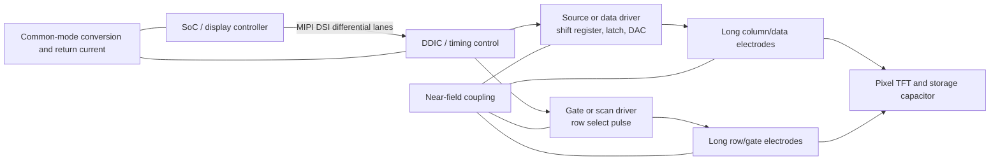

# 3기종 누설 IQ의 STFT 및 패널 구동 방사 검토

> **2026-09-23 정정:** 이 문서의 Python 복원·STFT는 `.rIs`를 little-endian으로 읽었다. 실험실 `RIS2IQ.m`이 규정하는 실제 형식은 **big-endian signed int16 I/Q**이다. 따라서 아래 복원 화면, STFT, 위상 및 상관 수치는 폐기하고, 장비 설정에서 직접 얻은 파일명·표본율·대역폭 메타데이터만 참고한다. 정정 재분석은 [LAB_MEETING_COHERENT_HSV_KR.md](LAB_MEETING_COHERENT_HSV_KR.md)와 [새 결과 갤러리](coherent_results/index.html)를 기준으로 한다.

분석일: 2026-09-22  
대상: LG X2 (2019), Galaxy S4 LTE, iPhone 6

## 결론

- iPhone 6은 기존 전체 저장 대역의 최적 후보 `P=488`을 다시 복원하고 3×3 median 및 행/열 고정 성분 제거를 적용했지만, 식별 가능한 UI를 얻지 못했다. 독립 half의 row-profile 상관은 0.903이지만 image correlation은 0.0244여서 raster timing은 맞고 pixel SNR이 부족한 경우로 해석한다.
- 수집 설정의 **complex instantaneous receive bandwidth**는 LG X2 60 MHz, Galaxy S4 LTE 20 MHz, iPhone 6 60 MHz이다. 파일의 저장 complex sample rate는 각각 136.565510, 55.816790, 124.085710 MS/s이며 아날로그 유효 대역폭과 같은 값으로 해석하지 않는다.
- 한 raster line을 창으로 쓴 row-scale STFT와, 라인 내부 64 raster-cell을 창으로 쓴 column-phase STFT를 계산했다. column-phase에 따른 band-integrated power의 P95-P05 변화는 LG 2.65 dB, Galaxy 0.95 dB, iPhone 0.15 dB였다.
- LG와 Galaxy의 세로선은 매 line에서 같은 위치에 반복되는 구동 또는 blanking 활동과 양립한다. 현재 자료만으로 source/column driver, gate/row driver, MIPI packet boundary, DDIC clock, 수신기 spur 중 하나를 특정할 수는 없다.
- Galaxy S4 LTE는 Super AMOLED이다. 세 기종을 함께 부를 때에는 LCD column/row driver보다 **panel source/data driver와 gate/scan driver**라는 용어가 정확하다.

## 수집 대역폭과 raster 시간

| 기종 | 중심주파수 | 설정 complex IQ BW | 저장 complex sample rate | 한 row | 한 raster cell | frame rate |
|---|---:|---:|---:|---:|---:|---:|
| iPhone 6 | 238.0 MHz | **60 MHz** | 124.085710 MS/s | 8.86485 µs | 8.05895 ns | 60.0027 Hz |
| LG X2 (2019) | 344.8 MHz | **60 MHz** | 136.565510 MS/s | 11.27654 µs | 11.03380 ns | 59.9998 Hz |
| Galaxy S4 LTE | 171.5 MHz | **20 MHz** | 55.816790 MS/s | 8.60930 µs | 7.97158 ns | 59.9966 Hz |

여기서 BW는 측정 파일명과 기존 acquisition 설정에 기록된 수신 필터 대역이다. 저장 sample rate 전체를 FFT에 넣으면 수치상 Nyquist span은 sample rate와 같지만, 그 가장자리까지 receiver가 평탄하고 보정된 124.086/136.566/55.817 MHz 대역이라고 주장할 근거는 없다. 정확한 usable bandwidth는 장비의 digital down-converter/filter 응답이나 calibration tone으로 따로 확인해야 한다.

Raster cell은 물리 subpixel clock과 동일하다고 확정한 값이 아니다. 복원에 사용한 total raster width를 한 line period로 나눈 **영상 좌표의 시간 간격**이다.

## STFT 구성

### Row-scale STFT

- Hann window 길이: 정확히 한 raster line
- iPhone 6: 1100 samples, 실제 시간 분해능 8.86485 µs, 실제 창 분해능 약 112.805 kHz
- LG X2: 1540 samples, 11.27654 µs, 약 88.679 kHz
- Galaxy: 481 samples, 8.60930 µs, 약 116.043 kHz
- 6 frame의 power를 평균했다.

이 그림의 가로축은 frame 안의 row index이다. 특정 RF 성분이 row 진행에 따라 변하는지, frame 내 특정 vertical position에서 켜지는지를 본다.

### Column-phase STFT

- 각 line을 같은 위상으로 정렬한 뒤, 64 raster-cell Hann window와 8-cell hop을 사용했다.
- iPhone 6: 64 samples/window, 약 1.939 MHz
- LG X2: 96 samples/window, 약 1.423 MHz
- Galaxy: 28 samples/window, 약 1.993 MHz
- 4 frame과 여러 row의 power를 평균했다.

물리 화면의 한 column은 frame 전체에서 연속된 하나의 시간 구간이 아니다. 각 row의 같은 line phase에 한 번씩 나타난다. 따라서 line을 접어 같은 phase를 평균한 이 방식이 세로줄의 RF 구조를 보는 데 일반적인 frame STFT보다 적합하다. 단, Galaxy는 한 raster cell당 저장 sample이 약 0.445개뿐이라 cell-scale 세부 구조는 alias/평균화될 수 있다.

## 결과

| 기종 | row 위치별 band power P95-P05 | column phase별 band power P95-P05 | 해석 |
|---|---:|---:|---|
| iPhone 6 | 0.47 dB | **0.15 dB** | 강한 narrowband line은 있으나 column phase에 거의 고정되어 보이며 UI는 복원되지 않음 |
| LG X2 | 0.37 dB | **2.65 dB** | 세 기종 중 line 내부 위치에 따른 RF power 변화가 가장 강함 |
| Galaxy S4 LTE | 0.96 dB | **0.95 dB** | line 내부 및 row 진행 양쪽에 중간 정도 변화 |

이 값은 STFT의 band-integrated power profile에 대한 robust spread이다. 화면 복원 SNR, 누설 신호 전력, driver 식별 확률은 아니다. LG에서 특히 강한 국소 변화가 나온 RF 구간은 약 318.1–323.5 MHz였고, Galaxy의 대표 변화는 176.7–180.2 MHz였다. 이 주파수는 탐색 우선순위로 쓸 수 있지만 spur 여부를 배제하려면 화면 pattern 및 probe 위치를 바꾼 재측정이 필요하다.

그림:

- [LG X2 복원 및 두 STFT](tf_results/lgx2/tf_montage.png)
- [Galaxy S4 LTE 복원 및 두 STFT](tf_results/galaxy_s4_lte/tf_montage.png)
- [iPhone 6 복원 및 두 STFT](tf_results/iphone6/tf_montage.png)
- [iPhone 6 후처리 비교](tf_results/iphone6/iphone6_reconstruction_attempt.png)
- [브라우저용 결과 인덱스](tf_results/index.html)

## iPhone 6 복원 시도

기존 timing search에서 가장 나은 전체 저장 대역 후보인 P=488을 기준으로 했다. 원본 AM 복원, 3×3 median, 행·열 고정 profile 제거 후 median을 비교했다.

- independent-half log image correlation: 0.02443
- independent-half edge correlation: -0.00034
- column-profile correlation: 0.50447
- row-profile correlation: 0.90347

높은 row-profile repeatability는 frame/line alignment의 근거가 되지만, 영상 세부의 독립 재현성을 뜻하지 않는다. profile 제거는 눈에 띄는 세로/가로 성분을 줄였지만 없는 화면 정보를 만들지 못했다. 따라서 이번 자료에서는 `복원 성공`으로 분류하지 않는다.

## 패널 driver의 동작과 방사 경로



1. MIPI DSI는 differential lane으로 영상 packet을 DDIC에 전달한다. pair skew, impedance imbalance, connector/flex 비대칭, reference/ground bounce가 있으면 differential 전류 일부가 common mode로 변환된다.
2. Source/data driver는 pixel data를 shift register와 latch에 저장하고 DAC를 통해 column/data line에 analog level을 인가한다. 많은 column capacitance를 동시에 충방전하면 `I = C·dV/dt` 전류와 ground bounce가 생긴다.
3. Gate/scan driver는 한 row의 TFT를 선택하는 pulse를 순차적으로 보낸다. 긴 gate line과 distributed RC, level shifter, charge pump가 반복 전류를 만든다.
4. 긴 panel electrode, COF/flex, FPC ground return, shield/chassis의 공통모드 전류가 loop와 monopole 성분을 형성한다. 이 구조가 근접 probe에 E/H field로 결합된다.
5. LCD에서는 선택된 TFT가 liquid-crystal pixel capacitor와 storage capacitor를 충전하고 backlight가 별도로 존재한다. AMOLED에서는 data/scan driver가 pixel drive transistor와 OLED current를 제어하며 backlight는 없다. Galaxy S4는 이 두 번째 구조다.

세로선이 생기는 핵심은 방사원이 panel의 어느 변에 있는가보다 **매 line의 같은 시간 위치에서 반복되는가**이다. 매 row의 intra-line time `x0`에 pulse 또는 carrier burst가 있으면 raster 영상에서 모든 row의 같은 x좌표에 쌓여 세로선이 된다. 이 현상은 source driver 활동과 잘 맞지만 horizontal blanking, packet boundary, DDIC PLL/charge pump, receiver spur에도 생긴다. Gate driver pulse도 line 시작과 고정된 위상으로 동작하므로 단순 영상만으로 배제할 수 없다.

## driver 사진과 작동 설명 참고자료

아래 링크는 구조를 이해하기 위한 대표 자료이다. 이번 실행 환경에는 지정된 Bright Data 웹 도구가 연결되지 않아 링크의 현재 상태를 실시간 검증하지 못했으며, 세 DUT의 정확한 driver IC part number를 식별한 자료는 아니다.

- [iFixit iPhone 6 teardown](https://www.ifixit.com/Teardown/iPhone+6+Teardown/29213): display assembly와 flex 위치 사진
- [TFT LCD 구조 개요](https://en.wikipedia.org/wiki/Thin-film-transistor_liquid-crystal_display): row/column electrode와 TFT pixel 구조
- [Chip-on-film 구조](https://en.wikipedia.org/wiki/Chip_on_film): panel 가장자리 flex 위 driver IC 형태
- [Himax display driver 제품군](https://www.himax.com.tw/products/display-drivers/): source/gate/display driver IC의 실제 제품 범주
- [MIPI D-PHY 공식 사양 소개](https://www.mipi.org/specifications/d-phy): DSI physical layer와 differential lane 배경
- [Markus Kuhn, Electromagnetic Eavesdropping Risks of Flat-Panel Displays](https://www.cl.cam.ac.uk/~mgk25/pet2004-fpd.pdf): flat panel 방사와 복원에 관한 기초 연구
- [IEEE Xplore 8423652](https://ieeexplore.ieee.org/document/8423652): display electromagnetic leakage 관련 논문
- [LCD source/gate driver 특허 검색](https://patents.google.com/?q=(LCD+source+driver+gate+driver)): 내부 block diagram과 timing figure를 볼 수 있는 특허 모음

실제 사진에서는 driver가 별도 PCB IC로 보이지 않고 panel edge의 길고 좁은 COF tab이나 DDIC에 통합돼 있을 수 있다. teardown 사진만으로 die 기능을 source/gate로 단정하지 않아야 한다.

## 다음 실험: source/data driver 가설을 구별하는 방법

1. **패턴 직교화**: 동일 밝기의 solid gray, vertical bars, horizontal bars, checkerboard를 같은 수신 설정으로 반복한다.
2. **한 축만 변화**: column 방향만 바꾸는 패턴과 row 방향만 바꾸는 패턴을 비교한다. 후보 RF bin의 column-phase STFT가 vertical pattern의 공간 주기와 함께 이동하면 data/source 경로 증거가 강해진다.
3. **위치 scan**: 작은 H-field probe로 MIPI flex, DDIC/COF, 좌우 panel edge, 상하 panel edge를 같은 gain으로 scan한다. 318–324 MHz(LG), 176.7–180.2 MHz(Galaxy)를 우선 본다.
4. **동시 reference**: panel flex common-mode current clamp 또는 두 번째 near-field probe를 reference channel로 기록해 coherence와 transfer function을 구한다.
5. **blanking 분리**: active/blanking time을 정확히 표시하고 burst가 active pixel position과 함께 이동하는지, line start에 고정되는지 확인한다.
6. **receiver control**: DUT 전원 off 또는 동일 환경의 50 Ω load 측정을 추가해 고정 spur를 제거한다. display off만으로는 driver clock과 전원 상태도 달라져 완전한 nuisance reference가 되지 않는다.

이 절차로 얻은 source-specific reference를 matched subspace의 `H`로 쓰면, 현재처럼 영상 자체에서 subspace를 학습하는 것보다 MIPI common-mode 또는 panel driver 성분을 물리적으로 구분할 수 있다.

## 재현

```powershell
python analyze_iq_tf.py
python make_iphone6_attempt.py
```

수치 자료는 [bandwidth_timing.csv](tf_results/bandwidth_timing.csv), 각 기종의 `tf_metadata.json`, `tf_arrays.npz`에 저장했다. 원본 IQ는 읽기 전용으로 사용했다.
