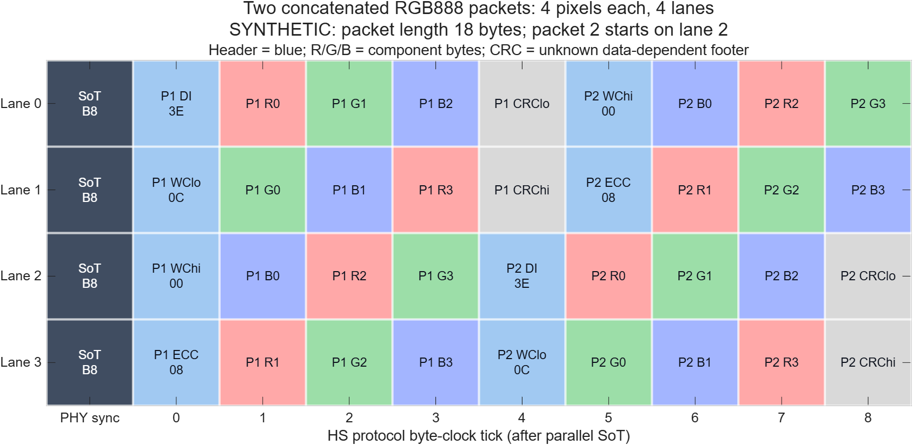

# RGB888 MIPI-DSI 프로토콜 학습 — stitching 후보 정리
작성 2026-10-22 · 문헌 검토 + MATLAB 프로토콜 계산. **실제 LG/iPhone IQ의 packet decode 결과는 아니다.**

## 먼저 확정한 관계
기존 스마트폰에 적용할 forwarded-clock D-PHY에서, 이 문서의 f_b는 한 data lane의 직렬 bit rate이다.

```text
f_b = R_lane = 8 f_byte = 2 f_DDR
f_DDR = 4 f_byte
aggregate bit throughput = N R_lane
RGB888 payload 중 평균 pixel throughput = N R_lane / 24
```

RGB888은 pixel당 3byte라는 정보를 준다. 절대 lane rate는 PLL, lane 수, 전송 모드, packet overhead, HS/LP 점유율이 있어야 결정된다. 단말 해상도와 frame rate만으로 실제 clock을 확정하지 않는다. 실제 수집 LG X2/iPhone6의 f_byte/f_DDR/f_b는 미상으로 유지한다.

A7(2018) 기존 공개 커널 mirror의 26MHz 기준, PMS=3/230/1, 4lane 설정이 적용된다는 조건에서:
- f_b=996.666667 Mbit/s, f_DDR=498.333333 MHz, f_byte=124.583333 MHz.
- RGB888 payload 평균166.111111 Mpixel/s.
- 이는 소스 설정을 이용한 계산이며 실측값이 아니다. 요청 field997, C 정수 로그996, 이상 PLL996.666667을 구분한다.
- 출처와 정확한 행: [속도·lane 상세 노트](rgb888_rates_lanes_20261022.md).

## Round-robin에서 놓치면 안 되는 부분
RGB888 byte stream은 R0,G0,B0,R1,G1,B1,...이고 byte 내부는 LSB-first이다. 첫 R이 lane0부터 시작하는 4lane payload라면:

| byte tick | lane0 | lane1 | lane2 | lane3 |
|---:|---|---|---|---|
| 0 | R0 | G0 | B0 | R1 |
| 1 | G1 | B1 | R2 | G2 |
| 2 | B2 | R3 | G3 | B3 |

12aggregate bytes / 4pixels / 3byte ticks마다 component 배치가 반복된다. N=1,2,4에서는 배치 주기율 f_byte/3, N=3에서는 f_byte이다. **배치 반복과 실제 데이터값의 반복은 다르다.**

Lane distributor는 HS transmission 전체 byte stream을 분배한다. 각 packet마다 lane0부터 다시 시작하지 않는다. 새 HS의 SoT에서 초기 정렬되고, 같은 HS 안에서는 앞선 모든 packet의 길이를 누적해야 한다. 이 점은 phase/color modulation과 template에 직접 영향을 준다.



그림은 4pixel씩 담은 두 video packet의 설명용 모델이다. CRC는 값이 미지인 symbol로 표시했다. 첫 packet18byte이므로 두 번째 header가 lane2에서 시작한다. 실제 폰 packetization을 묘사한 것은 아니다.

## 우선 학습·검정할 후보
| 후보 | 고정되는 부분 | 필요한 조건 |
|---|---|---|
| HS entry + SoT | 각 활성 lane의 B8, 시간순00011101 | HS마다 발생, packet마다 발생하는 것은 아님 |
| EoTp | 08 0F 0F 01 전체 | 기능이 활성일 때; bytes는 lane별 분배 |
| RGB888 video header | DT3E + VC/WC에 따른 ECC | video mode, VC·WC·누적 lane offset |
| DCS long write | DT39 + command2C/3C | command mode, pixel format, chunk/ROI |
| H/V sync packet | DT01/11/21/31 | mode별 존재와 short-data bytes |
| Null/blanking header | DT09/19 + 조건부 WC/ECC | payload를 zero로 가정하지 않음 |
| Clock/HS gating | clock rate와 진입·종료 구조 | continuous/noncontinuous와 packet cadence 구분 |

상세 bit/byte, 출처 PDF 쪽수 및 한계: [패킷 후보 노트](packet_candidates_20261022.md).

## MATLAB에서 확인한 header와 lane phase
모든 header 예는 VC=0, 한 packet에 W개 RGB888 pixel을 넣는 가정이다.

| W | video header hex | video packet bytes | 연속 packet의 시작 lane(4lane) | command1byte + RGB888 header |
|---:|---|---:|---|---|
| 720 | 3E 70 08 13 | 2166 | 0,2,0,2 | 39 71 08 08 |
| 750 | 3E CA 08 09 | 2256 | 0,0,0,0 | 39 CB 08 12 |
| 1080 | 3E A8 0C 22 | 3246 | 0,2,0,2 | 39 A9 0C 39 |

DCS의 WC에는 command1byte가 포함된다. 그 경우 packet 길이는3W+7이며 위 W에서 4packet 주기의 lane 회전이 가능하다. 위 전부 같은 HS 안에 다른 packet/채움 없이 이어지는 조건이다. 매 packet마다 LP/SoT로 재시작하면 이런 누적 회전은 사라진다.

MATLAB R2026b 실행:
- DSI Figure46의 37 F0 01 → ECC3F와 고정 EoTp08 0F 0F → ECC01, **독립 예제2개 일치**.
- packet 담당의 별도 column-XOR 계산과 MATLAB parity 식 계산이 일치.
- Code Analyzer 지적0개.
- [실행 코드](../../verification/studyMipiRgb888Protocol.m), [수치 JSON](../../verification/mipi_protocol_20261022/protocol_results.json).
- 이 확인은 ECC 계산과 설명용 mapping에 한정한다. RF 검출, decoder, stitching 성능을 검증하지 않았다.

## Stitching에 연결하는 방법
Known packet 구조를 coarse event alignment와 drift 추정에 사용하고, 겹치는 RF 대역의 complex phase/delay를 fine alignment에 사용한다. 여러 lane의 합성 및 수신 필터를 포함한 **대역별 template 또는 제약된 matched subspace**가 필요하다.

1. 모드·lane 수·WC·누적 lane offset별 후보를 등록한다.
2. HS entry, HS 내부 header, EoTp를 별도 event로 나눈다.
3. 동일 화면/다른 화면에서 유지되는 event 구간과 payload에 따라 달라지는 구간을 비교한다.
4. event 시간 변화로 fractional resampling을 추정하고 overlap에서 CFO·phase·delay를 검증한다.
5. 학습에 쓰지 않은 frame/payload에서 정렬과 화면 정보 개선을 평가한다.

1Gb/s·4lane의 정렬된4byte header는 약8ns이다. 120MHz를 가정한1/B=8.33ns와 비슷하므로 전후 payload와 필터 응답이 겹칠 수 있다. 1/B는 검출/시간 추정의 절대 한계가 아니다.

동일 SoT만으로 각 lane 채널을 분리할 수 없고, 알려진 bytes만으로 겹치지 않는 RF band의 미지 채널 위상이 정해지지도 않는다. event 간격T의 위상만 사용하면 CFO는1/T마다 모호하다. [독립 식별 가능성 검토](protocol_stitch_review_20261022.md)에 모델과 조건을 기록했다.

**새로운 관찰 후보는 packet 내용의 반복뿐 아니라 packet 길이 mod lane 수가 만드는 2/4-packet phase family이다.** 실제 폰의 준주기성 원인으로 채택하려면 HS 재시작 여부와 packetization이 함께 맞아야 한다.

## 자료 상태와 DB
- 사용자 보유 DSI v1.3,23-Mar-2015에는 DRAFT/Confidential 표기가 있다. 공식 배포본/정오표 대조는 미완료.
- 관련 원문 절을 재독하고 Arasan/Keysight 공개 제조사 문서와 Linux 구현 정의를 교차 확인했다.
- 저작한 해석, 후보, 계산만 Git에 저장. 원문 PDF/전체 추출문은 기존 local ignored cache에 유지한다.
- 검색 가능한 후보10개: [protocol_candidates.jsonl](protocol_candidates.jsonl).
- 전체 데이터베이스는 tools/index_knowledge.py로 갱신한다.
