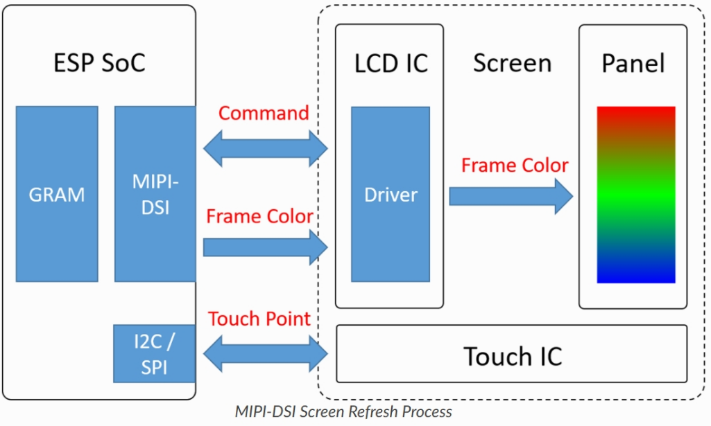
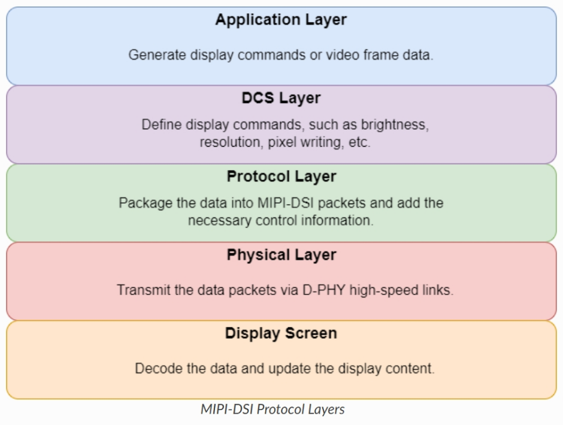
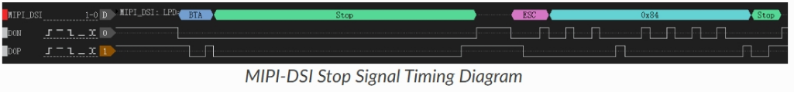
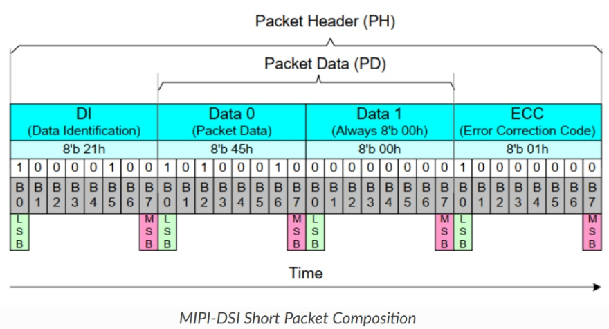
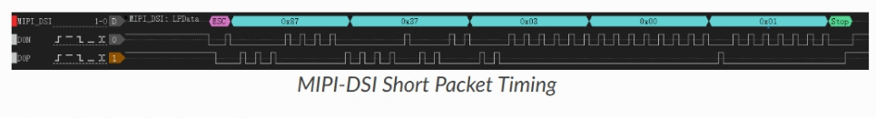
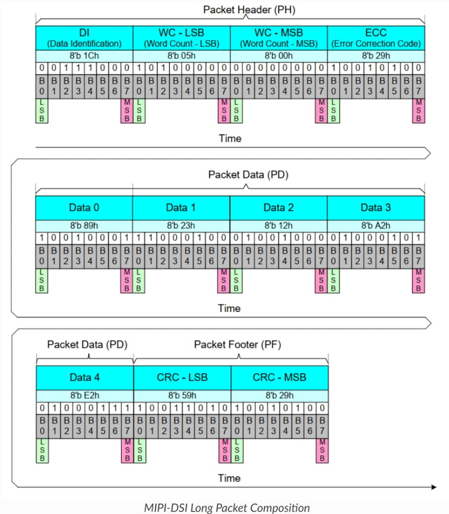
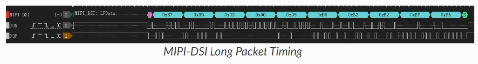
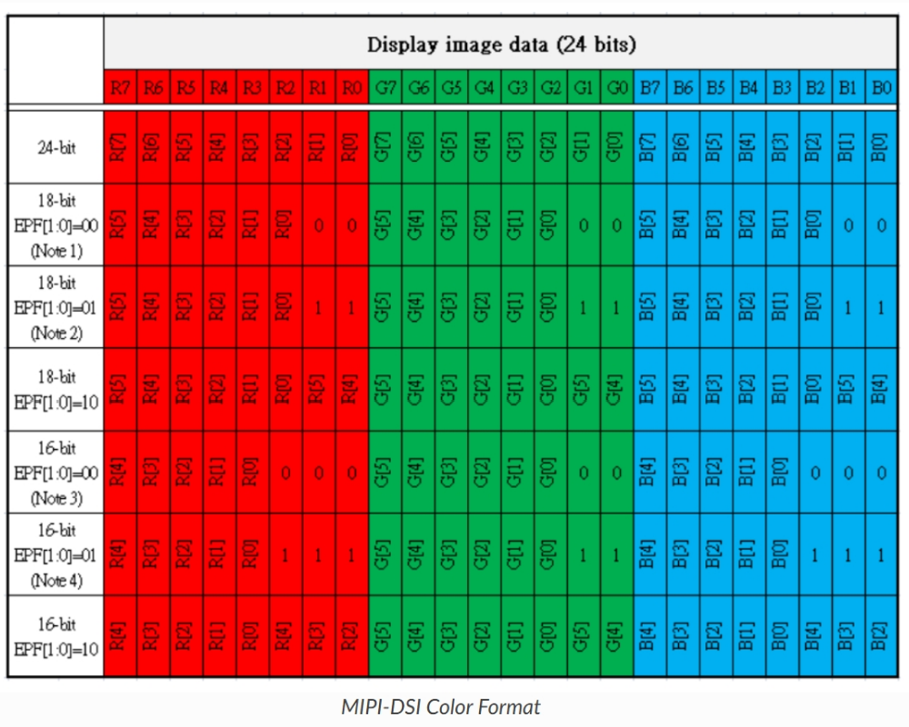
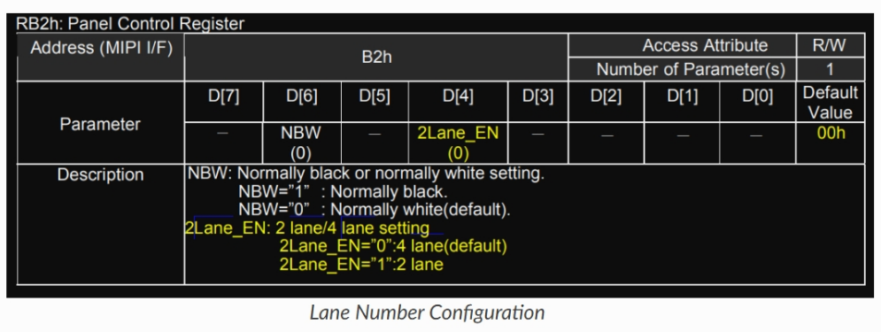
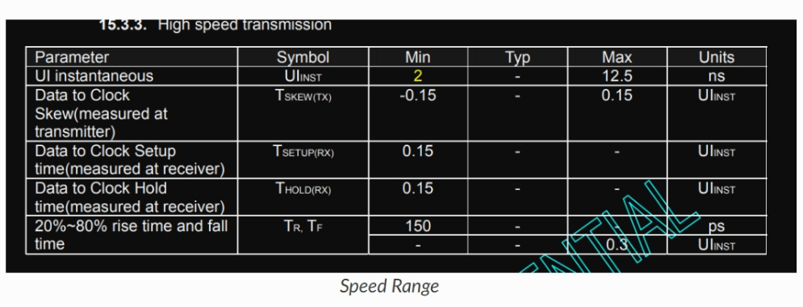

# MIPI DSI LCD 상세 가이드 — 전체 한국어 번역과 검증 해설

**Espressif 문서 · 사용자 첨부 전체 페이지 캡처 대조 · 2026-10-22**

사용자가 제공한 1763×28291 픽셀의 전체 페이지 캡처를 번역했다. [Espressif의 같은 웹페이지](https://docs.espressif.com/projects/esp-iot-solution/en/latest/display/lcd/mipi_dsi_lcd.html)와 문서 소스를 대조하여 작은 글씨와 가로 스크롤 밖 코드를 보완했다. 용어집부터 관련 문서·페이지 하단까지의 본문, 표, 코드, 그림 10개를 포함한다. 그림 내부의 영어 표기는 그림 아래의 번역 표와 설명으로 옮겼다.

**읽는 방법:** ‘원문 번역’은 원문의 주장과 예제 수치를 보존한다. 오기나 부정확한 설명에는 표시를 달고, ‘검증·해설’에서 근거와 함께 정정한다. 코드 식별자·수치·문자열은 유지하고 설명 주석을 번역했다. 이 문서는 Espressif의 검토·승인을 받은 공식 번역본은 아니다.

원문은 **ESP32-P4의 LCD 구동 안내**다. DSI 일반 개념과 ESP32-P4 구현 제한이 함께 쓰여 있으므로, 이 예제를 LG X2·iPhone의 실제 설정으로 해석하지 않는다.

## 먼저 확인할 원문 오류와 해석상의 주의점

| 항목 | 원문 | 검증 결과 |
|---|---|---|
| DSI 전송률 계산 | 8b/10b 때문에 ×1.25 | 이 문서의 clock-lane 기반 D-PHY HS 전송에는 일반적인 8b/10b 계수를 적용하지 않는다. |
| Pixel clock 예제 | 844×1324×60 = 62.4 MHz | **67.04736 MHz**가 맞다. 코드의 60 MHz는 같은 porch에서 **약 53.693389 Hz**다. |
| ULPS | Escape 0x84 | **0x84는 ACK trigger**에 해당한다. ULPS entry의 LSB-first byte 표기는 **0x78**이다. |
| 패킷 종류 표 | 0x16 = DCS read, 0x37 = DCS read response | **0x16 = Execute Queue**, **0x37 = Set Maximum Return Packet Size**다. |
| 파형의 전송 방식 | Short/Long packet 예시 | 그림의 ESC → 0x87은 **LPDT**다. HS DDR의 bit time을 읽는 파형이 아니다. |
| UI와 속도 | UI 2–12.5 ns → 20–500 Mbps | 역수를 취하면 **80–500 Mbps**다. |
| 코드 | 예제 그대로 사용 | dbi_config 누락, callback 인자 타입, SDK 버전에 따른 필드 변경을 확인해야 한다. |

위 정정의 출처와 적용 범위는 각 부의 해설에 기록했다. 문서 그림의 **4개 header ECC와 2개 payload CRC는 MATLAB 검산과 모두 일치**했다. 맞는 예제와 틀린 설명을 구분하여 읽으면 된다.

## 문서 구성

1. **제1부:** 용어, 화면 갱신 원리, D-PHY의 HS·LP·Escape·BTA·ULPS.
2. **제2부:** Short/Long packet, DI·DT·VC, DCS, RGB565·RGB666·RGB888.
3. **제3부:** ESP32-P4 드라이버 구성, 코드 전체, 문제 해결 8항목, 관련 문서.
4. **연구 연결:** lane 속도와 byte clock, 알려진 packet의 활용, stitching에 필요한 관측 조건.
5. **검산 및 출처:** MATLAB 결과, 대조 범위, 라이선스·변경 고지.

---


---

## 제1부 — 용어, 인터페이스 개요와 D-PHY 물리층

- 번역 대상: 사용자가 첨부한 전체 페이지 화면의 **Glossary부터 Physical Layer 끝까지**.
- 원문: [Espressif, MIPI DSI LCD Detailed Guide](https://docs.espressif.com/projects/esp-iot-solution/en/latest/display/lcd/mipi_dsi_lcd.html), 확인일 2026-10-22 KST.
- 원문 확인: 첨부 PNG 원본의 해당 영역을 확대해 본문·그림과 웹 문서를 대조했다.
- 아래 **A는 원문의 번역**, **B는 별도의 검증·설명**이다. A의 잘못된 표기까지 임의로 바꾸지 않고, 연구에 영향을 주는 오류는 [검증]으로 표시했다. 이 문서는 ESP32-P4 구현 안내를 포함한다. 그 구현 제한을 모든 스마트폰 DSI의 성질로 확대하면 안 된다.

### A. 원문 전체 번역

#### 1. 용어집 — Glossary

[LCD 용어표](https://docs.espressif.com/projects/esp-iot-solution/en/latest/display/lcd/lcd_terms_table.html)를 참조한다.

##### MIPI-DSI 관련 용어

| 약어 | 전체 이름 | 설명 |
|---|---|---|
| MIPI-DSI | MIPI Display Serial Interface | MIPI Alliance가 개발한 고속 직렬 인터페이스 표준. 프로세서와 디스플레이 장치를 연결하기 위해 설계되었다. |
| DCS | Display Command Set | 디스플레이 모듈을 제어하기 위해 MIPI-DSI에서 정의한 표준 디스플레이 명령 집합. |
| DBI | Display Bus Interface | DSI의 Command Mode를 esp-lcd의 제어 IO 계층으로 캡슐화한다. |
| DPI | Display Pixel Interface | DSI의 Video Mode를 esp-lcd의 데이터 패널 계층으로 캡슐화한다. |
| HS | High-Speed Mode | 고속 모드. 주로 디스플레이 프레임 데이터를 전송하는 데 사용하며, 일반적으로 lane당 80Mbps~1.5Gbps이다. |
| LP | Low-Power Mode | 저전력 모드. 일반적으로 DCS 명령 전송이나 링크 상태 제어에 사용하며, 최대 속도는 약 10MHz이다. [검증 P3] |
| HS-TX/HS-RX | High-Speed Transmitter/Receiver | 고속 송신기/수신기. |
| LP-TX/LP-RX | Low-Power Transmitter/Receiver | 저전력 송신기/수신기. |
| LP-CD | Low-Power Contention Detector | 저전력 모드에서의 충돌 검출기. |
| BTA | Bus Turnaround | 양방향 통신을 위한 버스 방향 전환. |
| ULPS | Ultra Low Power State | 전력 소모를 최대한 줄이기 위한 초저전력 상태. |
| LPDT | Low Power Data Transmission | 저전력 데이터 전송 모드. |
| ESC | Escape Mode | Escape 모드. MIPI-DSI의 저전력 동작 모드. |
| SoT | Start of Transmission | 전송 시작 신호. |
| EoT | End of Transmission | 전송 종료 신호. |
| DI | Data Identifier | 패킷 종류를 식별하는 데이터 식별자. |
| ECC | Error Correction Code | 데이터 무결성을 검증하기 위한 오류 검출 코드. [검증 P8: 이름은 오류 정정 코드이며 설명을 보완해야 한다.] |
| DT | Data Type | 픽셀 데이터 형식을 식별하는 데이터 유형. [검증 P8: 픽셀 형식 이외의 패킷 종류도 포함한다.] |
| HSYNC | Horizontal Synchronization | 수평 동기 신호. |
| VSYNC | Vertical Synchronization | 수직 동기 신호. |
| DMA | Direct Memory Access | 효율적인 데이터 전송을 위한 직접 메모리 접근. |
| PSRAM | Pseudo Static RAM | 의사 정적 RAM. |
| RGB565 | Red Green Blue 565 | 16비트 색상 형식. 빨강 5비트, 초록 6비트, 파랑 5비트. |
| RGB666 | Red Green Blue 666 | 18비트 색상 형식. 빨강·초록·파랑 각각 6비트. |
| RGB888 | Red Green Blue 888 | 24비트 색상 형식. 빨강·초록·파랑 각각 8비트. |

#### 2. MIPI-DSI 인터페이스 및 프로토콜 소개

##### 2.1 MIPI-DSI 인터페이스 개요

MIPI-DSI(MIPI Display Serial Interface)는 프로세서와 디스플레이 장치를 연결하기 위해 MIPI Alliance가 개발한 고속 직렬 인터페이스 표준이다. 다음과 같은 특징이 있다.

- **고속 전송:** 각 데이터 채널은 최대 수 Gbps의 전송 속도를 지원할 수 있다.
- **낮은 전력 소모:** 저전압 차동 신호를 사용하며, 유휴 상태이거나 저속으로 전송할 때 저전력 모드에 들어간다.
- **핀 수 감소:** 병렬 RGB 인터페이스와 비교하여 신호선 수가 크게 줄어든다.
- **확장성:** 1~4개의 데이터 채널을 지원한다.
- **높은 호환성:** 다양한 해상도와 디스플레이 장치를 지원한다.

현재 ESP32-P4에는 MIPI-DSI 인터페이스가 있으며, **2lane × 1.5Gbps**를 지원한다. 영상 스트림을 출력할 때는 Video Mode를 사용한다.

##### 2.2 MIPI-DSI 화면 갱신 원리

MIPI-DSI는 프로세서와 디스플레이를 연결할 때 널리 쓰이는 디스플레이 인터페이스 표준이다. 다음 두 가지 주요 데이터 전송 모드를 지원한다.

1. Command Mode
2. Video Mode

현재 ESP32-P4는 영상 스트림 출력에 Video Mode만 지원한다.

Video Mode에서 호스트는 디스플레이의 갱신 주기, 예를 들어 VSync에 엄격하게 동기화하여 연속적인 영상 프레임 형태로 데이터를 전송한다. 디스플레이에는 프레임 버퍼 메모리가 필요하지 않으므로 하드웨어 설계를 단순화할 수 있다. 이 모드는 고해상도·고주사율 디스플레이에 널리 사용된다.

**그림: MIPI-DSI 화면 갱신 과정**



원본 그림: [mipi_dsi_video.png](https://dl.espressif.com/AE/esp-dev-kits/mipi_dsi_video.png)

그림 속 표기 번역:

| 원문 표기 | 번역 |
|---|---|
| ESP SoC | ESP 시스템 온 칩 |
| GRAM | 그래픽 RAM |
| MIPI-DSI | MIPI 디스플레이 직렬 인터페이스 |
| I2C / SPI | I²C / SPI 통신 인터페이스 |
| Command | 명령 |
| Frame Color | 프레임의 색상 데이터 |
| Touch Point | 터치 위치 |
| Screen | 디스플레이 모듈 |
| LCD IC / Driver | LCD 집적회로 / 구동기 |
| Panel | 표시 패널 |
| Touch IC | 터치 제어 집적회로 |

위 그림은 MIPI-DSI의 화면 갱신 과정을 나타낸다.

- **명령 데이터:** MIPI-DCS 명령은 DBI를 통해 LCD 컨트롤러로 전달된다. 레지스터 초기화와 디스플레이 기능 제어에 사용된다.
- **프레임 색상 데이터:** MIPI-DSI Video Mode에서는 호스트 측 프레임 버퍼, 즉 내부 또는 외부 RAM의 픽셀 데이터를 DMA를 통해 LCD 패널로 연속 출력하여 표시한다. LCD 드라이버 IC에는 GRAM이 필요하지 않다.
- **터치 데이터:** 터치스크린이 터치 신호를 감지하고, I²C 또는 SPI 인터페이스를 통해 호스트 시스템에 전달하여 처리한다.

##### 2.3 MIPI-DSI 프로토콜

MIPI-DSI는 크게 물리 계층(Physical Layer), 프로토콜 계층(Protocol Layer), 디스플레이 명령 계층(DCS Layer)으로 나눌 수 있다. 각 계층은 고유한 기능을 담당하며, 함께 동작하여 호스트에서 디스플레이로 명령과 픽셀 데이터를 전달한다.

각 계층이 협력하는 과정은 다음 그림으로 요약할 수 있다.

**그림: MIPI-DSI 프로토콜 계층**



원본 그림: [mipi_dsi_layer.png](https://dl.espressif.com/AE/esp-dev-kits/mipi_dsi_layer.png)

그림 안의 모든 계층과 설명을 위에서 아래 순서로 번역하면 다음과 같다.

| 계층 | 그림 속 설명 번역 |
|---|---|
| Application Layer — 응용 계층 | 디스플레이 명령 또는 영상 프레임 데이터를 생성한다. |
| DCS Layer — 디스플레이 명령 계층 | 밝기, 해상도, 픽셀 쓰기 등의 디스플레이 명령을 정의한다. |
| Protocol Layer — 프로토콜 계층 | 데이터를 MIPI-DSI 패킷으로 구성하고 필요한 제어 정보를 추가한다. |
| Physical Layer — 물리 계층 | D-PHY 고속 링크를 통해 데이터 패킷을 전송한다. |
| Display Screen — 디스플레이 화면 | 데이터를 해석하고 표시 내용을 갱신한다. |

#### 3. 물리 계층 — Physical Layer

##### 3.1 기능

실제 데이터 전송을 담당하며 프로토콜 스택의 가장 아래에 위치한다. MIPI D-PHY를 이용해 고속 차동 신호를 전송하고, 여러 채널을 통한 데이터 전송을 지원한다.

##### 3.2 전송 모드

- **고속 모드(High-Speed Mode):** 주로 디스플레이 프레임 데이터를 전송하는 데 사용한다. 명령도 전송할 수 있으며, 일반적인 속도는 lane당 80Mbps~1.5Gbps이다.
- **저전력 모드(Low-Power Mode):** 일반적으로 Command Mode에서 DCS 명령을 보내거나 링크 상태를 제어할 때 사용한다. 최대 속도는 약 10MHz이며, 구체적인 값은 칩의 지원 범위에 따라 달라진다. [검증 P2·P3]

##### 3.3 구성

- **Clock Lane:** 동기화 신호를 제공한다.
- **Data Lane:** 실제 디스플레이 데이터를 전송한다.

##### 3.4 Lane 모듈, 즉 D-PHY의 상세 설명

###### 종류

| Lane 종류 / 전송 역할 | Master | Slave |
|---|---|---|
| 단방향 Clock Lane | HS-TX, LP-TX | HS-RX, LP-RX |
| 단방향 Data Lane | HS-TX, LP-TX | HS-RX, LP-RX |
| 양방향 Data Lane | HS-TX, LP-TX, HS-RX, LP-RX, LP-CD | HS-TX, LP-TX, HS-RX, LP-RX, LP-CD |

**참고 — 모듈 기능 설명**

- **LP-TX/LP-RX:** 저전력 송신기/수신기.
- **HS-TX/HS-RX:** 고속 송신기/수신기.
- **LP-CD:** 저전력 모드에서의 충돌 검출기.

Clock Lane은 일반적으로 단방향이며, Master가 제공한 신호를 Slave가 수신한다. 양방향 lane과 LP-CD는 주로 Command Mode의 저전력 통신에서 사용된다. [검증 P2·P7]

###### 상태

- **LP 상태(LP-00, LP-01, LP-10, LP-11):** 단일 종단 신호를 사용한다. 주로 저속 명령 전송, 제어 신호, 초기화 또는 대기 상태에 사용한다. 서로 다른 LP 상태를 부호화와 링크 제어에 사용한다.
- **HS 상태(HS-0, HS-1):** 차동 신호를 사용한다. 주로 영상 데이터나 프레임 내용을 고속으로 전송할 때 사용한다. HS-0과 HS-1은 차동 신호 쌍의 논리 상태를 나타내며, HS-TX/HS-RX에서만 유효하다.

###### 대표 전압

- **LP:** 일반적인 전압은 약 0~1.2V이다.
- **HP:** 일반적인 차동 전압은 약 100~300mV이다. [원문 표기 유지. 문맥상 HS의 오타로 판단됨 — 검증 P1]

###### 동작 모드

**1. Escape Mode**

Low-Power Mode에서만 사용할 수 있다. 특별한 데이터를 전송하거나 특정 기능을 실행하기 위한 MIPI-DSI의 저전력 동작 모드이다. 다음 기능을 지원한다.

| 기능 이름 | 설명 | 명령 |
|---|---|---|
| LPDT — Low Power Data Transmission | 저전력 모드로 데이터를 전송한다. | 0x87 |
| ULPS — Ultra Low Power State | 초저전력 상태에 들어가 전력 소모를 최대한 줄인다. | 0x84 [원문값; 검증 P4에서 정정] |
| Trigger Command | 상태 전환이나 모드 조정 등의 특정 이벤트를 발생시킨다. | 0x85 [원문값; 검증 P4] |

- **진입 과정 — 신호 상태 머신의 전이:**

  `LP-11 → LP-10 → LP-00 → LP-01 → LP-00`

- **종료 과정:**

  `LP-10 → LP-11`

**2. High-Speed (Burst) Mode**

항상 High-Speed Mode에서 동작한다. 고속 직렬 데이터 전송에 사용하며, 높은 대역폭이 필요한 경우에 적합하다. [원문 번역. “항상”이라는 표현은 검증 P5에서 보완한다.]

- **진입 과정:**

  `LP-11 → LP-01 → LP-00 → SoT(전송 시작) → HSD(80Mbps~1.5Gbps)`

- **종료 과정:**

  `EoT(전송 종료) → LP-11`

**3. Control Mode**

기본적으로 Low-Power Mode에서 동작한다. Stop 상태에서 명령을 전송하거나 양방향 통신, 즉 BTA(Bus Turnaround)를 수행할 때 사용한다. [검증 P5]

- **BTA 송신 과정:**

  `LP-11 → LP-10 → LP-00 → LP-10 → LP-00`

  위 과정은 버스 방향 전환을 위한 상태 전이다.

- **BTA 수신 과정:**

  `LP-00 → LP-10 → LP-11`

##### 3.5 중요한 신호 설명

MIPI-DSI 통신에서는 두 가지 중요한 Stop 신호를 통해 버스 상태를 적절하게 관리한다.

**그림: MIPI-DSI Stop 신호 타이밍**



원본 그림: [mipi_dsi_stop.png](https://dl.espressif.com/AE/esp-dev-kits/mipi_dsi_stop.png)

첨부 그림의 디코더 표시 순서는 `BTA → Stop → ESC → 0x84 → Stop`이다. 아래 두 파형은 D0N, D0P이다. BTA는 버스 방향 전환, Stop은 정지 상태, ESC는 Escape 진입을 의미한다. 0x84의 의미는 아래 원문의 설명과 별도로 검증 P4·P6을 확인해야 한다.

**1. BTA-Stop 신호**

Slave가 Bus Turnaround 응답을 마친 뒤 전송한다. 다음을 나타낸다.

- 버스 방향 전환 동작이 성공적으로 완료되었다.
- Slave가 버스 제어권을 해제했다.
- Host가 버스 제어권을 다시 얻을 수 있다.

**2. ESC-0X84-Stop 신호**

Lane의 Stop 신호 전송을 나타내는 데 사용한다. 구체적인 기능은 다음과 같다.

- 시스템을 초저전력 상태(ULPS)로 전환한다.
- Escape Mode의 0x84 명령에 해당한다.
- 전력 관리를 극대화한다.

**팁**

이러한 Stop 신호는 MIPI-DSI 프로토콜에서 통신 신뢰성과 전력 관리를 보장하는 핵심 수단이다.

**[원문 번역 종료: 다음 절은 Protocol Layer이다.]**

### B. 검증과 연구 해설 — 번역문과 구분

#### P1. HP는 문맥상 HS 오타이며, 전압은 측정량을 먼저 정의해야 한다

원문의 LP/HP는 LP/HS로 읽어야 한다. D-PHY는 같은 Dp/Dn 두 선에서 LP의 단일 종단 신호와 HS의 차동 신호를 사용한다. 그러나 “100~300mV”를 안테나 수신 신호의 전압으로 해석하면 안 된다. 이는 PHY 핀의 전기적 신호에 관한 기술이며, 차동 전압과 공통 모드 전압은 서로 다르다.


- 차동 전압: `v_d(t) = v_p(t) - v_n(t)`
- 공통 모드 전압: `v_cm(t) = [v_p(t) + v_n(t)] / 2`

차동 쌍의 불균형, 배선, 리턴 경로와 공간 전파를 거친 안테나의 복소 IQ는 위 핀 전압 중 하나를 그대로 복제한 값이 아니다. 따라서 HS의 차동 전압 범위만으로 방사 AM/PM 변조도나 수신 SNR을 계산할 수 없다. 상태 명칭과 Dp/Dn 매핑은 [Analog Devices AN-2621, Table 8](https://www.analog.com/en/resources/app-notes/an-2621.html)과 대조했다.

#### P2. HS/LP와 Video/Command는 서로 다른 분류다

| 구분 | 답하는 질문 |
|---|---|
| HS / LP | 배선에서 어떤 전기적 신호 방식으로 전송하는가? |
| Video / Command | 표시 데이터를 어떤 프로토콜·갱신 방식으로 전달하는가? |
| DCS | 디스플레이에 어떤 명령을 내리는가? |
| DBI / DPI | 이 문서의 esp-lcd 구현에서 제어 경로와 영상 경로를 어떻게 추상화하는가? |

“명령은 LP, 영상은 HS”는 흔한 사용 경향을 간단히 표현한 것이며, 엄밀한 일대일 대응이 아니다. HS로 명령을 보낼 수도 있고 Video Mode의 빈 구간에 명령을 삽입할 수도 있다. ESP32-P4가 영상 출력에 Video Mode를 사용한다는 문장도 스마트폰이 동일하게 동작한다는 증거가 아니다. [Microchip DS60001813E, Transmission of Commands의 Video/LP/HS 하위 절](https://onlinedocs.microchip.com/oxy/GUID-51CE727C-126C-4670-A2BA-189781F25924-en-US-3/GUID-7761A315-1C72-4B64-AFBF-C367690C6A11.html)

원문의 계층 그림은 설명용 개념도다. Video Mode의 모든 픽셀 데이터가 DCS 명령으로 변환된 뒤 전송된다고 해석해서는 안 된다. 화면 갱신 그림도 Video Mode의 한 구성 예시이며, “GRAM이 필요 없다”는 “어떤 수신 디스플레이에도 버퍼가 존재하지 않는다”는 뜻은 아니다.

#### P3. 80Mbps~1.5Gbps와 10MHz를 D-PHY 전체의 보편 상한으로 쓰지 않는다

원문의 HS 속도 범위는 예전 D-PHY 및 이 가이드의 ESP32-P4 범위와 연관 지어 읽어야 한다. [Arasan D-PHY v1.1 구현](https://www.arasan.com/products/mipi/mipi-phys/d-phy-v1-1/)은 HS 80~1500Mb/s, LP 비동기 전송 10Mb/s를 명시한다. LP 데이터 전송률을 MHz로 적으면 escape clock 주파수와 bit rate가 혼동되므로 **Mb/s**와 구분해야 한다. 칩 내부 escape clock과 실제 LP 유효 데이터 속도는 같은 값이라고 가정할 수 없다.

또한 [MIPI 공식 D-PHY 페이지](https://www.mipi.org/specifications/d-phy)는 후속 버전의 더 높은 속도와 선택적 embedded-clock mode를 설명한다. 따라서 이 문서의 고정 clock lane 구조와 속도 범위를 모든 버전의 D-PHY 규정으로 확대하지 않는다. 반대로 최신 버전 기능을 LG X2나 iPhone 6에 적용했다고 추정하지도 않는다.

#### P4. 원문의 “ULPS = 0x84”는 잘못되었다

시간순 비트열을 먼저 적고, 일반적인 16진 byte 표기로 바꾸어 보면 혼동을 줄일 수 있다.

| 기능 | 시간순 비트열: 먼저 전송되는 bit가 왼쪽 | LSB-first로 해석한 byte | 확인 근거 |
|---|---|---|---|
| ULPS entry | `00011110` | **0x78** | TI DS90UR910-Q1 Rev. E, p.19, Fig.13 |
| Acknowledge Trigger | `00100001` | **0x84** | 로컬 DSI v1.3 draft, PDF p.83 / 인쇄 p.71, §8.9.4, lines1880–1881 |
| TE Trigger | `01011101` | **0xBA** | 같은 DSI 문서 PDF p.92 / 인쇄 p.80, §8.12, lines2141–2143 |

따라서 0x84를 ULPS 동기 template로 사용하면 ACK를 ULPS로 오인하게 된다. 첨부 Stop 그림의 `ESC → 0x84 → Stop`은 **ACK Trigger와 일치하는 해석 후보**이다. 그림에 송수신 주체와 전체 앞뒤 트랜잭션이 없으므로 “어느 쪽이 어떤 명령에 응답한 ACK인가”까지는 확정할 수 없다.

근거: [TI 공식 DS90UR910-Q1 데이터시트, p.19](https://www.ti.com/lit/gpn/DS90UR910-Q1). ACK와 TE 값은 기존에 확보한 로컬 MIPI DSI v1.3 draft를 직접 확인했다. 해당 원문은 로컬 연구 참조이며 재배포하지 않는다.

원문의 “Trigger Command = 0x85”도 모든 trigger의 공통 명령처럼 사용하면 안 된다. 확인된 ACK와 TE는 각각 위의 값이며, 0x85에 대해 가이드가 의도한 특정 의미는 이 문서만으로 확인되지 않는다.

ST AN4860 공식 PDF도 교차 확인을 시도했으나 웹 도구의 크기 제한(약13.1MB) 및 로컬 네트워크 DNS 실패로 해당 파일의 본문 열람에 실패했다. 따라서 ST 본문을 읽었다고 기록하지 않았다.

#### P5. Stop 상태에서는 DCS 패킷을 전송하지 않는다

Stop은 Dp=1, Dn=1인 **LP-11 유휴 상태**다. 그 상태에서 전송 요청을 시작하여 Escape/LPDT 또는 HS 상태로 옮겨가 데이터를 전송하고, 이후 Stop으로 돌아온다. 따라서 원문의 “stop state에서 명령 전송”은 “Stop에서 출발하는 제어 절차”로 이해해야 한다. [Microchip, Control Mode](https://onlinedocs.microchip.com/oxy/GUID-51CE727C-126C-4670-A2BA-189781F25924-en-US-3/GUID-047D4BCE-20CD-4B02-B13C-C41914B010AE.html)

“High-Speed (Burst) Mode는 항상 HS”도 HS payload 구간에 한정한 설명이다. 실제 burst의 앞뒤에는 LP 진입·종료 과정이 포함된다. Clock lane과 data lane의 HS 진입·종료는 구별해야 하며, data lane 전체의 HS 전송을 포괄하는 동안 forwarded clock이 유효해야 한다. [Microchip, High-Speed Data Transfer Mode](https://onlinedocs.microchip.com/oxy/GUID-51CE727C-126C-4670-A2BA-189781F25924-en-US-3/GUID-1337F0F0-0EE8-402C-BF80-8AA8E69BA182.html)

#### P6. Stop과 ULPS, 버스 소유권을 구분한다

- **Stop:** LP-11.
- **ULPS 유지:** LP-00.
- **ULPS 종료:** 규정된 wakeup 시간의 Mark-1(LP-10)을 거친 뒤 Stop(LP-11).
- **BTA:** 누가 lane을 구동하는지 바꾸는 방향 전환 절차. LP-11 파형만으로 소유권을 단정할 수 없다.

[TI Fig.13](https://www.ti.com/lit/gpn/DS90UR910-Q1)은 ULPS(LP00), Mark-1(LP10), Stop(LP11)을 별도 구간으로 표시한다. 따라서 원문의 “ESC-0x84-Stop이 ULPS 진입”이라는 해석은 전기적 상태 및 명령 값 양쪽에서 맞지 않는다.

또한 BTA 직후의 Stop이 항상 “slave가 응답을 끝내고 host에 돌려주었다”는 뜻도 아니다. Host→peripheral로 넘기는 BTA인지 반대 방향인지, 앞뒤의 제어 흐름을 확인해야 한다. 로컬 DSI v1.3 §8.12에는 host가 bus ownership을 peripheral에 넘긴 뒤 TE trigger를 기다리는 사례가 있다.

#### P7. Lane 모듈 표는 가능한 PHY 구성과 DSI 실제 연결을 구분해서 읽는다

원문의 양방향 lane 표는 HS/LP TX·RX를 모두 나열한 일반적인 모듈 구성 설명이다. 그것만으로 실제 스마트폰 디스플레이가 모든 lane에서 양방향 HS 데이터를 주고받는다고 결론낼 수 없다. 사용 장치와 DSI 규격에 맞게 forward HS 경로, reverse LP 경로, BTA가 사용되는 lane을 따로 확인해야 한다.

#### P8. ECC, DT 용어의 범위를 보완한다

- **ECC**는 단순 CRC 같은 payload 검출 코드와 구별된다. DSI header의 수정된 Hamming code는 규정된 범위의 bit 오류를 정정·검출한다. 원문 용어표가 “Error Correction Code”를 적어 놓고 설명에서 “error detection code”로 줄인 점을 보완해야 한다.
- **DT**는 RGB888 같은 pixel stream뿐 아니라 DCS short/long write, read response, sync event 등 여러 패킷 종류를 나타낸다. DI는 VC와 DT를 함께 포함한다.

#### P9. 스마트폰 방사 연구에 적용할 때의 의미

이 부분에서 얻을 수 있는 유용한 후보는 세 종류다.

1. **HS 진입과 종료가 만드는 상태 전환:** 화면 전체를 직렬화하는 데이터 구간과 구별되는 반복 이벤트 후보.
2. **LPDT, ACK, TE 같은 알려진 제어 패턴:** 실제 사용 여부가 확인된다면 timing anchor 후보.
3. **Pixel payload의 반복성과 packet 경계:** 동일한 RGB888 데이터라도 lane 수·packetization·video/command mode에 따라 서로 다른 시간 구조를 만든다.

다만 이 문서의 LP/HS logic analyzer 그림은 접촉 측정한 논리 복호 결과에 해당한다. 안테나 IQ에서 같은 패턴이 곧바로 읽힌다는 뜻은 아니다. 안테나 관측에는 lane별 결합, RF 대역 제한, 필터 지연과 미지 위상이 포함되므로, 실제 프로토콜 이벤트를 찾을 때는 대역 제한된 template 및 독립적인 timing evidence를 함께 사용해야 한다.


---

## 제2부 — 프로토콜 계층·DCS·색 형식

대상: Espressif, *MIPI DSI LCD Detailed Guide*의 **Protocol Layer**부터 **Color Format** 끝까지. 열람일: 2026-10-22. 사용자 제공 전체 페이지 캡처의 해당 부분과 현재 웹 페이지를 대조했다. 본문은 원문의 문장과 표를 빠짐없이 번역하고, 원문에 있는 오류·생략은 별도의 **검증 해설**에서 바로잡는다. 본 범위에는 소스 코드 블록이 없다.

원문: <https://docs.espressif.com/projects/esp-iot-solution/en/latest/display/lcd/mipi_dsi_lcd.html#protocol-layer>

### 1. 원문 전체 번역

#### 프로토콜 계층 (Protocol Layer)

- **기능:** 데이터를 패킷으로 구성하고 해석한다. DCS 패킷이나 영상 데이터 패킷과 같은 전송 형식을 정의하고, 데이터의 정확성과 신뢰성을 보장하기 위한 오류 검출 기능을 제공한다.
- **데이터 프레임 구조**

##### 짧은 패킷 (Short Packet)

- **길이:** 4바이트로 고정된다.
- **구성:** 데이터 식별자 DI 1바이트, 프레임 데이터 2바이트, 오류 검출 ECC 1바이트.

**원문 그림: MIPI-DSI 짧은 패킷의 구성**



[원문 그림 보기](https://dl.espressif.com/AE/esp-dev-kits/mipi_dsi_short_packet.png)

그림에 표시된 문구와 값은 다음과 같다.

| 원문 그림 표기 | 한국어 번역 또는 값 |
|---|---|
| Packet Header (PH) | 패킷 헤더 |
| Packet Data (PD) | 패킷 데이터 |
| DI (Data Identification) | 데이터 식별자 |
| Data 0 (Packet Data) | 데이터 0, 패킷 데이터 |
| Data 1 (Always 8'b 00h) | 데이터 1, 항상 0x00으로 표시됨 |
| ECC (Error Correction Code) | 오류 정정 코드 |
| DI / Data 0 / Data 1 / ECC | `21 45 00 01` |
| B0 … B7 / LSB / MSB | 비트 0 … 비트 7 / 최하위 비트 / 최상위 비트 |
| Time | 시간, 오른쪽으로 증가 |

그림은 각 바이트의 최하위 비트부터 전송되는 순서를 표시한다. `Data 1 = 00` 표기는 이 그림의 예시를 그대로 옮긴 것으로, 모든 짧은 패킷에 적용되는 규칙은 아니다. 자세한 설명은 아래 검증 해설에 있다.

**예시: MIPI-DSI 짧은 패킷의 타이밍**



[원문 파형 그림 보기](https://dl.espressif.com/AE/esp-dev-kits/mipi_dsi_short_packet_example.png)

주요 필드는 전송 순서대로 다음과 같다.

- **ESC:** Escape 모드로 진입한다.
- **0x87:** LPDT, 저전력 데이터 전송 모드.
- **0x37:** 데이터 식별자. 원문에서는 DCS 명령인 “최대 반환 패킷 크기 설정(Set Maximum Return Packet Size)”에 해당한다고 설명한다. 호스트가 주변 장치로부터 수신하는 반환 데이터 패킷의 최대 크기를 설정한다.
- **0x03, 0x00:** 프레임 데이터. 최대 반환 패킷 크기를 3바이트로 설정한다는 뜻이다.
- **0x01:** ECC, 오류 정정 코드.

##### 긴 패킷 (Long Packet)

- **길이:** 6바이트에서 65,541바이트까지 가변적이다.
- **구성:** 프레임 헤더는 데이터 식별자 DI 1바이트, 데이터 수 WC 2바이트, 오류 검출 ECC 1바이트로 구성된다. 이어서 0~65,535바이트의 데이터 페이로드와 2바이트 체크섬으로 된 프레임 꼬리가 온다.

**원문 그림: MIPI-DSI 긴 패킷의 구성**



[원문 그림 보기](https://dl.espressif.com/AE/esp-dev-kits/mipi_dsi_long_paket.png)

| 원문 그림 표기 | 한국어 번역 또는 값 |
|---|---|
| Packet Header (PH) | 패킷 헤더 |
| DI (Data Identification) | 데이터 식별자 |
| WC-LSB / WC-MSB (Word Count) | 페이로드 바이트 수의 하위 바이트 / 상위 바이트 |
| ECC (Error Correction Code) | 오류 정정 코드 |
| 헤더에 표시된 DI / WC-LSB / WC-MSB / ECC | `1C 05 00 29` |
| Packet Data (PD) | 패킷 데이터 |
| Data 0 / Data 1 / Data 2 / Data 3 / Data 4 | `89 23 12 A2 E2` |
| Packet Footer (PF) | 패킷 꼬리 |
| CRC-LSB / CRC-MSB | CRC의 하위 바이트 / 상위 바이트 |
| 그림의 CRC-LSB / CRC-MSB | `59 29` |
| B0 … B7 / LSB / MSB / Time | 비트 0 … 비트 7 / 최하위 비트 / 최상위 비트 / 시간 |

긴 그림은 시간축을 여러 줄로 접어 그렸다. 헤더 뒤에 5바이트의 페이로드가 이어지고, 그 뒤에 2바이트의 CRC가 전송된다. 이 그림의 헤더 ECC와 페이로드 CRC는 MATLAB 재계산 결과 모두 일치했다.

**예시: MIPI-DSI 긴 패킷의 타이밍**



[원문 파형 그림 보기](https://dl.espressif.com/AE/esp-dev-kits/mipi_dsi_long_packet_example.png)

주요 필드는 전송 순서대로 다음과 같다.

- **ESC:** Escape 모드로 진입한다.
- **0x87:** LPDT, 저전력 데이터 전송 모드.
- **0x39:** 데이터 식별자. 원문에서는 DCS 명령 “DCS Write Long”에 해당한다고 설명한다.
- **0x03, 0x00:** 데이터 수. 명령 데이터 3바이트를 전송한다는 뜻이다.
- **0x09:** ECC, 오류 정정 코드.
- **0xB6, 0xB2, 0xB2:** 실제로 전송하는 명령 데이터.
- **0xEF, 0xFA:** 체크섬 필드.

##### 자주 쓰는 데이터 식별자 (DI)

아래 표는 원문 표를 그대로 번역한 것이다. **0x16과 0x37 행에는 원문 오류가 있으므로 분석 코드나 실제 장치 설정에 그대로 사용하지 않는다.** 정확한 값은 뒤의 교정 표를 참고한다.

| Data ID | 명칭 — 원문 의미 그대로 | 설명 — 원문 의미 그대로 |
|---|---|---|
| 0x05 | DCS 짧은 쓰기, 매개변수 0개 | 매개변수가 없는 DCS 명령을 보낸다. 예: Sleep Out 0x11. |
| 0x15 | DCS 짧은 쓰기, 매개변수 1개 | 매개변수 1개를 가진 DCS 명령을 보낸다. |
| 0x39 | DCS 긴 쓰기 | 여러 바이트의 데이터를 가진 DCS 명령을 보낸다. 메모리 쓰기에 흔히 사용된다. |
| 0x06 | DCS 짧은 읽기, 매개변수 0개 | 매개변수 없이 DCS 상태나 레지스터를 읽는다. |
| 0x16 | DCS 짧은 읽기, 매개변수 1개 **[원문 오류]** | 매개변수 1개로 DCS 상태나 레지스터를 읽는다. **[원문 오류]** |
| 0x37 | DCS 읽기 응답 **[원문 오류]** | 디스플레이가 반환하는 DCS 읽기 데이터. **[원문 오류]** |
| 0x03 | 범용 짧은 쓰기, 매개변수 0개 | 매개변수가 없는 범용 명령을 보낸다. |
| 0x13 | 범용 짧은 쓰기, 매개변수 1개 | 매개변수 1개를 가진 범용 명령을 보낸다. |
| 0x23 | 범용 짧은 쓰기, 매개변수 2개 | 매개변수 2개를 가진 범용 명령을 보낸다. |
| 0x29 | 범용 긴 쓰기 | 여러 바이트의 데이터를 가진 범용 명령을 보낸다. |
| 0x04 | 범용 읽기, 매개변수 0개 | 매개변수가 없는 범용 읽기 명령. |
| 0x14 | 범용 읽기, 매개변수 1개 | 매개변수 1개를 가진 범용 읽기 명령. |
| 0x24 | 범용 읽기, 매개변수 2개 | 매개변수 2개를 가진 범용 읽기 명령. |

#### 디스플레이 명령 계층 (DCS Layer)

- **기능:** DCS(Display Command Set)는 디스플레이를 제어하기 위한 표준 명령 집합이다. 원문에서는 MIPI-DSI가 정의한 명령 집합이라고 설명한다. 호스트는 이 명령들을 통해 디스플레이와 상호작용한다. 이를 이용해 전원 켜기·끄기, 절전, 백라이트, 화면 켜기·끄기와 같은 디스플레이 모듈의 기본 제어를 수행한다. 또한 픽셀 형식, 표시 모드, 주소 설정과 같은 표시 매개변수를 구성하고, 이미지 데이터 쓰기나 상태 정보 읽기 같은 프레임 버퍼 접근을 수행한다.

DCS 명령은 DSI 버스에서 짧은 쓰기, 긴 쓰기, 읽기 명령의 형태로 전송되며, 애플리케이션 계층과 디스플레이 하드웨어 사이의 주요 제어 인터페이스가 된다.

**자주 쓰는 명령**

| 명령 코드 | 명칭 | 기능 설명 |
|---|---|---|
| 0x01 | Software Reset | 소프트웨어 리셋 |
| 0x11 | Sleep Out | 절전 모드에서 나옴 |
| 0x28 | Display Off | 화면 표시를 끔 |
| 0x29 | Display On | 화면 표시를 켬 |
| 0x2A | Column Address Set | 열 주소 범위를 설정 |
| 0x2B | Page Address Set | 페이지 주소 범위를 설정 |
| 0x2C | Memory Write | 프레임 버퍼 데이터를 씀 |
| 0x2E | Memory Read | 프레임 버퍼 데이터를 읽음 |
| 0x36 | Address Mode | 메모리 스캔 방향과 뒤집기 모드를 설정 |
| 0x3A | Pixel Format Set | RGB565 또는 RGB888 같은 픽셀 형식을 설정 |

#### 색 형식 (Color Format)

**원문 그림: MIPI-DSI 색 형식**



[원문 그림 보기](https://dl.espressif.com/AE/esp-dev-kits/mipi_dsi_color_format.png)

그림 제목인 **Display image data (24 bits)**는 **표시 이미지 데이터, 24비트**를 뜻한다. 상단의 `R7…R0`, `G7…G0`, `B7…B0`는 24비트 표시 데이터에서 각 색 성분의 비트 위치를 나타낸다. 그림은 16/18비트 입력 성분을 24비트 표현으로 확장하는 예를 나열한다.

| 그림의 행 | R 성분의 8비트 표현 | G 성분의 8비트 표현 | B 성분의 8비트 표현 |
|---|---|---|---|
| 24-bit | `R[7:0]` | `G[7:0]` | `B[7:0]` |
| 18-bit, EPF[1:0]=00, Note 1 | `R[5:0] 00` | `G[5:0] 00` | `B[5:0] 00` |
| 18-bit, EPF[1:0]=01, Note 2 | `R[5:0] 11` | `G[5:0] 11` | `B[5:0] 11` |
| 18-bit, EPF[1:0]=10 | `R[5:0] R[5:4]` | `G[5:0] G[5:4]` | `B[5:0] B[5:4]` |
| 16-bit, EPF[1:0]=00, Note 3 | `R[4:0] 000` | `G[5:0] 00` | `B[4:0] 000` |
| 16-bit, EPF[1:0]=01, Note 4 | `R[4:0] 111` | `G[5:0] 11` | `B[4:0] 111` |
| 16-bit, EPF[1:0]=10 | `R[4:0] R[4:2]` | `G[5:0] G[5:4]` | `B[4:0] B[4:2]` |

여기서 공백은 비트열을 이어 붙이는 위치를 나타내며, `Note 1…4`는 그림에 표시된 주석 번호다. 본 페이지에는 그 주석의 상세 설명이 함께 실려 있지 않으므로 추가 내용을 추정해서 번역하지 않았다. EPF 설정도 이 페이지에서 모든 DSI 패널에 공통인 설정으로 정의하지 않는다.

대부분의 MIPI-DSI LCD는 RGB565, RGB666, RGB888 등 여러 입력 색 형식을 지원한다. 호스트는 DCS 명령 0x3A, 즉 Pixel Format Set을 통해 디스플레이의 색 깊이를 설정할 수 있다. 예를 들면 다음과 같다.

- **RGB565, 16비트로 설정할 때:** `Command: 0x3A`, `Parameter: 0x55`를 전송한다. 구체적인 매개변수 값은 LCD 컨트롤러 데이터시트를 확인해야 한다.

픽셀 데이터는 일반적으로 긴 패킷으로 전송된다. 이 패킷에는 픽셀 데이터와 해당 데이터 유형 DT가 포함된다. 예를 들어 RGB565 형식의 픽셀 스트림은 일반적으로 `DT = 0x0E`, 즉 16비트 Packed Pixel Stream을 사용한다.

##### 설명 (Description)

- 16비트와 18비트 형식은 대역폭과 저장 공간을 줄이기 위해 흔히 사용된다.
- 24비트 형식은 높은 표시 품질이 필요한 경우에 적합하다.

##### 일반적인 색 형식과 데이터 유형

| 색 형식 | 색 깊이 | DCS 매개변수 예 | 데이터 유형 DT |
|---|---|---|---|
| RGB565 | 16비트 | 0x55 | 0x0E |
| RGB666 | 18비트 | 0x66 | 0x1E / 0x2E |
| RGB888 | 24비트 | 0x77 | 0x3E |

### 2. 검증 해설: 연구에서 반드시 구분할 내용

#### 2.1 DI, DT, VC, DCS command는 서로 다른 필드다

고전적인 DSI 패킷에서 DI는 1바이트이며 `DI = (VC << 6) | DT`다. VC는 상위 2비트, DT는 하위 6비트다. 따라서 원문 표에서 0x05나 0x39를 그대로 DI로 부르려면 VC=0이라는 조건이 필요하다. 다른 VC를 쓰면 동일한 DT여도 DI의 1바이트 값은 달라진다.

DSI의 DT는 “어떤 종류의 패킷인가”를 표시하고, DCS command는 “디스플레이가 어떤 동작을 수행해야 하는가”를 표시한다. DCS는 DSI와 별도인 MIPI 명령 규격이며, DSI 패킷을 통해 전달될 수 있다.

예를 들어 Sleep Out을 VC=0의 DCS 짧은 쓰기로 보내는 패킷은 다음과 같이 해석한다.

```text
DI=05 | DCS command=11 | unused parameter=00 | ECC
```

원문의 긴 쓰기 예는 다음과 같다.

```text
ESC | 87 | DI=39 | WC=03 00 | ECC=09 | command=B6 | parameters=B2 B2 | CRC=EF FA
```

여기서 `B6 B2 B2`를 서로 독립인 명령 3개로 해석하면 안 된다. DCS Long Write 형식에서는 첫 바이트가 명령이고 나머지가 그 명령에 대한 데이터다. `B6`의 실제 의미는 대상 패널 컨트롤러의 명령 집합과 현재 명령 페이지 설정을 확인해야 한다. `WC=3`에는 명령 바이트도 포함되며, 헤더와 CRC는 포함되지 않는다.

같은 숫자라도 필드가 다르면 의미가 달라진다. 예를 들어 **DT 0x39는 DCS Long Write**, **DCS command 0x39는 Enter Idle Mode**다. **DT 0x3E는 RGB888 Video Mode pixel stream**, **DCS command 0x3E는 Read Memory Continue**다. 숫자만 검색해서 packet을 분류하면 잘못된 결과가 나온다.

근거: 사용자 보유 DSI v1.3 DRAFT §8.4–8.7, PDF 55–60쪽; §8.8.9, PDF 65–66쪽. 구현 교차 확인: [Linux mipi_display.h](https://raw.githubusercontent.com/torvalds/linux/master/include/video/mipi_display.h).

#### 2.2 원문 DI 표의 두 행은 틀렸다

| 원문 내용 | 확인된 의미 | 전송 방향 |
|---|---|---|
| 0x16 = DCS Short Read, 1 Param | **Execute Queue** | 호스트 → 주변 장치 |
| 0x37 = DCS Read Response | **Set Maximum Return Packet Size** | 호스트 → 주변 장치 |
| 원문 표에 없는 DCS 1바이트 읽기 응답 | **DT 0x21** | 주변 장치 → 호스트 |
| 원문 표에 없는 DCS 2바이트 읽기 응답 | **DT 0x22** | 주변 장치 → 호스트 |
| 원문 표에 없는 DCS 긴 읽기 응답 | **DT 0x1C** | 주변 장치 → 호스트 |

0x37은 원문 짧은 패킷 파형 설명에서는 최대 반환 크기 설정이라고 올바르게 설명했지만, 바로 아래 표에서는 읽기 응답이라고 잘못 적었다. 또한 이를 DCS 명령이라고 부른 문장도 층을 혼동한 것이다. 0x37은 이 문맥에서 DSI packet data type이다.

근거: DSI v1.3 DRAFT Table 16, PDF 60쪽; §8.8.10, PDF 66–67쪽; [Linux의 host→peripheral 및 peripheral→host enum](https://raw.githubusercontent.com/torvalds/linux/master/include/video/mipi_display.h).

#### 2.3 그림의 구성 예와 뒤에 붙인 LPDT 파형 예는 다른 패킷이다

짧은 패킷 **구성 그림**의 `DI=0x21`은 주변 장치→호스트 방향에서 해석하면 DCS 1바이트 읽기 응답이다. 그래서 Data0에 반환값 0x45, Data1에 미사용값 0x00이 들어간다. 반면 **타이밍 그림**의 `DI=0x37`은 호스트→주변 장치의 최대 반환 크기 설정이다. 모든 short packet의 Data1을 0으로 고정하는 규칙은 없다.

긴 패킷 **구성 그림**의 `DI=0x1C`는 주변 장치→호스트 방향에서 DCS Long Read Response로 해석된다. 뒤의 **타이밍 그림**은 `DI=0x39`인 호스트의 DCS Long Write다. 전송 방향을 모르면 0x21과 0x1C는 호스트가 보내는 별도의 DT와도 겹칠 수 있으므로, 그림의 바이트값만 보고 모든 DSI 전송에 공통인 예시로 취급하지 않는다.

두 **타이밍 그림**은 모두 `ESC → 0x87 → DSI packet` 순서를 보인다. 이들은 **LPDT 예시**다. D-PHY HS에서 SoT를 지난 후 DDR clock에 맞춰 전송하는 파형 예시가 아니다. LPDT는 저전력 신호 상태와 자체 클록 방식으로 데이터를 전달하므로, 이 파형에서 측정한 펄스 폭을 HS의 bit time이나 byte clock으로 환산하면 안 된다.

#### 2.4 ECC는 헤더를, CRC는 긴 패킷의 페이로드를 보호한다

짧은 패킷은 `DI + Data0 + Data1 + ECC`로 된 4바이트다. 긴 패킷은 다음 구조다.

```text
DI[1] | WC[2] | ECC[1] | payload[WC] | CRC[2]
```

기본 4바이트 헤더의 ECC는 앞의 3바이트, 즉 24비트로부터 계산된다. 긴 패킷에서는 DI와 WC, 짧은 패킷에서는 DI와 두 데이터 바이트가 대상이다. ECC를 단순한 “오류 검출”로만 번역하면 정정 능력을 놓친다. 기본 DSI 헤더 코드는 1비트 오류 정정과 2비트 오류 검출을 지원한다. ECC가 픽셀 페이로드 전체를 정정해 주는 것은 아니다.

긴 패킷의 16비트 CRC는 페이로드에 대해 계산된다. DCS Long Write의 명령 바이트 역시 페이로드에 들어 있으므로 CRC 계산에 포함된다. WC와 CRC는 하위 바이트부터, 각 바이트 내부는 최하위 비트부터 전송된다. 예를 들어 `WC=03 00`은 0x0003, `CRC=EF FA`는 0xFAEF다.

따라서 stitching의 알려진 패턴 후보로 쓸 때는 **고정된 DI·WC로부터 ECC까지 계산할 수 있는 header**와 **화면 내용에 따라 달라지는 CRC**를 나눠야 한다.

이번 원문 예제는 MATLAB R2026b에서 별도로 재계산했다. 네 개 헤더와 두 페이로드의 보호 코드가 모두 일치했다. **DT 설명 표의 오류와 그림 예제의 보호 코드 정확성은 구분해야 한다.**

| 재계산 대상 | 계산 결과 | 원문과 일치 |
|---|---|---|
| Header `37 03 00` | ECC `01` | 일치 |
| Header `39 03 00` | ECC `09` | 일치 |
| Header `21 45 00` | ECC `01` | 일치 |
| Header `1C 05 00` | ECC `29` | 일치 |
| Payload `B6 B2 B2` | CRC 전송 바이트 `EF FA` | 일치 |
| Payload `89 23 12 A2 E2` | CRC 전송 바이트 `59 29` | 일치 |

재현 코드: `verification/verifyEspressifGuide.m`. 수치 기록: `verification/espressif_20261022/guide_verification.json`. 이는 문서 예제의 계산 검증이며 수집 IQ에서 packet을 검출했다는 뜻은 아니다.

근거: DSI v1.3 DRAFT §8.3–8.4.2, PDF 55–57쪽; checksum 관련 §9. 본 검토에서는 보호 범위와 endian 정책을 해당 페이지 전체로 대조했다.

#### 2.5 RGB666은 “18비트 색”이어도 전송에 24비트를 쓸 수 있다

원문의 `RGB666: DT=0x1E / 0x2E`는 서로 같은 배치라는 뜻이 아니다.

| 형식 | DT | 유효 색 정보 | 전송되는 payload 크기 |
|---|---:|---:|---|
| RGB565 packed | 0x0E | 16bit/pixel | 2bytes/pixel |
| RGB666 packed | 0x1E | 18bit/pixel | **4pixels = 9bytes** |
| RGB666 loosely packed | 0x2E | 18bit/pixel | **3bytes/pixel = 24 transmitted bits/pixel** |
| RGB888 packed | 0x3E | 24bit/pixel | **3bytes/pixel** |

RGB666 packed는 6비트 R·G·B 성분을 빈틈없이 이어 붙인다. 따라서 pixel 경계가 byte 경계와 다시 일치하는 단위는 4pixels, 즉 9bytes다. RGB666 loosely packed는 각 색 성분을 하나의 바이트에 넣고 유효 6비트를 `[7:2]`에 둔다. 해당 바이트의 `[1:0]`은 수신 측에서 무시한다. “무시한다”는 것은 송신되는 두 비트가 반드시 0이라는 뜻은 아니다.

따라서 **RGB666 loosely packed는 RGB888과 동일한 payload byte 수를 사용**한다. 원문의 “18비트 형식은 대역폭을 줄인다”는 설명은 packed 형식에는 적용되지만 loosely packed 형식에 자동 적용되지 않는다. 또 링크 포맷과 MCU/SoC의 RAM 저장 형식은 별개이므로, RAM 용량 감소 역시 드라이버의 저장 방식까지 확인해야 한다.

원문 색상 그림의 EPF 행은 작은 색 깊이를 24비트 표시 값으로 확장하는 방법을 나타낸다. 이것을 DSI lane 위의 직렬 bit 배치도나 RGB666 packed/loosely packed 차이로 읽으면 안 된다.

근거: DSI v1.3 DRAFT §8.8.20–8.8.23, PDF 73–77쪽, 특히 Figure 36–38. 이 검토에서 PDF 74–77쪽을 직접 읽었다. [Linux DT 정의](https://raw.githubusercontent.com/torvalds/linux/master/include/video/mipi_display.h)와도 일치한다.

#### 2.6 RGB888 가정과 사용자의 누설 신호 연구에 연결하기

RGB888의 Video Mode pixel stream은 DT=0x3E이고, 각 픽셀은 `R, G, B` 순서의 세 바이트로 전송된다. 각 바이트 내부는 LSB-first다. 반면 RGB888 데이터를 Command Mode의 메모리 쓰기로 보내면 DT=0x39인 DCS Long Write와 내부의 `0x2C` 또는 `0x3C` 명령을 고려해야 한다. RGB888이라는 색 형식만으로 패킷 DT를 하나로 단정할 수 없다.

알려진 header를 stitching이나 검출에 쓰려면 최소한 전송 방향, VC, video/command mode, WC, lane 수와 HS transmission 경계를 구분해야 한다. 이 페이지의 LPDT 파형은 packet 필드의 의미를 배우는 데 도움이 되지만, 현재 연구 대상인 고속 차동 방사의 반복 bit pattern을 그대로 제공하지는 않는다.

이번 문서 대조는 프로토콜과 원문 오류를 확인한 결과다. LG X2 또는 iPhone 6의 실제 packet, lane 설정이나 누설 경로를 검출했다는 의미는 아니다.

### 3. 대조 출처와 독해 기록

- 사용자 제공 전체 페이지 캡처: `codex-clipboard-6d1deffe-1b8b-463e-8943-d2bbb51a4add.png`, 1763×28291 pixels. 첨부 원본을 분할한 `cache/espressif_capture/capture_03.png` 및 `capture_04.png`에서 이 범위의 그림·표를 시각 대조했다. `capture_05`에 이어지는 Color Format 끝의 본문은 현재 웹 원문으로 확인했다.
- Espressif 현재 원문, 2026-10-22 열람: 웹 본문 Protocol Layer부터 Color Format 마지막 표까지, 원문 anchor `#protocol-layer` ~ `#common-color-formats-and-data-types`. 이 구간의 문장·목록·표 3개 및 그림 5개의 표제와 주요 표기를 번역했다.
- 사용자 보유 *MIPI Alliance Specification for DSI*, v1.3, 23-Mar-2015, **DRAFT**: `C:/Users/leechanghoon/Desktop/MIPI_Alliance_Specification_DSI/MIPI_Alliance_DSI_ver1.3.pdf`. 관련 PDF 54–57, 59–60, 66, 74–77쪽을 읽었으며 본문 인쇄 페이지 번호는 PDF 번호보다 12 작다. PDF 92–93쪽은 DCS/DSI 계층 분리의 부가 확인으로 읽었다. 원문 PDF나 전체 추출문은 이 번역 파일에 재배포하지 않는다.
- Linux upstream `include/video/mipi_display.h`, 2026-10-22 열람: host→peripheral DT, peripheral→host DT, DCS command, pixel format enum. `master` URL이므로 규범 문서의 버전을 대신하지 않는 구현 교차 확인이다. <https://raw.githubusercontent.com/torvalds/linux/master/include/video/mipi_display.h>


---

## 제3부 — 드라이버 구성과 문제 해결

### 4. MIPI-DSI 드라이버 구성 절차 — 원문 번역

번역 대상: 사용자가 첨부한 전체 페이지 캡처의 **MIPI-DSI Driver Flow**부터 페이지 끝까지. 2026-10-22의 [Espressif 원문](https://docs.espressif.com/projects/esp-iot-solution/en/latest/display/lcd/mipi_dsi_lcd.html#mipi-dsi-driver-flow)을 텍스트 대조에 사용했다. 캡처 `capture_05`–`capture_08`과 비교했으며 이 범위의 본문에서 실질적인 차이를 발견하지 못했다. 코드 블록의 가로 스크롤 밖 부분은 현재 페이지의 텍스트로 보완했다. 코드의 식별자·수치·문자열은 보존하고 설명 주석을 번역했다. **아래는 원문의 주장까지 보존한 번역이며, 오류와 적용 범위는 마지막의 별도 해설에서 다룬다.**

MIPI-DSI LCD 드라이버 구성은 크게 네 부분으로 나눌 수 있다. DSI 버스 초기화, DBI 인터페이스 설정, 드라이버 컴포넌트 포팅, LCD 장치 초기화이다.

#### 4.1 DSI, DBI, DPI

- **DSI:** PHY, Host, Bridge의 저수준 초기화를 담당한다. DBI와 DPI가 공유하는 “버스” 역할을 한다.
- **DBI:** DSI의 Command Mode를 `esp-lcd`의 제어용 IO 계층으로 감싼다.
- **DPI:** DSI의 Video Mode를 `esp-lcd`의 데이터용 패널 계층으로 감싼다. 프레임 버퍼에서 화면으로 데이터를 계속 전송해 화면을 갱신한다.

#### 4.2 DSI 버스 초기화

```c
esp_lcd_dsi_bus_handle_t dsi_bus = NULL;
esp_lcd_dsi_bus_config_t bus_config = {
    .bus_id = 0,                                  // DSI 컨트롤러 번호
    .num_data_lanes = 2,                          // 데이터 lane 수(1–2)
    .phy_clk_src = MIPI_DSI_PHY_CLK_SRC_DEFAULT,  // PHY 클록 공급원
    .lane_bit_rate_mbps = 1300,                   // lane당 bit rate(Mbps)
};
ESP_ERROR_CHECK(esp_lcd_new_dsi_bus(&bus_config, &dsi_bus));
```

데이터 lane 수(`num_data_lanes`)는 LCD IC가 사용하고 지원하는 lane 수에 따라 정한다. 어떤 LCD IC는 레지스터로 사용할 lane 수를 설정할 수 있고, 어떤 IC는 lane 수가 고정되어 있다. ESP32-P4는 최대 2개 lane을 지원하며, 1-lane과 2-lane LCD 구성을 모두 지원한다.

lane당 bit rate(`lane_bit_rate_mbps`)의 계산 방법은 다음과 같다.

**계산 예제의 조건**

- 해상도: 800×1280.
- 수평 타이밍: `hspw=4`, `hbp=20`, `hfp=20`.
- 수직 타이밍: `vspw=4`, `vbp=20`, `vfp=20`.
- 화면 갱신률: 60 Hz.
- 색 깊이: 24 bpp.
- 데이터 lane 수: 2.

**① 원시 데이터 전송률 계산**

```text
pixel_clock = 수평 전체 pixel 수 × 수직 전체 pixel 수 × 화면 갱신률
raw_data_rate = pixel_clock × pixel당 bit 수
```

원문의 계산 예:

```text
pixel_clock = (800+20+20+4) × (1280+20+20+4) × 60 = 62.4 MHz
raw_data_rate = 62.4 M × 24 = 1497.6 Mbps
```

**② DSI 프로토콜 overhead 고려**

- 8b/10b 인코딩: 실제 데이터 전송률에 1.25를 곱해야 한다.
- 프로토콜 header와 ECC: 약 10–15%의 추가 overhead가 필요하다.

```text
protocol_data_rate = raw_data_rate × 1.25 × 1.15
```

원문의 계산 예:

```text
protocol_data_rate = 1497.6 × 1.25 × 1.15 = 2153.55 Mbps
```

**③ 각 데이터 lane으로 분배**

```text
lane_bit_rate = protocol_data_rate ÷ num_data_lanes
```

원문의 계산 예:

```text
lane_bit_rate = 2153.55 ÷ 2 = 1076.78 Mbps
```

**④ 대역폭 여유 확보: 20% 권장**

```text
final_bit_rate = lane_bit_rate × 1.2
```

원문의 계산 예:

```text
final_bit_rate = 1076.78 × 1.2 ≈ 1292 Mbps
```

따라서 `lane_bit_rate_mbps`는 `final_bit_rate`로 설정할 것을 권장한다. 이 예제에서는 약 1300이다. ESP32-P4에서는 `lane_bit_rate_mbps`가 1500을 넘을 수 없으며, 권장 최솟값은 480 이상이다.

> **번역자 표시:** 위 계산 결과와 8b/10b 주장은 원문 그대로이다. 올바른 계산과 프로토콜 해석은 아래 §7을 참조한다.

#### 4.3 DBI 인터페이스 설정

```c
esp_lcd_panel_io_handle_t io_handle = NULL;
esp_lcd_dbi_io_config_t io_config = {
    .virtual_channel = 0,  // 가상 채널 번호(0–3). 대부분의 LCD는 0만 지원하므로 보통 0으로 설정
    .lcd_cmd_bits = 8,     // 명령어 bit 폭
    .lcd_param_bits = 8,   // 매개변수 bit 폭
};
ESP_ERROR_CHECK(esp_lcd_new_panel_io_dbi(dsi_bus, &io_config, &io_handle));
```

명령어와 매개변수의 bit 폭은 패널 규격과 일치해야 한다. 가상 채널은 여러 장치를 구분하기 위해 사용한다.

#### 4.4 드라이버 컴포넌트 포팅

MIPI-DSI LCD 드라이버 컴포넌트를 포팅하는 기본 원칙은 다음 세 가지이다.

1. `esp_lcd_panel_io_handle_t` 타입의 인터페이스 장치 handle을 사용해 지정된 형식으로 명령어와 매개변수를 전송한다.
2. LCD 장치를 구현하고 생성한다. 그런 다음 callback 함수를 등록해 [`esp_lcd_panel_t` 구조체](https://github.com/espressif/esp-idf/blob/release/v6.0/components/esp_lcd/interface/esp_lcd_panel_interface.h)의 함수들을 구현한다.
3. `esp_lcd_panel_handle_t` 타입의 LCD 장치 handle을 제공하는 함수를 구현한다. 그러면 응용프로그램에서 [LCD 공통 API](https://github.com/espressif/esp-idf/blob/release/v6.0/components/esp_lcd/include/esp_lcd_panel_ops.h)를 사용해 LCD 장치를 제어할 수 있다.

아래는 `esp_lcd_panel_handle_t`의 각 함수에 대한 구현 설명과 LCD 공통 API와의 대응 관계이다.

> **번역자 표시:** 원문에는 이 문장 다음에 대응표나 함수별 설명이 실제로 제시되어 있지 않다. 캡처도 동일하다.

대부분의 MIPI-DSI LCD는 driver IC의 명령어와 매개변수가 위의 구현 설명과 호환되므로, 다음 절차로 포팅할 수 있다.

1. [LCD 드라이버 컴포넌트](https://docs.espressif.com/projects/esp-iot-solution/en/latest/display/lcd/lcd_development_guide.html#driver-and-examples)에서 모델이 비슷한 MIPI-DSI LCD 드라이버를 선택한다.
2. 대상 LCD driver IC의 datasheet를 확인하고, 선택한 컴포넌트의 각 함수에서 사용하는 명령어와 매개변수가 대상 IC와 일치하는지 확인한다. 다르면 관련 코드를 수정한다.
3. LCD driver IC 모델이 같아도 패널 제조사가 다르면 보통 서로 다른 초기화 명령 설정이 필요하다. 따라서 초기화 함수 `init()`에서 보내는 명령어와 매개변수를 수정해야 한다. 초기화 명령은 대개 정해진 형식의 static 배열에 저장된다. 또한 `LCD_CMD_COLMOD(3Ah)`나 `LCD_CMD_MADCTL(36h)`처럼 드라이버 컴포넌트가 직접 관리하고 사용하는 특수 명령은 초기화 명령에 넣지 않도록 주의한다.
4. 편집기의 문자 검색·바꾸기를 사용해 컴포넌트의 LCD driver IC 이름을 대상 이름으로 바꾼다. 예를 들어 `ek79007`을 `ili9881`로 바꾼다.

#### 4.5 LCD 장치 초기화

다음은 [EK79007](https://components.espressif.com/components/espressif/esp_lcd_ek79007)을 사용한 코드 예제이다.

```c
#include "esp_lcd_panel_vendor.h"   // 필요한 헤더 파일
#include "esp_lcd_panel_ops.h"
#include "esp_lcd_ek79007.h"        // 대상 드라이버 컴포넌트의 헤더 파일

// static const ek79007_lcd_init_cmd_t lcd_init_cmds[] = {
//  {cmd, { data }, data_size, delay_ms}
// {0xE0, (uint8_t []){0x00}, 1, 0},
// {0xE1, (uint8_t []){0x93}, 1, 0},
// {0xE2, (uint8_t []){0x65}, 1, 0},
// {0xE3, (uint8_t []){0xF8}, 1, 0},
//     ...
// };

    ESP_LOGI(TAG, "MIPI DSI PHY Powered on");
    esp_ldo_channel_handle_t ldo_mipi_phy = NULL;
    esp_ldo_channel_config_t ldo_mipi_phy_config = {
        .chan_id = 3,
        .voltage_mv = 2500,
    };
    ESP_ERROR_CHECK(esp_ldo_acquire_channel(&ldo_mipi_phy_config, &ldo_mipi_phy));

    ESP_LOGI(TAG, "Initialize MIPI DSI bus");
    esp_lcd_dsi_bus_handle_t mipi_dsi_bus = NULL;
    esp_lcd_dsi_bus_config_t bus_config = EK79007_PANEL_BUS_DSI_2CH_CONFIG();
    ESP_ERROR_CHECK(esp_lcd_new_dsi_bus(&bus_config, &mipi_dsi_bus));

    ESP_LOGI(TAG, "Install panel IO");
    esp_lcd_panel_io_handle_t mipi_dbi_io = NULL;
    esp_lcd_dpi_panel_config_t dpi_config = {
        .virtual_channel = 0,
        .dpi_clk_src = MIPI_DSI_DPI_CLK_SRC_DEFAULT,
        .dpi_clock_freq_mhz = 60,                 // pixel clock 주파수
        .in_color_format = LCD_COLOR_FMT_RGB888,  // 색 형식
        .video_timing = {
            .h_size = 800,                        // 수평 해상도
            .v_size = 1280,                       // 수직 해상도
            .hsync_pulse_width = 4,               // HSYNC pulse 폭
            .hsync_back_porch = 20,               // 수평 back porch
            .hsync_front_porch = 20,              // 수평 front porch
            .vsync_pulse_width = 4,               // VSYNC pulse 폭
            .vsync_back_porch = 20,               // 수직 back porch
            .vsync_front_porch = 20,              // 수직 front porch
        },
        .flags.use_dma2d = true,                  // 2D DMA 가속 사용
    };
    ESP_ERROR_CHECK(esp_lcd_new_panel_io_dbi(mipi_dsi_bus, &dbi_config, &mipi_dbi_io));

    ESP_LOGI(TAG, "Install EK79007S panel driver");
    esp_lcd_panel_handle_t panel_handle = NULL;
    ek79007_vendor_config_t vendor_config = {
        .flags = {
            .use_mipi_interface = 1,
        },
        .mipi_config = {
            .dsi_bus = mipi_dsi_bus,
            .dpi_config = &dpi_config,
        },
    };
    const esp_lcd_panel_dev_config_t panel_config = {
        .reset_gpio_num = EXAMPLE_LCD_IO_RST,           // 사용하지 않으면 -1로 설정
        .rgb_ele_order = LCD_RGB_ELEMENT_ORDER_RGB,     // LCD 명령 36h로 구현
        .bits_per_pixel = EXAMPLE_LCD_BIT_PER_PIXEL,    // LCD 명령 3Ah로 구현(16/18/24)
        .vendor_config = &vendor_config,
    };
    ESP_ERROR_CHECK(esp_lcd_new_panel_ek79007(mipi_dbi_io, &panel_config, &panel_handle));
    ESP_ERROR_CHECK(esp_lcd_panel_reset(panel_handle));
    ESP_ERROR_CHECK(esp_lcd_panel_init(panel_handle));
    ESP_ERROR_CHECK(esp_lcd_panel_disp_on_off(panel_handle, true));
```

**타이밍 매개변수 설명**

MIPI-DSI의 타이밍 매개변수는 타이밍도 관점에서 RGB 인터페이스의 SYNC Mode와 같은 방식으로 정의한다. 두 방식 모두 HSYNC와 VSYNC 동기 신호를 사용하며 blanking porch 매개변수의 설정이 필요하다. 타이밍 매개변수의 상세 설명, 매개변수와 타이밍도 기호의 대응 관계, 설정 방법은 [RGB LCD 소개](https://docs.espressif.com/projects/esp-iot-solution/en/latest/display/lcd/rgb_lcd.html)의 “Timing Parameter Correspondence” 절을 참조한다.

ESP32-P4의 MIPI DSI PHY에는 안정적인 2.5 V 전원 공급이 필요하다. 클록 주파수는 위의 `pixel_clock` 계산 방법으로 구한다. 색 형식, 해상도, pulse 폭, front/back porch는 패널 datasheet의 요구조건을 엄격히 따라야 한다.

포팅한 드라이버 컴포넌트로 LCD 장치를 생성해 `esp_lcd_panel_handle_t` 타입의 handle을 얻은 다음, LCD 공통 API로 장치를 초기화한다.

MIPI-DSI 인터페이스 설정 매개변수에 대한 자세한 설명은 [ESP-IDF Programming Guide](https://docs.espressif.com/projects/esp-idf/en/latest/esp32p4/api-reference/peripherals/lcd/dsi_lcd.html)를 참조한다. `esp_lcd_panel_draw_bitmap()`으로 LCD 영상을 갱신할 때의 동작은 다음과 같다.

- 이 함수는 메모리 복사를 통해 프레임 버퍼의 영상 데이터를 갱신한다. 따라서 함수 호출이 끝났을 때 프레임 버퍼의 영상 데이터도 갱신되어 있다. MIPI-DSI 인터페이스는 DMA로 프레임 버퍼의 영상 데이터를 가져와 LCD를 갱신한다. 이 두 과정은 비동기적으로 이루어진다.
- 함수는 전달받은 `color_data` 값이 MIPI-DSI 인터페이스의 내부 프레임 버퍼 주소인지 확인한다. 내부 프레임 버퍼 주소라면 앞에서 설명한 메모리 복사를 하지 않고 MIPI-DSI DMA의 전송 주소를 그 버퍼 주소로 직접 설정한다. 이 방식으로 다중 프레임 버퍼 간 전환이 가능하다.

LCD 공통 API 외에도 [MIPI-DSI 인터페이스 드라이버](https://github.com/espressif/esp-idf/blob/release/v6.0/components/esp_lcd/dsi/include/esp_lcd_mipi_dsi.h)는 일부 전용 함수를 제공한다. 자주 사용하는 함수는 다음과 같다.

- `esp_lcd_dpi_panel_get_frame_buffer()`: 프레임 버퍼 주소들을 얻는다. 사용 가능한 버퍼 수는 `num_fbs`로 정하며, 다중 버퍼를 이용한 화면 찢어짐 방지에 사용한다.
- `esp_lcd_dpi_panel_set_pattern()`: 시험이나 디버깅을 위해 사전 정의된 패턴을 화면에 설정한다.
- `esp_lcd_dpi_panel_set_yuv_conversion()`: DPI 패널의 YUV 변환을 설정한다.
- `esp_lcd_dpi_panel_register_event_callbacks()`: 여러 이벤트에 대한 callback 함수를 등록한다. 예제와 설명은 다음과 같다.

```c
static bool example_on_color_trans_event(esp_lcd_panel_handle_t panel, const esp_lcd_dpi_panel_event_callbacks_t *edata, void *user_ctx)
{
    /* 이 위치에서 필요한 작업을 수행할 수 있다. */

    return false;
}
static bool example_on_refresh_event(esp_lcd_panel_handle_t panel, const esp_lcd_dpi_panel_event_callbacks_t *edata, void *user_ctx)
{
    /* 이 위치에서 필요한 작업을 수행할 수 있다. */

    return false;
}

esp_lcd_dpi_panel_event_callbacks_t cbs = {
    .on_color_trans_done = example_on_color_trans_event, // 사용자의 색 데이터 버퍼를 내부 프레임 버퍼에 복사했을 때 호출
    .on_refresh_done = example_on_refresh_event,         // 내부 프레임 버퍼 내용의 갱신이 끝나 화면에 표시되었을 때 호출
};
ESP_ERROR_CHECK(esp_lcd_dpi_panel_register_event_callbacks(panel_handle, &cbs, &example_user_ctx));
```

### 5. 자주 발생하는 문제 — 원문 번역

#### 5.1 오류 로그는 없지만 화면에 영상이 나타나지 않음

`SPIRAM SPEED`가 `200M`으로 설정되어 있는지 확인한다. MIPI-DSI 화면을 구동하려면 높은 PSRAM 대역폭이 필요하다.

#### 5.2 화면 초기화 명령을 정상적으로 전송할 수 없음

칩의 DSI 데이터 핀(`DSI_DATAN0`, `DSI_DATAP0`)과 clock 핀(`DSI_CLKN`, `DSI_CLKP`)이 화면의 데이터 핀과 clock 핀에 올바르게 연결되지 않은 경우이다.

#### 5.3 화면 영상이 왜곡되거나 위치가 어긋남

대체로 `lane_bit_rate_mbps`와 `pixel_clock`이 맞지 않거나, `lane_bit_rate_mbps`가 패널이 요구하는 전송률과 맞지 않을 때 발생한다. `lane_bit_rate_mbps`를 조정하면서 시험할 수 있다. 구체적인 계산은 위의 `pixel_clock` 계산 방법을 참조한다.

#### 5.4 화면이 파란색으로 깜빡이며 underrun 로그가 출력됨

로그: `can't fetch data from external memory fast enough, underrun happens`

뜻: “외부 메모리에서 데이터를 충분히 빠르게 가져오지 못하여 underrun이 발생했습니다.”

PSRAM 대역폭이 부족해서 발생하는 문제이다. `lane_bit_rate_mbps`와 `pixel_clock` 값을 낮추는 방안을 검토할 수 있다. RGB888을 사용한다면 RGB565로 변경하는 방법도 고려할 수 있다. PSRAM 대역폭을 개선하기 위해 다음 설정을 검토한다.

```text
CONFIG_SPIRAM_XIP_FROM_PSRAM=y
CONFIG_CACHE_L2_CACHE_256KB=y
CONFIG_CACHE_L2_CACHE_LINE_128B=y
COMPILER_OPTIMIZATION_PERF=y
```

#### 5.5 화면 찢어짐을 해결하는 방법

[LCD 화면 찢어짐 상세 가이드](https://docs.espressif.com/projects/esp-iot-solution/en/latest/display/lcd/lcd_screen_tearing.html)를 참조한다. 관련 예제는 [`display/lcd/mipi_dsi_avoid_tearing`](https://github.com/espressif/esp-iot-solution/tree/db9f2f485/examples/display/lcd/mipi_dsi_avoid_tearing)에 있다.

#### 5.6 프레임률 최적화 설정

프레임률을 최적화하려면 다음 설정을 검토한다.

```text
CONFIG_SPIRAM_XIP_FROM_PSRAM=y
CONFIG_CACHE_L2_CACHE_256KB=y
CONFIG_CACHE_L2_CACHE_LINE_128B=y
COMPILER_OPTIMIZATION_PERF=y
```

LVGL 관련 설정:

```text
CONFIG_LV_MEMCPY_MEMSET_STD=y
CONFIG_LV_MEM_CUSTOM=y
```

#### 5.7 기본 설정이 4-lane인 화면을 구동하는 방법

대부분의 LCD IC는 레지스터로 lane 수를 조정할 수 있지만, 레지스터 주소와 조작 방법은 IC마다 다르다. 해당 IC의 datasheet로 lane 수 변경이 가능한지 확인하거나 패널 제조사에 직접 문의해야 한다. 예를 들어 EK79007에서는 `0xB2` 레지스터를 설정해 2-lane과 4-lane을 선택할 수 있다.



원본 그림: [Lane Number Configuration](https://dl.espressif.com/AE/esp-dev-kits/mipi_dsi_lane_num.png)

**그림: Lane 수 설정 — 캡처의 레지스터 표 번역**

| 항목 | 값 또는 설명 |
|---|---|
| 레지스터 | `RB2h: Panel Control Register` — 패널 제어 레지스터 |
| MIPI 인터페이스 주소 | `B2h` |
| 접근 속성 | 읽기/쓰기(`R/W`) |
| 매개변수 개수 | 1 |
| 기본값 | `00h` |
| D7 | — |
| D6 | `NBW`, 기본값 0 |
| D5 | — |
| D4 | `2Lane_EN`, 기본값 0 |
| D3, D2, D1, D0 | — |

- `NBW`: normally black 또는 normally white 설정. `NBW=1`이면 normally black, `NBW=0`이면 normally white(기본값)이다.
- `2Lane_EN`: 2-lane/4-lane 설정. `2Lane_EN=0`이면 4-lane(기본값), `2Lane_EN=1`이면 2-lane이다.

> **용어 설명:** normally black/white는 구동하지 않는 상태에서 패널이 검게/밝게 보이는 특성과 관련된 설정이다. 위 레지스터는 해당 IC의 예시이므로 다른 패널에 그대로 적용할 수 없다.

#### 5.8 패널이 지원하는 lane bit rate 범위를 확인하는 방법

고속 직렬 통신에서 UI는 보통 물리 채널의 한 bit가 차지하는 시간 단위를 뜻한다. 즉, 한 bit의 시간 또는 bit 주기이다. 예를 들어 프레임률 또는 링크 전송률이 1 Gbps라면 1 UI는 약 1 ns이다. 500 Mbps라면 UI는 약 2 ns이며, 다른 속도에서도 같은 방식으로 계산한다. 따라서 LCD IC datasheet의 `AC ELECTRICAL CHARACTERISTIC - High speed transmission` 항목을 통해 lane bit rate 범위를 계산할 수 있다.

아래 그림에서 lane bit rate, 즉 하나의 Data Lane 전송률 범위는 20–500 Mbps이다.



원본 그림: [Speed Range](https://dl.espressif.com/AE/esp-dev-kits/mipi_dsi_speed.png)

**그림: 속도 범위 — 캡처의 고속 전송 규격 표 번역**

| 매개변수 | 기호 | 최소 | 대표 | 최대 | 단위 |
|---|---|---:|---|---:|---|
| 순간 UI | `UI_INST` | 2 | — | 12.5 | ns |
| Data–clock skew, 송신기에서 측정 | `T_SKEW(TX)` | −0.15 | — | 0.15 | `UI_INST` |
| Clock에 대한 data setup time, 수신기에서 측정 | `T_SETUP(RX)` | 0.15 | — | — | `UI_INST` |
| Clock에 대한 data hold time, 수신기에서 측정 | `T_HOLD(RX)` | 0.15 | — | — | `UI_INST` |
| 20–80% 상승·하강 시간 | `T_R`, `T_F` | 150 | — | — | ps |
| 같은 상승·하강 시간의 UI 기준 제한 | `T_R`, `T_F` | — | — | 0.3 | `UI_INST` |

> **번역자 표시:** 표의 `UI_INST=2–12.5 ns`와 본문의 `20–500 Mbps`는 서로 맞지 않는다. 원문은 그대로 번역했으며, 계산상 범위는 §7.4에서 정정한다. “프레임률이 1 Gbps”라는 표현도 원문의 표현이다.

### 6. 관련 문서 및 예제 — 원문 번역

- [MIPI DSI 규격](https://www.mipi.org/specifications/dsi)
- [ESP-IDF MIPI DSI LCD Programming Guide](https://docs.espressif.com/projects/esp-idf/en/latest/esp32p4/api-reference/peripherals/lcd/dsi_lcd.html)
- [ESP LCD 드라이버 라이브러리](https://github.com/espressif/esp-idf/tree/master/components/esp_lcd)
- [ESP LCD 예제 코드](https://github.com/espressif/esp-idf/tree/master/examples/peripherals/lcd)
- [ESP LCD FAQ](https://docs.espressif.com/projects/esp-faq/en/latest/software-framework/peripherals/lcd.html)

페이지 하단 UI: “이 문서에 대한 의견 보내기”, “이전”, “다음”, “PDF 다운로드”. 저작권 표기: © 2016–2026 Espressif Systems (Shanghai) CO., LTD. Sphinx로 제작했으며 Read the Docs Sphinx Theme에 기반한 테마를 사용한다.

### 7. 해설 및 원문 오류 검토 — 번역과 구분

#### 7.1 Clock, bit rate, frame rate를 분리해서 읽기

이 문서는 ESP32-P4에서 LCD를 구동하는 방법을 설명한다. 예제 설정은 LG X2나 iPhone의 실제 lane 수와 clock을 나타내지 않는다. `lane_bit_rate_mbps`는 lane 한 개의 직렬 bit rate이고, `dpi_clock_freq_mhz`는 pixel clock이며, 60 Hz는 초당 화면 갱신 횟수이다.

고전적 clock-lane 기반 D-PHY의 DDR HS 전송에서는 lane bit rate를 `R_lane`으로 둘 때 `f_DDR=R_lane/2`, `f_byte=R_lane/8`이다. 1300 Mbps 설정 자체에 대응하는 값은 clock 650 MHz, byte clock 162.5 MHz이다. 이것들은 RF 수신 중심주파수도, pixel clock 60 MHz도 아니다.

#### 7.2 800×1280 예제의 산술 오류와 60 MHz/60 Hz 구분

본문에 적힌 타이밍 값으로 총 수평·수직 길이는 각각 `H_total=844`, `V_total=1324`이다. 따라서 60 Hz를 원하면:

```text
pixel_clock = 844 × 1324 × 60 = 67,047,360 Hz = 67.04736 MHz
raw_data_rate = 67.04736 × 24 = 1609.13664 Mbps
```

원문의 `62.4 MHz`, `1497.6 Mbps`는 이 입력값으로 계산한 결과가 아니다. 추가로, 원문에 적힌 식 자체를 계산해도 `1497.6×1.25×1.15=2152.8`이므로 `2153.55 Mbps`와 맞지 않는다. 뒤의 1300 Mbps 권고값도 그 잘못된 계산과 overhead 가정에서 이어진 값이므로 프로토콜로부터 유도된 필수 속도로 취급하면 안 된다.

초기화 코드의 `.dpi_clock_freq_mhz=60`을 같은 porch와 함께 사용하면:

```text
frame_rate = 60,000,000 / (844 × 1324) ≈ 53.693389 Hz
```

즉, **60 MHz pixel clock은 이 타이밍에서 60 Hz 갱신률을 뜻하지 않는다.** 실제 hardware clock rounding과 panel 제약은 별도로 확인해야 한다.

#### 7.3 D-PHY에 일반적인 8b/10b 계수를 붙일 수 없음

원문은 DSI overhead로 `×1.25`를 적용하지만, 본문에서 설명하는 일반적인 DSI-over-D-PHY의 HS byte 직렬화에 8b/10b 인코딩을 가정하는 것은 맞지 않는다. Header의 ECC, payload의 CRC, sync packet, blanking/null packet, HS 진입·종료 시간 등은 각각 계산해야 한다. “Header와 ECC가 항상 15%”라는 수치도 규격의 보편적인 상수가 아니다.

예를 들어 active row 800pixel을 RGB888 long packet 하나에 넣는 경우 payload는 2400bytes이고, DSI long packet header 4bytes와 CRC 2bytes의 비율만 보면 `6/2400=0.25%`이다. 이것은 **해당 packet의 header+CRC 비율만 계산한 것**이며, blanking이나 HS duty cycle까지 포함한 전체 overhead는 아니다. Lane 속도 선정에서는 한 행/프레임 안에서 실제로 사용할 수 있는 전송 시간을 따져야 한다.

#### 7.4 UI 표로부터 속도 구하기

`R_lane=1/UI`이므로 그림의 `2≤UI≤12.5 ns`는:

```text
R_min = 1/(12.5 ns) = 80 Mbps
R_max = 1/(2 ns)    = 500 Mbps
```

따라서 그림을 기준으로 한 범위는 **80–500 Mbps**이다. 원문의 20 Mbps를 얻으려면 최대 UI가 50 ns여야 하는데, 캡처의 표에는 12.5 ns로 적혀 있다. 또한 Gbps는 프레임률의 단위가 아니라 bit rate의 단위이다.

이 표는 예시 IC의 조건을 읽는 방법을 설명할 뿐이며, ESP32-P4의 1.5 Gbps 상한이나 스마트폰의 지원 속도와 같은 규격으로 합칠 수 없다.

#### 7.5 코드는 교육용 예제이며 버전과 누락을 점검해야 함

- **`dbi_config` 선언 누락:** 초기화 예제는 `dpi_config`만 선언하고 `esp_lcd_new_panel_io_dbi(...,&dbi_config,...)`를 호출한다. 앞 절의 변수 이름은 `io_config`이므로 해당 코드를 붙여도 이름이 맞지 않는다. [EK79007 공식 컴포넌트 예제](https://components.espressif.com/components/espressif/esp_lcd_ek79007/versions/2.0.2~1/readme)는 `esp_lcd_dbi_io_config_t dbi_config = EK79007_PANEL_IO_DBI_CONFIG();`를 별도로 선언한다.
- **Callback 인자 타입 오류:** 원문은 `const esp_lcd_dpi_panel_event_callbacks_t *edata`를 사용한다. 그러나 원문이 연결한 [ESP-IDF release/v6.0 헤더](https://github.com/espressif/esp-idf/blob/release/v6.0/components/esp_lcd/dsi/include/esp_lcd_mipi_dsi.h)의 함수 원형은 `esp_lcd_dpi_panel_event_data_t *edata`이다. Callback 목록을 담는 구조체와 이벤트 데이터를 혼동한 것으로 보인다.
- **버전 차이:** 같은 release/v6.0 헤더의 DPI config flags에는 `disable_lp`가 있고 `use_dma2d`는 없다. 원문 예제의 `.flags.use_dma2d=true`를 그대로 사용할 수 있는지는 SDK 버전을 확인해야 한다.
- **`on_refresh_done` 의미와 버전:** release/v6.0 헤더에서는 deprecated로 표시되며 `on_frame_buf_complete`를 권장한다. 그 설명은 프레임 버퍼를 안전하게 재사용할 수 있는 시점이다. 문서의 “화면에 표시 완료”를 곧바로 광학적 표시 완료의 계측 기준으로 삼지 않아야 한다.
- **구성 옵션:** 설정 이름과 지원 여부는 ESP-IDF·LVGL 버전에 의존한다. 이 번역은 원문의 `COMPILER_OPTIMIZATION_PERF=y` 등 문자열을 수정하지 않고 보존했다. 실제 `sdkconfig` 적용 전에는 해당 버전의 Kconfig를 대조해야 한다.

#### 7.6 스마트폰 방사 신호 연구에 연결할 부분

- **Lane 설정 정보는 유용한 단서다.** 패널 driver code의 lane 수, pixel format, porch, PLL 설정을 확보하면 known-packet과 lane interleaving 후보를 크게 줄일 수 있다. 다만 EK79007의 `B2h`를 다른 스마트폰 driver IC의 설정으로 해석하면 안 된다.
- **정적 frame buffer와 DMA 반복은 준주기성의 한 원인이다.** 반대로 버퍼 전환, memory underrun, command mode, panel 내부 메모리는 반복 구조를 바꿀 수 있다. 이 문서의 Video Mode 동작을 모든 스마트폰에 일반화할 수 없다.
- **시험 패턴은 검증에 적합하다.** 단색·회색·RGB stripe처럼 알려진 입력을 사용하면 payload와 packet 구조에 따른 방사 변화를 비교하기 쉽다. 다만 보이는 세로줄 하나만으로 source/column driver 방사인지 DSI header 반복인지 판단할 수 없다.
- **DBI/DPI는 여기서 소프트웨어 계층의 명칭도 겸한다.** DBI API를 사용했다는 사실만으로 영상 전체가 DSI Command Mode로 전송된다고 결론 낼 수 없다. 패널 초기화 명령은 DBI 경로, 반복 영상은 DPI/Video 경로를 함께 사용할 수 있다.

#### 읽기 기록

- 첨부 대조: `capture_05`–`capture_08`, 후반 본문·수식·코드·lane 레지스터 표·UI 표·footer까지 검토.
- 웹 대조: `MIPI-DSI Driver Flow`부터 `Related Documentation and Examples`까지.
- 별도 1차 자료 확인: ESP-IDF release/v6.0 `esp_lcd_mipi_dsi.h`, EK79007 공식 컴포넌트 README.
- 실행/설치/계측: 수행하지 않음. 이 문서는 번역 및 문서 검토이며 ESP32 코드의 빌드 성공을 의미하지 않는다.


---

## 연구 연결 — 스마트폰 누설 신호에 적용할 부분

### 1. 세 가지 속도의 정의

별도 clock lane을 사용하는 일반적인 D-PHY HS DDR에서 한 data lane의 직렬 bit rate를 **R_lane**으로 정의하면:

```text
R_lane = 2 × f_DDR = 8 × f_byte
T_bit  = 1 / R_lane
T_byte = 8 / R_lane
```

| 원문 예제의 설정 | 환산한 값 | 의미 |
|---|---:|---|
| lane_bit_rate_mbps = 1300 | R_lane = 1.3 Gbit/s | 한 lane의 직렬 bit rate |
| Forwarded DDR clock | f_DDR = 650 MHz | 한 주기에 두 bit 전송 |
| Byte clock | f_byte = 162.5 MHz | lane 하나의 초당 byte 수에 대응 |
| One bit | 약 0.76923 ns | HS 한 bit의 시간 |
| One byte on one lane | 약 6.15385 ns | HS 한 byte의 직렬화 시간 |

이는 **원문 예제 설정의 환산값**이다. 스마트폰 실측값이나 RF 중심주파수 fc로부터 바로 정해지는 값이 아니다. 스펙트럼의 한 피크만으로 그것을 f_byte, f_DDR 또는 R_lane에 대응시키면 안 된다.

RGB888 payload는 3bytes/pixel이다. Active payload를 끊김 없이 보내고 overhead를 제외한 순간 전송 능력은 **L×R_lane/24 pixels/s**다. 이것이 실제 pixel clock과 같으려면 blanking, burst duty, packet 배치 등의 조건이 추가로 필요하다.

### 2. Lane 분배는 byte 순서를 기준으로 본다

RGB888 네 픽셀의 byte stream은 다음과 같다.

```text
R0 G0 B0 R1 G1 B1 R2 G2 B2 R3 G3 B3
```

4-lane에서 첫 payload byte가 lane 0에 놓인다고 가정하면:

| Byte clock tick | Lane 0 | Lane 1 | Lane 2 | Lane 3 |
|---:|---|---|---|---|
| 0 | R0 | G0 | B0 | R1 |
| 1 | G1 | B1 | R2 | G2 |
| 2 | B2 | R3 | G3 | B3 |

Lane마다 특정 색 하나만 전달하는 구조가 아니다. **4pixels의 12bytes가 3개 byte clock tick에 분배**된다. 앞의 header, 같은 HS transmission에 앞서 있던 packet 길이, lane distributor의 시작 상태가 다르면 표의 lane 시작 위치가 달라질 수 있다. 새로운 packet마다 무조건 lane 0부터 다시 시작한다고 가정하면 반복 template의 위상을 잘못 만들 수 있다.

기존 근거와 MATLAB 예제는 [RGB888 속도·lane 정리](../rgb888_rates_lanes_20261022.md)에 기록했다.

### 3. Known packet 후보와 확인 조건

| 후보 | 알 수 있는 부분 | 확인할 조건 |
|---|---|---|
| HS 진입 및 SoT | 정의된 물리 계층 동기 패턴 | lane별 진입 시점, HS burst 주기, 수신 대역에서의 파형 |
| Video pixel packet header | VC·DT·WC를 알면 ECC까지 계산 가능 | Video Mode 여부, packet당 pixel 수, 행별 packet 구성 |
| DCS memory write header | DT·WC·command 0x2C/0x3C 후보 | Command Mode·메모리 쓰기 방식, 갱신 영역·빈도 |
| Sync/blanking/null packet | 일부 필드·길이의 반복 가능성 | 모드와 구현에 따른 삽입 위치·내용 |
| ACK·TE·LPDT | 정의된 제어 bit pattern | 발생 여부·빈도, LP 이벤트와 HS 영상 전송의 구분 |
| Payload CRC | payload가 알려져 있으면 계산 가능 | 화면 내용이 바뀌면 일반적으로 함께 바뀜 |

초기화 명령은 전원을 켤 때 한 번 전송될 수 있다. **고정된 값과 주기적으로 반복되는 값은 다른 조건**이다. 반면 일정한 row payload 길이를 가진 video packet header는 화면 내용이 변해도 일부가 반복될 수 있으므로 준주기성 후보가 될 수 있다.

원문의 **ESC → 0x87 → packet은 LPDT**다. 이를 HS 영상 누설의 bit template로 그대로 복사하지 않는다. 같은 packet 내용도 LPDT와 HS에서 전기적인 파형과 시간 척도가 달라진다.

### 4. Stitching에서 packet 지식의 역할

Packet 지식은 수집 구간들에서 **같은 프로토콜 이벤트를 대응시키고 시간·주파수·위상 정렬 후보를 줄이는 데** 사용할 수 있다. 그러나 알려진 bit pattern만으로 안테나의 복소 RF 파형이 정해지지는 않는다. Lane별 결합 세기·위상, 공통 모드 변환, 전파 경로, 수신 필터와 LO 위상이 함께 작용한다.

1. 단색·RGB stripe 등 알려진 화면으로 실제 반복 주기와 재현성을 측정한다.
2. HS/LP, video/command, lane 수·rate 후보를 구분하고, template를 수신 대역과 샘플링률에 맞게 모델링한다.
3. 인접 RF 수집 대역의 겹치는 부분에서 gain·상대 phase·delay·frequency drift를 추정한다. Packet anchor는 같은 이벤트를 대응시키는 보조 근거로 쓴다.
4. 정렬에 사용하지 않은 frame이나 화면 패턴으로 복원 개선을 확인한다.

넓은 중심주파수 범위에서 각각 복원된다는 관측은 **다대역 stitching을 시도할 근거**다. 복소 스펙트럼의 위상 정합과 coherent stitching의 성립 여부는 정렬 후 추가로 검증할 대상이다.

### 5. 세로줄의 발생원은 이 문서만으로 확정되지 않는다

같은 x 위치에서 반복되는 packet/blanking 구조가 raster화 과정에서 세로줄로 보일 수 있다. Panel source/column driver의 주기적 구동도 후보다. 줄 모양이나 행렬 rank만으로 발생 회로를 구분할 수 없다.

구분에 도움이 되는 것은 **표시 패턴에 따른 줄의 위치·위상 변화**, **packet·행·프레임 주기와의 관계**, **수신 대역·안테나 위치에 따른 변화**다. 이 문서는 DSI 전송 구조를 제공하며 특정 스마트폰 panel driver의 방사 발생원을 확인한 결과는 아니다.

## MATLAB 검산 기록

MATLAB R2026b에서 원문 산술과 보호 코드 예제를 실행했다. 문서의 계산 검증이며 스마트폰 IQ의 packet 검출이나 ESP32 C 코드 빌드 결과는 아니다.

| 검산 항목 | 결과 |
|---|---|
| H_total, V_total | 844, 1324 |
| 60 Hz일 때 pixel clock | 67.04736 MHz |
| RGB888 raster 환산 rate, 전체 | 1609.13664 Mbit/s |
| 같은 환산 rate, 2-lane으로 분배 | 804.56832 Mbit/s/lane |
| Active pixel payload만의 frame 평균 | 737.28 Mbit/s/lane |
| 행마다 long packet 1개, header+CRC만 추가한 frame 평균 | 739.1232 Mbit/s/lane |
| Pixel clock 60 MHz일 때 frame rate | 약 53.693389 Hz |
| 원문의 1497.6×1.25×1.15 산술 | 2152.8 |
| 원문 4개 header ECC / 2개 payload CRC | 모두 일치 |
| 별도 2개 header 참조 벡터 | 모두 일치 |
| MATLAB Code Analyzer | 문제 0개 |

**Frame 평균 rate와 raster 환산 rate는 실제 필요한 DSI lane rate의 확정값이 아니다.** 사용 가능한 HS 전송 시간, LP 구간, packet 종류, lane tail, panel 제약을 별도로 계산해야 한다.

- 실행 코드: [verifyEspressifGuide.m](../../../verification/verifyEspressifGuide.m)
- 수치 결과: [guide_verification.json](../../../verification/espressif_20261022/guide_verification.json)
- 원본·대조 범위 기록: [provenance.json](provenance.json)

## 출처·저작권·변경 고지

**번역 대상:** Espressif Systems, *MIPI DSI LCD Detailed Guide*, 사용자 첨부 전체 페이지 캡처 및 2026-10-22의 [공식 웹페이지](https://docs.espressif.com/projects/esp-iot-solution/en/latest/display/lcd/mipi_dsi_lcd.html). [RST 소스](https://github.com/espressif/esp-iot-solution/blob/master/docs/en/display/lcd/mipi_dsi_lcd.rst)와도 대조했다. latest/master는 변경될 수 있으므로 당시 파일 hash를 기록했다.

원문 저작권: **© 2016–2026 Espressif Systems (Shanghai) CO., LTD.** 저장소의 [Apache License 2.0](https://github.com/espressif/esp-iot-solution/blob/master/LICENSE)을 [동봉](LICENSE-ESPRESSIF-APACHE-2.0.txt)했다. 그림은 사용자가 제공한 캡처에서 추출했으며 원문의 링크와 귀속을 보존했다. 그림에 포함된 제3자 자료의 권리가 새로 작성한 번역자에게 이전되는 것은 아니다.

**변경 내용:** 한국어 번역, 캡처에서 그림 분리, 그림 표기의 한국어 설명, 오류 정정, 수치 검산, 스마트폰 연구 해설을 추가했다. 번역 구간에서는 코드 식별자·수치·문자열을 유지했다. Espressif의 공식 번역이나 공식 errata는 아니다.

**교차 검증 자료:**

- [TI DS90UR910-Q1 데이터시트](https://www.ti.com/lit/ds/symlink/ds90ur910-q1.pdf), Rev. E, PDF p.19 Figure 13: D-PHY ULPS entry·유지·종료. CSI packet 규칙을 DSI에 적용하지 않았다.
- 사용자 보유 *MIPI Alliance Specification for DSI*, v1.3, 23-Mar-2015, DRAFT: packet·ECC·CRC·ACK·TE·RGB 형식의 해당 절. 공식 배포본 여부와 최종 규격 지위는 별도 확인 대상이며 원문 전체를 재배포하지 않았다.
- [Linux mipi_display.h](https://raw.githubusercontent.com/torvalds/linux/master/include/video/mipi_display.h): 방향별 DT와 DCS command의 구현 교차 확인.
- [ESP-IDF DSI LCD API](https://docs.espressif.com/projects/esp-idf/en/stable/esp32p4/api-reference/peripherals/lcd/dsi_lcd.html) 및 [release/v6.0 헤더](https://github.com/espressif/esp-idf/blob/release/v6.0/components/esp_lcd/dsi/include/esp_lcd_mipi_dsi.h): callback·config 필드의 버전 확인.
- [EK79007 컴포넌트 2.0.2~1 예제](https://components.espressif.com/components/espressif/esp_lcd_ek79007/versions/2.0.2~1/readme): DBI config 초기화.

용어집, 프로토콜·색 형식, 드라이버, Common Issues 8항목, 관련 링크·footer를 대조했다. 연결된 외부 문서 전체를 모두 읽었다는 의미는 아니다. 세부 열람 범위와 접근 실패는 각 부와 지식 DB에 기록했다.
