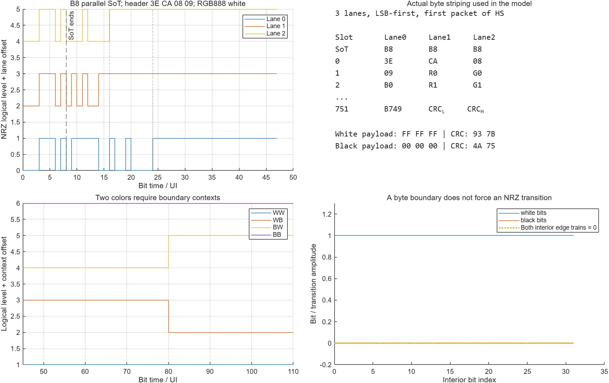
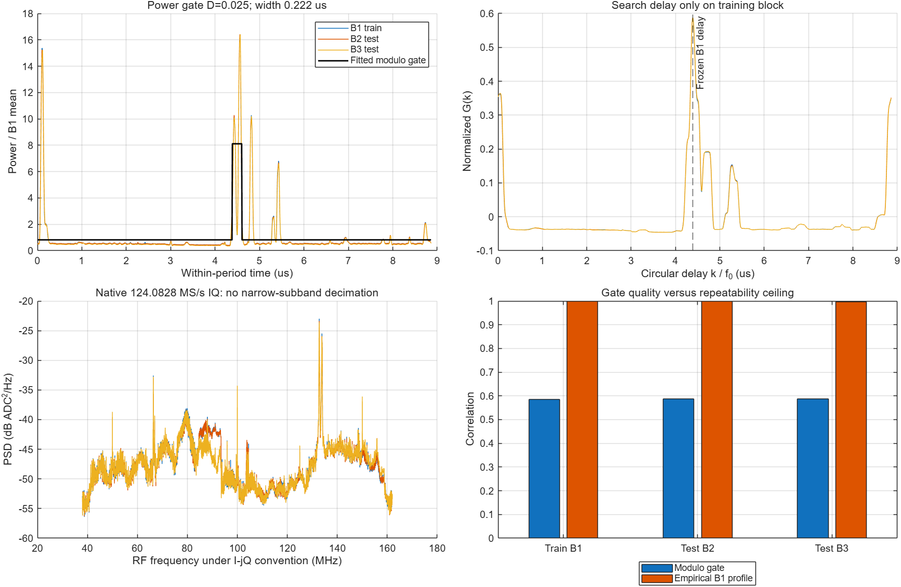
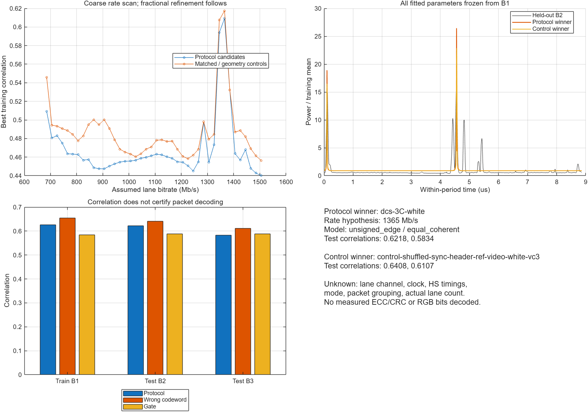
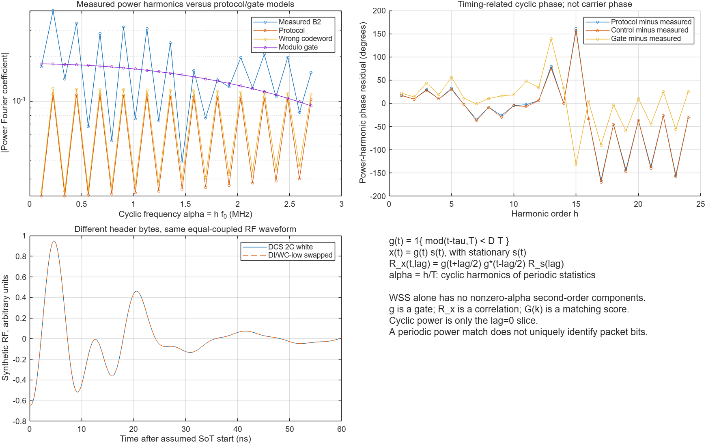
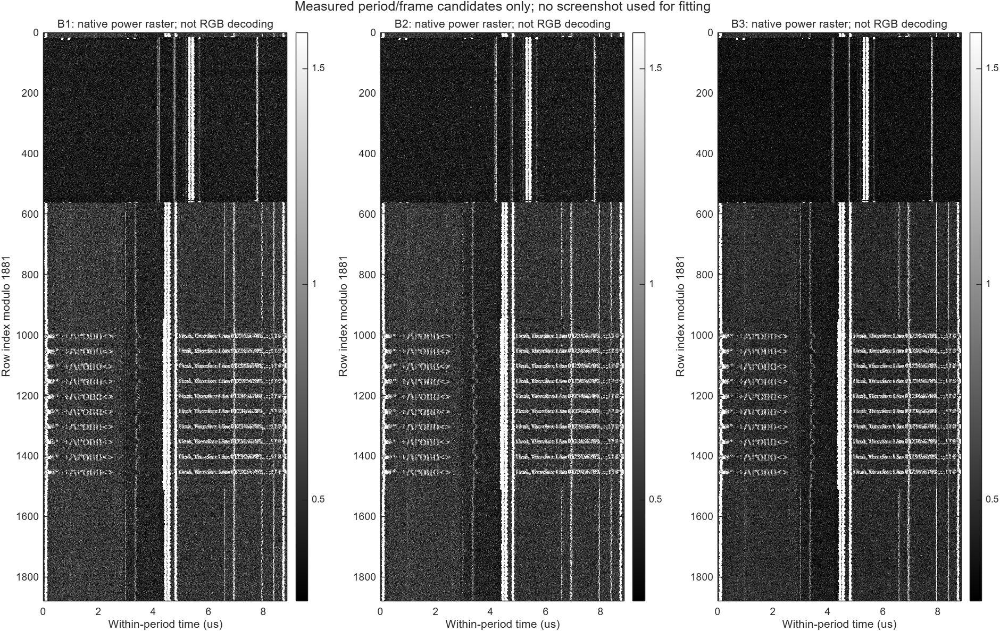

# iPhone 6: RGB888·3 data lane 프로토콜 codebook 적용
2026-10-27 · MATLAB 실행 결과 · 최종 산출물 v3

**Codebook을 만들고 fc100 MHz 실측에 적용했다. 반복 전력 구조는 매우 안정적이지만, 이번 모델에서는 유효한 packet header를 잘못된 header와 구별하지 못했다.** 이 결과는 DSI 누설이 없다는 뜻이 아니다. 현재 관측량(평균 전력)과 제한된 방사·채널 가정의 식별성 결과이다.

## 1. 무엇을 만들고 실행했는가
- RGB888, 3 data lanes, byte round-robin, LSB-first를 구현했다. 실제 iPhone의 lane 수가 확인됐다는 주장은 아니다.
- 750 pixel 단일 packet 가정: video 흑백 × VC0–3 = 8개, DCS write 2C/3C 흑백 × VC0 = 4개.
- 유효 후보 각각에 byte 순열, header bit-order 반전, SoT/header bit shuffle을 적용한 대응 대조군 36개. 같은 유효 시간만 유지하고 비트 구조를 지운 geometry 대조군 12개.
- 총 60 codeword × 42 lane-rate 가설(685–1505 Mb/s, 20 Mb/s 간격) × 3 방사 기저 × 2 lane 결합 = **15,120개 coarse 비교**.
- 각 codeword의 training 최적점에서 지연을 ±1 native sample, 1/16 sample 간격(**0.503696 ns**)으로 추가 탐색했다. 이 과정은 템플릿의 fractional delay이며 원본 IQ의 clock-resampling/CFO 보정을 수행한 것은 아니다.
- 원본 124.0828 MS/s IQ에서 전력을 먼저 계산한 뒤 주기에 접었다. 저속 RF78 자료로 고속 header를 맞춘 것이 아니다.
- 모든 선택·gain·offset·delay는 B1에서 정했다. B2/B3에서 다시 맞추지 않았다. 같은 녹음의 떨어진 시간 구간이므로 독립 재측정 검증은 아니다.

## 2. 정확한 codebook
Video RGB888 DT=3E, WC=3×750=2250=08CA, VC0일 때:
\[
[\mathrm{DI},\mathrm{WC_L},\mathrm{WC_H},\mathrm{ECC}]
=[\mathtt{3E},\mathtt{CA},\mathtt{08},\mathtt{09}].
\]

흰 payload는 FF FF FF, 검정은 00 00 00이다. 2250-byte all-white CRC=7B93(전송 순서 93 7B), all-black CRC=754A(4A 75). **혼합 문자 행의 CRC는 해당 행 전체 byte에서 따로 계산해야 한다.**

|byte-clock slot|Lane0|Lane1|Lane2|
|---|---|---|---|
|PHY SoT|B8|B8|B8|
|0|3E|CA|08|
|1|09|R0|G0|
|2|B0|R1|G1|
|…|…|…|…|
|751|B749|CRC_L|CRC_H|

B8은 시간순으로 00011101이며, 모든 lane에서 병렬 전송된다. 따라서 첫 video packet에서는 R→lane1, G→lane2, B→lane0이고 B가 한 byte-clock 늦는다. 한 HS 안에 여러 packet이 이어질 때는 앞선 전체 byte 수 mod 3을 유지해야 한다. 이 실행은 **HS의 첫 단일 packet**만 시험했다.

RGB888이라고 video mode를 확정하지 않으므로 DCS long-write도 넣었다. WC=2251, header=39 CB 08 12 뒤에 command 2C 또는 3C를 둔다. SoT와 header만 구현했으며 PHY HS-prepare/zero/trail의 미지 시간을 임의로 정하지 않았다. EoTp 08 0F 0F 01은 codebook에 별도 기록했으나 이번 waveform에는 덧붙이지 않았다.

ECC 독립 검산: 08 0F 0F → 01, 37 F0 01 → 3F.
CRC 독립 검산: payload 01 → 1E0E. 생성기 실행 시 assertion으로 확인했다.

## 3. 사용자가 제안한 g[n], 상관함수, G(k)의 연결
modulo gate를 다음처럼 둘 수 있다.
\[
g[n;\tau,D,T]=\mathbf1\!\left\{0\le
\left(\frac{n}{F_s}-\tau\right)\bmod T<DT\right\}.
\]
\[
p[n]\simeq P_{\mathrm{off}}+
(P_{\mathrm{on}}-P_{\mathrm{off}})g[n].
\]
잡음과 다른 누설이 있으면 off 전력이 0일 필요는 없다. 이번 코드도 양의 gain과 offset을 허용한다. 또한 FsT가 정수가 아니므로 정수 1100으로 단순 반복시키지 않고 실제 시각 n/Fs의 위상을 사용했다.

여기서 g는 **gate**, R은 **자기상관**, G(k)는 **template와 관측의 지연별 정합 점수**다. 서로 같은 객체는 아니다.

연속시간에서 x(t)=g(t)s(t), s가 WSS라면:
\[
R_x(t,\ell)=g(t+\ell/2)g^*(t-\ell/2)R_s(\ell),
\qquad
R_x^{\alpha}(\ell)=\frac1T\int_0^T R_x(t,\ell)e^{-j2\pi\alpha t}\,dt .
\]
주기 gate 때문에 \(\alpha=h/T\)에 cyclic 성분이 생긴다. 이는 **2차 cyclostationarity**이다. 엄밀한 WSS 자체는 비영 cyclic frequency의 2차 성분을 만들지 않는다.

lag=0인 전력 단면의 사각 gate Fourier 계수는:
\[
p_h=\sigma_s^2D\,\operatorname{sinc}(hD)
e^{-j2\pi h(\tau/T+D/2)},\quad h\ne0 .
\]
따라서 gate의 폭은 harmonic 크기 배열에, 지연은 harmonic 위상 기울기에 반영된다. 하지만 서로 다른 byte열이 같은 전력 단면을 만들 수 있다.

이번 G(k)는:
\[
G_\theta(k)=
\frac{\sum_j(p_\theta[j]-\bar p_\theta)(\hat p[j+k]-\bar{\hat p})}
{\|p_\theta-\bar p_\theta\|\,\|\hat p-\bar{\hat p}\|}.
\]
FAM에서 찾은 alpha는 주기의 후보를 제공하고, codebook은 그 주기 안의 예상 형태를 제공한다. 이전 FAM 결과의 \(f_0=112802.5501974424\) Hz를 고정했다. **이 주기가 HS 또는 row라는 protocol 식별은 아직 안 됐다.**

## 4. 논리 비트에서 RF template로 가는 과정
비트열을 ADC 표본에 바로 대입하지 않았다.

1. byte striping → 각 lane의 bit열 → NRZ(±1, 미전송 구간 0).
2. NRZ, signed transition, unsigned transition의 세 방사 기저를 생성.
3. 실제 fc100/BW120에 대응하는 **40–160 MHz 양의 RF 대역**만 남김. 양 끝 5 MHz cosine taper는 수신기 응답의 가정이다.
4. 세 lane의 동일 복소계수 coherent 합 또는 동일 가중치 incoherent power 합을 시험.
5. **복소 RF 파형을 실제 sample-phase 분포에서 표본화 → 절댓값 제곱 → phase bin별 평균.** 전력을 먼저 anti-alias resample하지 않았다.
6. 원본의 phase bin별 subphase 분포를 사용하고, B1에서 맞춘 지연·gain·offset을 B2/B3에 고정 적용.

NRZ의 Fourier 계수는 bit 경계 변화량으로 정확하게 계산했다:
\[
S_\ell(f_h)=\frac{1}{j2\pi f_hT}
\sum_e \Delta s_{\ell,e}e^{-j2\pi f_h t_e},\quad f_h=h/T .
\]
실제 common-mode 변환, lane별 복소 채널·skew, clock 방사, LP↔HS 전이는 미확정이다. 이번 세 기저는 그것을 모두 해결한 물리 모델이 아니다. 동시 흑·백·문자·blanking 행이 섞인 관측 평균에 단일 균일색 packet 모형을 맞췄다는 제한도 있다.

## 5. 실제 결과
원본: black글_fc100MHz.rIs, BE int16 interleaved IQ, I−jQ 가설, frozen preflight DC.
B1/B2/B3 시작: 0.2 / 1.1 / 1.8 s. 각 16,777,600 complex samples = 약135.213 ms.
원본 SHA256: 32f74cf59e279b72b27fab92949d2a7bf1520a418c3a28e7828fe208df2809fa (이전 검증 identity 인용; 이번에는 파일 크기 대조).
주기 8.865047805 µs, 약1099.999954 native samples.

|비교 대상|B1 학습 상관|B2 검증 상관|B3 검증 상관|
|---|---:|---:|---:|
|B1 경험적 전력 profile|1.0000|0.9997|0.9964|
|단일 modulo 전력 gate|0.5844|0.5878|0.5883|
|유효 protocol bank 최적 후보|0.6258|0.6218|0.5834|
|대조군 bank 최적 후보|0.6545|0.6408|0.6107|
|유효 최적 후보의 DI/WC-low 순서를 바꾼 대응 대조군|0.6258|0.6218|0.5834|
|DCS 길이를 유지한 geometry-only 대조군|0.5219|0.5266|0.4846|

최적 protocol 가설은 DCS 3C/all-white, lane bitrate 가설1365 Mb/s, unsigned-edge, equal coherent coupling이었다. **1365 Mb/s를 측정 bitrate로 채택하지 않는다.** 시작·끝의 약 반 주기 간격에 잘 맞는 값이며 잘못된 codeword도 같은 rate에서 높은 점수를 얻는다. DCS mode/VC/HS identity도 확정하지 않는다.

Gate의 학습 duty는0.025, 높은 전력 구간 폭0.221626 µs였다. 이는 큰 전력 lobe를 근사한 폭이고 packet의 HS payload 길이로 해석하면 안 된다. 실제 profile에는 단일 gate로 설명되지 않는 여러 peak가 남는다.

더 강한 식별성 반례도 확인했다. 특정 DCS header의 DI와 WC-low를 서로 바꾸면 잘못된 packet이지만, **동일 가중치로 합치는 세 lane의 RF 파형이 수치 정밀도에서 동일**하다. 세 방사 기저의 상대오차가 약2.6–3.2×10⁻¹⁶이다. 따라서 이 모델에서는 학습량을 늘려도 그 두 header를 구별할 수 없다. lane별 비대칭 응답이나 다른 관측량·여러 통제 화면이 필요하다.

대조군의 개수가 더 많으므로 bank 최대값 비교를 유의확률로 해석하지 않는다. 위의 **동일 reference의 byte-swap 대조군과 정확히 같은 파형·점수**라는 결과가 별도로 식별성 문제를 보여준다.

## 6. 수치 구현 검증
- bit 경계 합으로 얻은 Fourier 계수를 독립 NRZ rectangle 적분과 비교: 상대오차5.20×10⁻¹³.
- signed-edge 미분 관계: 상대오차1.85×10⁻¹⁶.
- RF grid16384→32768, subphase16→64, cubic4-point→MATLAB pchip을 함께 비교. 파라미터 재학습 없음.
- 중심화된 예측 파형 기준 변화는 최댓값 약0.101%. 검증 점수 순위는 유지됐다.
- 정밀 검증 B2/B3: protocol0.621861/0.583449, control0.640727/0.610679.
- 0.503696 ns는 delay 탐색 간격이지 실제 timing 정확도의 보증이 아니다.
- 이전 v1은 구조체 대입 오류로 중단했다. v2는 video 기반 대조군만 둔 탐색으로 보존했으며, 이 v3가 대응 대조군·fractional delay·bin조건부 표본 분포를 반영한 결과다.

아래 위상 그래프는 **전력 harmonic의 cyclic 위상**이며 RF carrier 위상이나 복원된 RGB hue가 아니다. FAM 전체 SCF를 새로 계산한 그림도 아니다. FAM에서 고정한 f0에 대한 folded-power Fourier 계수를 보여준다.

## 7. 흑백 가정의 유효 범위와 다음 모델
참조 PNG(750×1334)의95.5723%는 정확한 흰색 또는 검정이고, 나머지4.4277%는 회색이다. 모든 pixel은 grayscale이고 unique 값은256개다. 이는 antialiasing을 포함한 흑백 화면 근사가 충분히 유용함을 지지한다. 참조 이미지는 detector fitting에 사용하지 않았다.

다만 constant FF/00의 내부에는 둘 다 NRZ 전이가 없다. 흑→백과 백→흑의 signed edge는 부호가 다르지만 단독 power는 같아질 수 있다. 따라서 다음 단계는 단일 pixel별 두 RF symbol보다 **경계 context + packet 위치 + 제한된 lane 채널**을 함께 사용하는 모델이다.

우선할 확장:
1. 실제 전력 profile로 row/packet 상태를 나누어 균일색·문자·blanking을 섞어 평균하지 않기.
2. lag0 power뿐 아니라 **비영 lag의 복소 cyclic autocorrelation**을 함께 맞추고 lane 채널의 자유도를 제한하기.
3. HS 진입/종료 및 clock-gating의 nuisance basis를 분리하고 header가 그것을 넘는 증거를 주는지 확인하기.
4. 같은 channel을 고정한 채 여러 알려진 화면으로 codeword 구별을 검증하고, 최종적으로 측정 byte의 ECC/CRC가 일치하는지 확인하기.

이 실행에서 packet bytes, 실제 lane count, carrier CFO, 텍스트 decoding 또는 stitching 개선을 성공으로 보고하지 않는다. **완료한 것은 정확한 조건부 codebook 생성, 수신 대역을 고려한 적용, 독립 시간 구간 및 잘못된 codebook 검증이다.**

위 raster는 주기·1881-row frame 가설로 원본 전력을 배열한 것이다. 가로축은750pixel이 아니라 주기 내 시간이고 원본 스크린샷을 사용해 채운 화면이 아니다.

## 8. 재현
MATLAB 경로를 이 laboratory로 두고:
~~~matlab
addpath('signal_processing')
book = buildDsi3LaneCodebook27();
out = fullfile(pwd,'results','new_unique_codebook_run');
report = applyDsi3LaneCodebook27(out);
audit = auditDsiCodebook27(out);
~~~
기존 output 폴더가 있으면 덮어쓰지 않는다. 원본 capture는 읽기만 한다.

파일: codebook.mat / book_summary.json / native_fold.mat / candidate_results.mat / candidate_scan.csv / candidate_validation.csv / metrics.json / numerical_audit.json / 5개 PNG 및 편집 가능한 FIG. 실행 코드의 동일 시점 복사본은 code/에 있다.

## 출처
- 사용자 보유 DSI v1.3 draft: §6(lane 분배), §8.1(HS grouping), §8.3(bit order), §8.8.23(RGB888), §9(ECC/CRC). 선택 범위와 문서 상태는 knowledge/mipi_dphy/codebook_three_lane_source_audit_20261027.md에 기록. 원문 PDF 재배포 없음.
- [Keysight M8085A User Guide](https://www.keysight.com/ge/en/assets/9018-04458/user-manuals/9018-04458.pdf), pp.68·116: SoT와 LSB-first.
- [ST AN4860](https://www.st.com/resource/en/application_note/dm00287601.pdf), Table7·Fig45: DSI data types/RGB888.
- [TI SNLA356](https://www.ti.com/lit/an/snla356/snla356.pdf), §2.1: RGB888 DT3E 교차 확인.
- [CSP의 cyclic autocorrelation 설명](https://cyclostationary.blog/2015/09/28/the-cyclic-autocorrelation/comment-page-1/).
- [FAM 설명 원문](https://cyclostationary.blog/2018/06/01/csp-estimators-the-fft-accumulation-method/). 이번 run은 이전 FAM 추정 f0를 사용한 protocol-template 검증이다.
