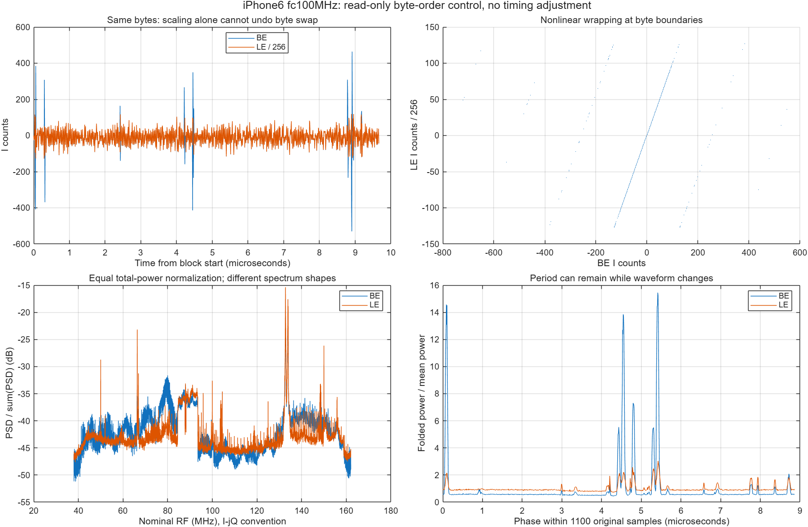

# 기존 Claude 모바일 복원 자료와 현재 iPhone6 분석의 대조

원본 연구 폴더 C:/Users/leechanghoon/Desktop/mobile/0625를 찾아 기존 성공 화면과 해당 MATLAB 코드·기록을 함께 검토했다. 전체 2,537개 파일의 메타데이터를 목록화했고, 43개(9,070,501 bytes)를 원래 상대 경로대로 보관했다. 각 복사본의 SHA-256이 원본 수집 기록과 일치한다. 원본 RIS·MAT 또는 원본 코드는 변경하지 않았다.

## 1. 기존 성공 화면을 찾았다

Galaxy와 LG의 기존 복원 PNG에는 실제 keypad 구조와 숫자가 보인다. 이 성공 결과는 다시 분석해야 할 근거다. 다만 화면 인지 성공과 저장 IQ를 물리적 진폭·위상으로 정확히 해석했는지는 별개의 검증 항목이다. 이번에는 보관된 성공 화면을 재표시했고, 새로운 화면 복원을 실행했다고 표시하지 않았다.

### Galaxy 111.9 MHz

[스냅샷](source_snapshot/analysis_outputs/final_screens_v1/galaxy_111p9M_K120_equalised_1080x1920.png) · [원본](C:/Users/leechanghoon/Desktop/mobile/0625/analysis_outputs/final_screens_v1/galaxy_111p9M_K120_equalised_1080x1920.png)

### LG X2

[스냅샷](source_snapshot/analysis_outputs/final_screens_v1/lgx2_subaligned_K85_equalised_720x1440.png) · [원본](C:/Users/leechanghoon/Desktop/mobile/0625/analysis_outputs/final_screens_v1/lgx2_subaligned_K85_equalised_720x1440.png)

### 기존 iPhone6 100MHz P139

가로 위치 정보가 크게 흐려지고 글줄 위치에 대응하는 띠가 보인다. 이 PNG만으로 원인을 확정할 수 없다.

[스냅샷](source_snapshot/analysis_outputs/res_generic_black_fc100M_P139/black_fc100M_P139_active.png) · [원본](C:/Users/leechanghoon/Desktop/mobile/0625/analysis_outputs/res_generic_black_fc100M_P139/black_fc100M_P139_active.png)

## 2. 같은 원본 바이트에서 LE 사용을 재현했다

새 MATLAB 대조 실험은 동일한 iPhone6 fc100MHz 파일의 4개 구간을 BE와 LE로 각각 읽었다. 기존 CSV에 남은 평균 I RMS 9770.355666857가 LE 해석에서 9770.355666857로 재현됐으며, BE 해석에서는 50.519375351였다. 이는 검토한 이전 실행이 LE 경로를 사용했다는 직접적인 재현 근거다. 현재 프로젝트의 BE 기록 규약과 충돌하므로 reader 기준을 먼저 일치시켜야 한다. 수집 VI 자체는 이번 audit에서 열어 확인하지 않았다.

LE/256과 BE의 상관은 0.662849–0.683510였고, 정규화 제곱오차는 0.538917–0.567193였다. BE scalar 값의 1.2931–1.3406%만 [−128,127] 밖에 있지만 이들이 BE power의 44.37–47.06%를 차지한다. 따라서 단순 gain 256 차이로 볼 수 없다. 작은 정수 구간에서는 byte swap 결과가 원값에 가깝게 비례하므로 구조와 주기가 남을 수 있고, 범위를 넘는 pulse에서 비선형 wrapping이 발생해 스펙트럼·진폭·위상이 달라진다. 기존 화면이 읽힌다는 사실과 물리적 해석을 재검증해야 한다는 판단은 함께 성립한다.

| block | 첫 complex sample | BE I RMS | LE I RMS | corr(BE,LE/256) | 범위 밖 scalar % | 해당 scalar power % | NMSE(LE/256−BE) |
| --- | --- | --- | --- | --- | --- | --- | --- |
| 1 | 0 | 51.137672 | 9966.074486 | 0.683510 | 1.3406 | 44.3655 | 0.538917 |
| 2 | 95126898.0 | 51.140527 | 9988.858839 | 0.681446 | 1.3349 | 44.4586 | 0.541777 |
| 3 | 190253797.0 | 50.509104 | 9733.147034 | 0.673640 | 1.3268 | 45.5874 | 0.552648 |
| 4 | 285380695.0 | 49.290198 | 9393.342308 | 0.662849 | 1.2931 | 47.0628 | 0.567193 |

[스냅샷](source_snapshot/survey_captures_level_band_linerate_v1.m) · [원본](C:/Users/leechanghoon/Desktop/mobile/0625/survey_captures_level_band_linerate_v1.m)

[스냅샷](source_snapshot/reconstruct_explicit_res_generic_v1.m) · [원본](C:/Users/leechanghoon/Desktop/mobile/0625/reconstruct_explicit_res_generic_v1.m)

## 3. Fs 이름표보다 samples/cycle을 비교해야 한다

| 항목 | 기존 Claude 100MHz | 현재 FAM 기반 |
| --- | --- | --- |
| Fs label (MS/s) | 124.0842800 | 124.0828000 |
| 주기 추정치 (Hz) | 112804.136768000 | 112802.550197442 |
| samples/cycle | 1099.997602528 | 1099.999953749 |
| 현재 Fs 축에 환산한 주파수 (Hz) | 112802.791310522 | 112802.550197442 |

Fs label 차이는 11.927519 ppm이지만 Fs와 주파수 추정치를 같은 비율로 스케일했다면 fH/Fs는 변하지 않는다. 따라서 11.9 ppm을 그대로 복원 오류라고 할 수 없다. 실제 비교해야 하는 것은 sample당 cycle이다. 환산 후에도 2.137479 ppm의 차이가 남고, 전체 289,575,000.0 complex samples에서 누적 차이는 0.562691365 cycle이다. 750-column folding을 가정하면 422.019 cell, 약 반 line의 누적 위치 차이에 해당한다. 이것은 두 추정치를 고정 사용했을 때의 계산값이며, 실제 P139 화면 열화의 원인을 이 항목 하나로 확정한 결과는 아니다.

[스냅샷](source_snapshot/run_timing_black_fc100M_v1.m) · [원본](C:/Users/leechanghoon/Desktop/mobile/0625/run_timing_black_fc100M_v1.m)

## 4. 성공 파이프라인과 실제 비균일 Fourier 구현

성공 그림의 주요 처리 경로는 IQ 읽기 → AM |IQ| → frame별 위치 보정을 반영한 fractional sample phase의 raster cell 누적 → cell mean → 수평 harmonic 제한 K 및 표시용 crop/equalization으로 구분된다. 이 중 image FFT에서 K개 harmonic만 유지하는 연산은 재배치된 cell 이미지의 수평 저역 투영이다. 원본 비균일 sample 위치에서 Fourier least-squares를 푸는 연산과 같지 않다. 후속 iPhone6s 구현에는 실제 비균일 phase matrix를 만든 nearest-one 방식과 grouped noise-aware Fourier 해법이 추가되어 있으며, 저장 CSV도 존재한다. 따라서 전체 연구를 '비균일 Fourier 복원 미구현'으로 요약하면 부정확하다.

| 대상 | 지표/조건 | 기록된 수치 | 해석 범위 |
| --- | --- | --- | --- |
| LG X2 | 동일 P=411, edge half correlation | −0.000723 → 0.811617 → 0.842219 | 미정렬 → 정수 shift → fractional shift; 정렬 개선의 비교 |
| Galaxy 111.9 MHz | half log correlation | 0.023376 → 0.570816 | 자체 fH + frame 정렬 + P=200→377을 함께 변경; timing 단독 효과로 분해 불가 |
| iPhone6s Fourier | cell baseline 대비 full log correlation | 0.318193 → 0.908486 | nearest-one → grouped noise-aware; ground truth 정확도가 아님 |
| Galaxy row 700 sampling | N, Fourier Gram condition | N=359,911; κ≈1.003–1.07 | 377 frames의 Galaxy 표본 구조; iPhone6 100MHz 수치가 아님 |

N=359,911과 κ≈1.003–1.07은 Galaxy 377-frame 특정 row의 sample geometry에 대한 수치다. 다른 기기·대역의 신호 강도나 복원 품질을 보장하지 않는다. iPhone6s의 0.908486 대 0.318193은 기존 cell 결과와의 유사도이며 원본 화면과의 정확도가 아니다. LG 정수/fractional 정렬 비교는 동일 P=411 조건이라는 점에서 효과 해석이 비교적 분명하다. Galaxy 개선은 자체 fH 선택, 정렬, frame 수가 함께 바뀐 결과이므로 어느 한 단계만의 이득으로 귀속할 수 없다.

[스냅샷](source_snapshot/docs/theory/2026-07-27_PAPER_RES_EQUATIONS_AND_CODE_COMPARISON.md) · [원본](C:/Users/leechanghoon/Desktop/mobile/0625/docs/theory/2026-07-27_PAPER_RES_EQUATIONS_AND_CODE_COMPARISON.md)

[스냅샷](source_snapshot/analysis_outputs/iphone6s_RES_paper_fourier_full_v1/iphone6s_RES_paper_fourier_full_metrics_v1.csv) · [원본](C:/Users/leechanghoon/Desktop/mobile/0625/analysis_outputs/iphone6s_RES_paper_fourier_full_v1/iphone6s_RES_paper_fourier_full_metrics_v1.csv)

[스냅샷](source_snapshot/docs/experiments/2026-07-29_galaxy_111p9M_band_and_linerate_v1.md) · [원본](C:/Users/leechanghoon/Desktop/mobile/0625/docs/experiments/2026-07-29_galaxy_111p9M_band_and_linerate_v1.md)

[스냅샷](source_snapshot/analysis_outputs/ppt_galaxy_111p9M/galaxy_111p9M_ppt.png) · [원본](C:/Users/leechanghoon/Desktop/mobile/0625/analysis_outputs/ppt_galaxy_111p9M/galaxy_111p9M_ppt.png)

## 5. 이전 iPhone6 실패 해석과 BW 기록

기존 iPhone6 238MHz 분석과 현재 100MHz black text 측정은 서로 다른 capture다. 238MHz 기록은 1880-row raster를 사용했지만 ACF의 1881-row 후보 및 G(k) 탐색 경계에 걸린 결과가 남아 있으므로 frame 수를 늘려 반복성이 좋아졌다는 사실만으로 timing 문제를 배제할 수 없다. blanking이나 세로선도 두 half에서 반복될 수 있다. 과거 노트의 'SNR만이 실패 원인' 또는 10,000-frame 외삽은 확정 결론으로 유지하지 않는다.

기존 100MHz survey launcher에는 nominalBW_Hz=60 MHz가 있고, 사용자가 제공한 측정 셋업은 120 MHz다. 수신 하드웨어/드라이버 설정 기록으로 해결해야 하는 메타데이터 불일치다. 이를 디지털 subband 폭이나 저역 필터 cutoff와 혼합하면 안 된다. ADC Fs, 실제 analog/DDC passband, 선택한 디지털 처리 대역, 출력 cell 수는 각각 기록해야 한다.

[스냅샷](source_snapshot/docs/experiments/2026-07-27_iphone6_238M_frame_count_200_to_488_v1.md) · [원본](C:/Users/leechanghoon/Desktop/mobile/0625/docs/experiments/2026-07-27_iphone6_238M_frame_count_200_to_488_v1.md)

[스냅샷](source_snapshot/run_survey_black_fc100M_v1.m) · [원본](C:/Users/leechanghoon/Desktop/mobile/0625/run_survey_black_fc100M_v1.m)

## 6. 증거의 종류와 재사용 방향

| 종류 | 확인 내용 | 근거/범위 |
| --- | --- | --- |
| 이번 재실행 | 동일 바이트의 BE/LE RMS·비선형 차이·PSD·1100-sample fold | endian_audit.json / endian_comparison.png |
| 소스/출력 확인 | 기존 reader의 ieee-le, Fs=124.08428e6, nominalBW=60e6 | 보관한 run_*black_fc100M*.m 및 공통 reader |
| 기존 결과 | Galaxy/LG 성공 PNG, P139 가로띠 PNG, 과거 반복성 지표 | source_snapshot 이미지·CSV·노트; 이번 새 복원 아님 |
| 계산으로 도출 | 정규화 timing 차이 2.137479 ppm, 전체 422.019 cells | 두 저장 추정치와 동일 파일 길이로 계산 |
| 미확정 가설 | 가로띠 원인 중 byte swap·누적 timing 오차·정렬·대역 선택의 상대 기여 | 동일 조건 복원 A/B가 필요 |
| 미해결 metadata | 60 MHz 대 120 MHz 수신 BW, 원 acquisition VI endian | 현재 source와 사용자 측정 설명을 따로 보존 |

현재 정리된 재사용 자산은 읽을 수 있는 Galaxy/LG 성공 결과, capture별 timing·정렬 코드, iPhone6s 비균일 Fourier 비교다. iPhone6 100MHz를 다시 비교할 때는 BE/LE 해석과 fH/Fs를 먼저 고정한 동일 구간 대조군을 만들고, frame 정렬·평균 횟수·대역 선택을 각각 분리해 평가해야 한다. 이번 결과는 그 비교에 필요한 원본 위치와 실패 후보를 확정한 검토 기록이다. 새로운 reconstruction 또는 stitching 결과를 제시한 것은 아니다.

## 파일과 실행 범위

- [스냅샷 설명](source_snapshot/README_KO.md)
- [43개 파일 원본 경로·SHA-256](source_snapshot/SOURCE_INVENTORY.json)
- [전체 파일 메타데이터 목록](source_snapshot/ORIGINAL_FILE_LIST_METADATA_ONLY.csv)
- [이번 MATLAB 수치 audit](endian_audit.json)
- [실행 로그](matlab_audit.log)

스냅샷은 검토용 선별 자료다. RIS와 MAT 의존성을 포함하는 재실행 패키지가 아니므로 보관 코드를 그대로 실행하면 원래 경로와 입력 의존성이 필요하다. 과거 노트의 해석은 당시 주장으로 읽었고, 이번 audit와 충돌하거나 검증되지 않은 부분은 별도로 표시했다.
