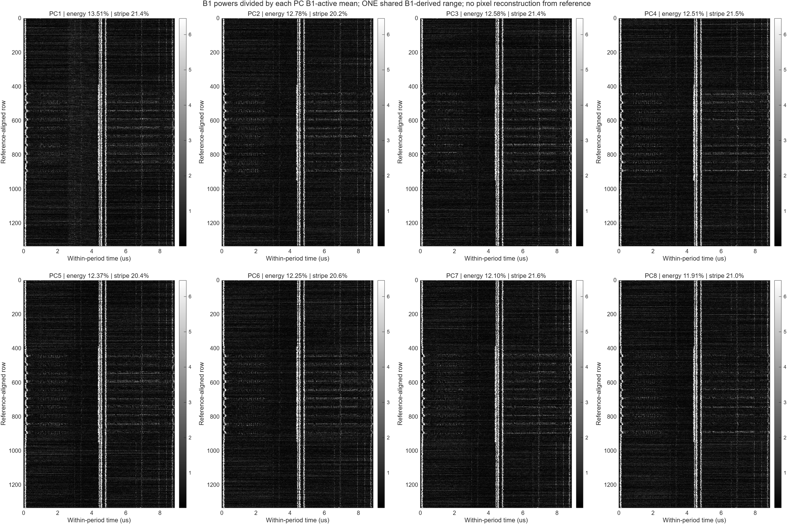
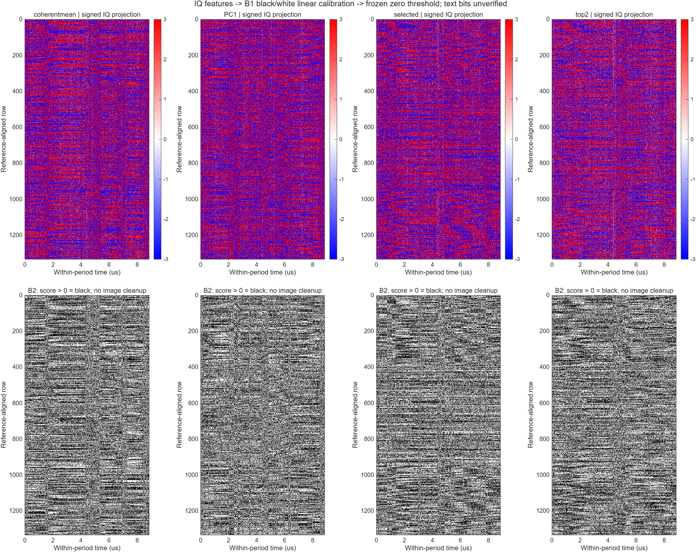
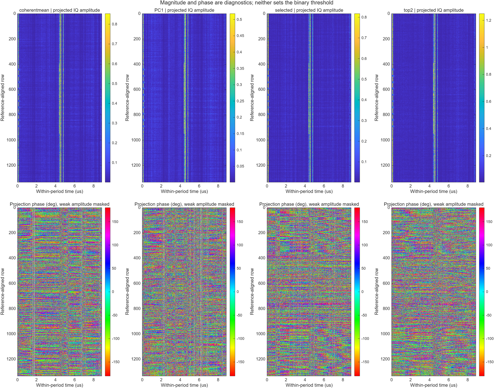
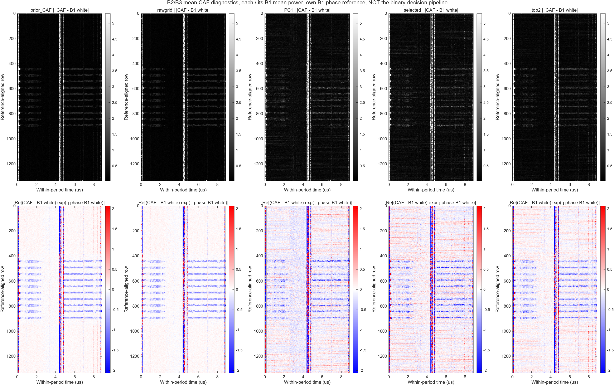
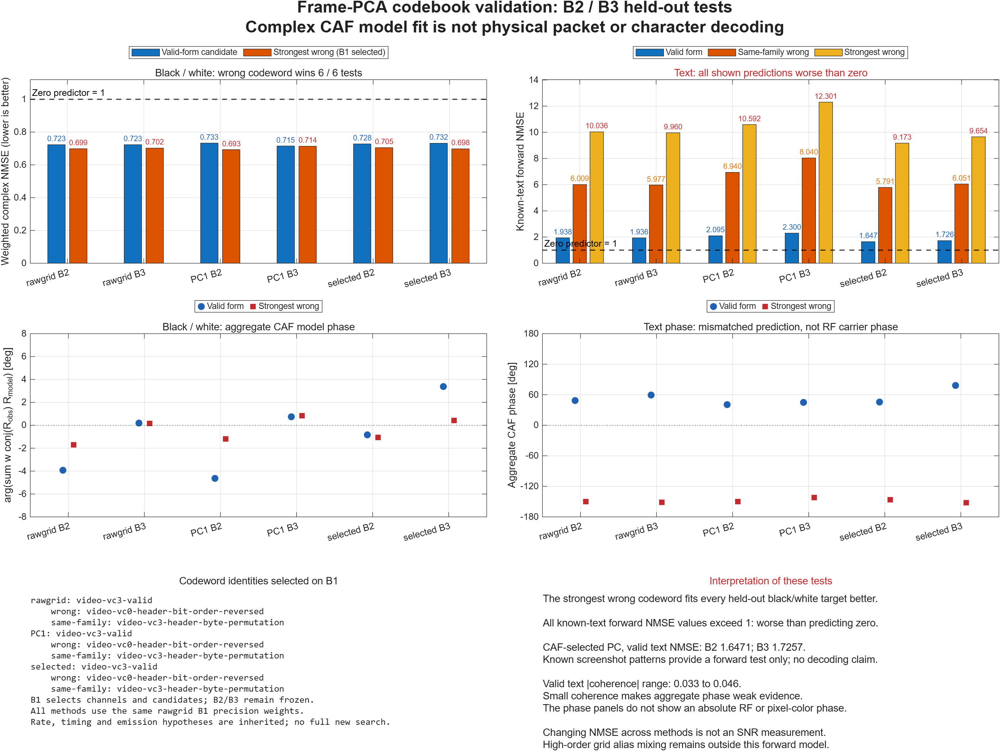

# iPhone 6 · 100 MHz 복소 IQ SVD → CAF 선택 → 투영 후 이진화

2026-10-27 실측 분석. 대상은 black글_fc100MHz.rIs이며, 이번 실행은 8프레임씩 세 구간(총 24프레임)을 사용했다.

**요청한 IQ 특징벡터의 선형 투영 후 이진화를 실제 MATLAB에서 수행했다. 현재 설정에서는 문자 이진 복원에 성공하지 못했다.** CAF에는 문자 행의 구조가 보이지만, 직접 IQ 투영의 검증 균형정확도는 49.5–51.4%였다. 첫 번째 주성분이 세로선만 분리한 결과도 아니다.

[그림과 수치를 보는 갤러리](gallery/index.html) · [원시 수치 CSV](iq_projection_binary_metrics.csv) · [코드북 수치](pca_caf_codebook_bank.json)

## 1. 사용한 데이터와 고정 조건

|항목|값|
|---|---|
|원본|C:/Users/leechanghoon/Downloads/black글_fc100MHz.rIs|
|크기 / 복소 샘플 수|1,158,300,000 bytes / 289,575,000|
|저장 샘플링률|124.0828 MS/s — 사용자 확인값|
|중심주파수 / 명목 수신대역폭|100 MHz / 120 MHz|
|저장 해석|big-endian int16 I,Q; 분석 복소 관례 I−jQ|
|주기 후보 f0|112,802.5501974424 Hz — 기존 FAM 결과를 고정|
|주기 길이|약 8.865 µs; 물리적 HS/row 식별은 미확정|
|프레임 가설|1881주기/프레임, 약 16.675155 ms|
|그리드|1100샘플/주기, 124,082,805.21718663 samples/s|
|B1 학습|절대 프레임 12–19, 시작 0.200101859 s|
|B2 검증|66–73, 시작 1.100560225 s|
|B3 검증|108–115, 시작 1.800916731 s|
|각 구간 길이|0.133401239 s|

원본은 변경하지 않았다. SHA256은 이전 2026-10-26 확인값 32f74cf59e279b72b27fab92949d2a7bf1520a418c3a28e7828fe208df2809fa를 참조하며, 이번 실행에서는 크기와 읽은 샘플 수를 검사했다. B2/B3는 같은 정지 화면·같은 녹음 안의 시간 분리 검증이다. 별도 측정으로 일반화 성능을 검증한 것은 아니다.

DC와 전력 정규화는 기존 B1 값으로 고정했다. MATLAB R2026b, Signal Processing Toolbox와 Wavelet Toolbox 설치를 확인했다. 이번 핵심 연산은 복소 행렬분해·비영 lag CAF이며 wavelet 변환은 수행하지 않았다.

## 2. 무엇을 특징벡터로 만들었는가

같은 프레임 위치 n에서 8개 프레임의 복소 IQ를 모았다. 따라서 X는 (1881×1100)×8 복소 행렬이다. 프레임마다 알려진 중심주파수와 시작시각에 따른 위상 관례를 맞춘 뒤 계산했다.

$$X=U\Sigma V^H,\qquad y_j=Xv_j/\sqrt{8}.$$

엄밀히는 프레임 평균을 빼지 않은 **uncentered complex SVD**이다. 공통 화면 성분을 먼저 제거하지 않도록 이 선택을 했다. 연구 대화에서 부른 complex PCA의 이번 구체적 구현이다. 일반적인 평균 제거 PCA나 공간 패치/Hankel 특징벡터의 PCA까지 시험한 것은 아니다.

B1에서 얻은 V와 선택 성분을 B2/B3에 그대로 적용했다. 학습 화면의 공간 벡터 U를 검증 영상에 투사하지 않았다. 각 검증 위치의 실제 8개 IQ만 혼합하므로 학습 문자 모양을 출력에 삽입하는 연산이 아니다.

1100그리드로의 정렬은 실제 측정 guard를 포함한 FFT fractional-delay로 했다. 행 안의 아주 작은 affine clock slope는 중점 지연으로 근사했다. 4096점 FFT와 8192점 guard의 B1 민감도는 상대 0.148%였다. 이는 실제 신호의 절대 보간 오차 상한은 아니다. 현재 비율에서 행 안 중점 근사의 최대 시간오차는 2.31×10⁻⁵ native sample이다.

## 3. CAF로 고른 성분과 세로선

CAF 선택은 B1의 비영 lag {1,2,4,8,16}, cyclic order 1–32에서 흑−백 및 문자−백 대비의 앞/뒤 4프레임 일치도와 비주기 후보의 대비를 사용했다. off-cycle은 (h+0.37)f0이며 전체 시간의 위상을 유지했다. 선택 기준은 B1에서만 정한 heuristic이고, 유의확률은 아니다. 두 절반 모두 같은 B1에서 학습한 V를 사용하므로 독립적인 최종 검증도 아니다.

**선택은 PC6, 보조 성분은 PC7이었다.** PC1의 에너지 비중은 13.51%, PC6은 12.25%, 나머지도 11.91–12.78%다. 8개 특이값에 뚜렷한 rank-1 우세가 없다.

|성분|에너지 비중|고정 열 전력 패턴의 분산 비중|
|---|---:|---:|
|PC1|13.51%|21.44%|
|PC6|12.25%|20.60%|
|PC7|12.10%|21.55%|
|8개 전체 범위|11.91–13.51%|20.22–21.55%|

열 패턴 비중은 전력영상 P의 행 평균으로 만든 고정 열 패턴이 전체 중심화 전력영상 분산에서 차지하는 비율이다. 시간 축을 접은 영상의 세로선 지표일 뿐 LCD driver 방사 전력의 비율이 아니다. **세로선은 모든 성분에 비슷하게 남는다. PC1=column driver라고 판단할 근거는 없다.**

## 4. 요청한 투영 후 binary의 정확한 정의

PC6 단독에서는 복소 특징 q가 1차원, PC6+7에서는 2차원이다. 비교군은 coherent mean과 PC1이다. 각 열 c에서 B1의 균일 검정 행과 흰 행의 복소 평균을 구하고, 모든 학습 열·행을 모은 within-class covariance C 하나로 방향을 정했다.

$$w_c=(C+\lambda I)^{-1}(\mu_{B,c}-\mu_{W,c}),\quad \lambda=0.05\operatorname{tr}(C)/D.$$
$$s(r,c)=\Re\{w_c^H[q(r,c)-(\mu_{B,c}+\mu_{W,c})/2]\},\quad \widehat b(r,c)=\mathbf1[s(r,c)>0].$$

bit 1을 검정으로 표시했다. 임계값은 B1에서 고정된 중점/0이고, B2/B3에서 재학습하지 않았다. 전력, 절댓값, CAF, Otsu, 후처리로 이진 결과를 바꾸지 않았다. 표시용 점수 정규화와 저분리 열 표시는 임계값을 바꾸지 않는다.

원본 화면은 행 종류와 행 정렬을 알려주는 지도 정보로 사용했다. 따라서 완전한 blind decoder는 아니다. 원본의 문자 픽셀을 이진 출력에 넣지는 않았다. 1100개의 시간 열마다 다른 w_c를 학습하므로 범용 RGB/비트 디코더나 물리적 3-lane 복호기로 해석할 수 없다. 1100개 시간 빈은 750개 화면 픽셀 또는 DSI 비트와 일대일 대응하지 않는다. PC들은 프레임 혼합 성분이며 물리적 lane이 아니다. 이번에는 일반 복소 공분산으로 방향을 구했으며 pseudo-covariance를 반영한 실수 확장 공분산의 최적 판정까지 검증하지 않았다.

|IQ 투영|B2 균형정확도|B3 균형정확도|
|---|---:|---:|
|Coherent mean|50.60%|49.70%|
|PC1|50.05%|50.37%|
|PC6, CAF 선택|51.11%|49.51%|
|PC6+PC7|51.40%|49.77%|

균형정확도는 알려진 균일 검정 행의 검정 recall과 균일 흰 행의 흰 recall 평균이다. 문자 픽셀 정확도나 OCR 정확도가 아니다. 샘플의 시간·공간 상관을 무시한 독립 Bernoulli 신뢰구간은 계산하지 않았다. B1 점수 평균이 정규화 후 ±1 부근인 것은 정의의 결과이며 높은 분리 성능을 뜻하지 않는다.

위상 그림은 학습된 복소 투영 z=w_c^H q의 위상이다. 저진폭 부분은 B1에서 정한 기준으로 가렸다. 절대 RF 위상, RGB hue, 개별 MIPI lane 위상을 측정했다고 해석하면 안 된다.

## 5. 기존 복원과 비교

기존 native-grid CAF 결과와 이번 동일 8프레임 그리드의 rawgrid를 모두 남겼다. PCA의 공정한 직접 비교 기준은 rawgrid다. rawgrid는 8프레임의 lag-product를 합하며, coherent mean은 IQ를 먼저 합한다. PC6+7의 CAF는 두 성분의 CAF를 합한 것이며 두 IQ를 한 개의 신호로 합친 것과 다르다.

|방법|B2 문자−흰 행 효과크기|B3 문자−흰 행 효과크기|
|---|---:|---:|
|기존 CAF 위상 투영|4.688|4.799|
|동일 그리드 rawgrid CAF|4.720|4.871|
|PC1 CAF|1.580|1.476|
|PC6 CAF|1.649|1.612|
|PC6+7 CAF|2.781|2.464|

이는 B1 흰 행 기준 잔차의 행별 크기에 대한 표준화 효과크기다. **SNR dB나 문자 인식률이 아니다.** 성분을 버리면서 잡음뿐 아니라 재현 가능한 2차 통계도 버린 결과다. 이미지에서 문자 구조는 기존 CAF에 더 잘 남으며, 현재의 PCA 선택은 이를 개선하지 못했다.

CAF 위상 그림의 기준은 B1 흰 행의 lag-1 상관 위상이다. B2/B3 측정 문자−백 대비의 rawgrid 위상 변화는 −0.123°/−1.667°, PC6은 −2.581°/−1.714°였다. 이 안정성이 직접 IQ의 위상 일치를 뜻하지는 않는다.

## 6. 왜 CAF가 살아 있는데 IQ binary는 실패하는가

예를 들어 프레임 간 1차 상관은 작아도 각 프레임의 지연곱 x[n+d]x*[n]의 기대값은 같은 주기성을 가질 수 있다. 프레임 간 교차항이 약하면 선형 혼합 y=Σa_k x_k의 CAF는 대략 Σ|a_k|² R_x^α(d)가 된다. 그러면 여러 PC가 비슷한 정규화 CAF를 보이면서 어느 하나도 원하는 방사원만 분리하지 못할 수 있다.

**프레임마다 일정한 global phase만 다른 것은 이번 평평한 특이값의 충분한 설명이 아니다.** 열마다 단위 복소수를 곱하는 연산은 특이값을 보존한다. 완전히 같은 파형에 프레임별 상수 위상만 달랐다면 rank-1 구조가 남는다. 프레임 안의 CFO·타이밍 변화, HS 구간마다 다른 위상, 여러 신호의 혼합 등은 후보이나 이번 결과로 원인을 특정하지 못했다.

추가 진단으로 B1 기준 프레임과 나머지 7프레임의 상대 CFO ±100 kHz, 정수 지연 ±4그리드 샘플을 탐색했다. 앞 절반에서 보정량을 구하고 뒤 절반에서 검증했다. 검증 coherence 중앙값은 보정 전 0.01294 → 보정 후 0.00941, 보정 후 최대 0.01894였다. 7쌍 중 2쌍만 향상됐다. 이번의 제한된 상수 CFO·정수 지연 보정은 일치도를 회복시키지 못했다. fractional/행별/nonlinear timing까지 불가능하다는 증거는 아니다. 이 진단 보정은 주 PCA 결과에 적용하지 않았다.

## 7. 선택 성분에서 codebook/오답 대조 재검증

RGB888, 3-lane round-robin은 가정이다. 이전 30개 후보(정상 video VC0–3 및 DCS2C/3C 가족과 header byte permutation, bit-order reversal, shuffle, geometry 오답)를 같은 조건으로 비교했다. 기존 후보별 bitrate·timing·emission 설정은 유지하고, B1 흑/백을 공유하는 복소 3-lane 채널 h를 다시 적합했다. B2/B3와 문자 행에는 재적합하지 않았다.

측정에 적용한 프레임 혼합 연산을 forward codeword에도 동일하게 적용했다. 이번의 정수 row-period 프레임 간격과 주기적 RF 격자 모델에서는 이 연산이 각 branch의 공통 복소 스칼라로 축약된다. 채널 재적합이 그 크기를 흡수하므로 이것만으로 packet의 정체를 새롭게 식별했다고 할 수 없다.

|방법|정상 후보 NMSE B2/B3|B1 최선 오답 NMSE B2/B3|정상 후보의 문자 forward NMSE B2/B3|
|---|---|---|---|
|rawgrid|0.7231 / 0.7230|0.6985 / 0.7023|1.9380 / 1.9358|
|PC1|0.7329 / 0.7151|0.6930 / 0.7136|2.0953 / 2.2996|
|PC6|0.7278 / 0.7317|0.7051 / 0.6978|1.6471 / 1.7257|

오차는 작을수록 좋으며, 동일 가중 NMSE에서 영 예측의 값은 1이다. 정상 후보는 video-vc3-valid, 전체 오답 중 B1 최선은 video-vc0-header-bit-order-reversed였다. 정상 후보의 같은 가족 오답은 video-vc3-header-byte-permutation이다. 정상 후보가 문자 예측에서는 오답보다 낫지만, **정상 후보의 문자 NMSE조차 1보다 크다. 균일 행에서는 전체 최선 오답이 모든 검증 구간에서 더 잘 맞았다. 따라서 packet을 식별하거나 복호화한 결과가 아니다.**

PC6의 문자 오차가 rawgrid보다 낮아진 것은 관측된 제한적 개선이다. 동시에 PCA로 관측 target 자체도 변하므로 이것을 SNR 향상 또는 복원 정확도 향상으로 바꿔 부르지 않는다. 755 Mb/s 역시 이전 후보의 조건부 값이지 실제 iPhone 6 lane rate를 확인한 값이 아니다. 고차 격자 alias mixing과 실제 아날로그 주파수 의존 채널은 현재 모델에 완전히 포함되지 않았다.

## 8. 수치 확인과 재현

모든 PC 전력의 합과 rawgrid 전력을 비교한 상대 L2 오차는 세 구간 모두 약 9.3×10⁻⁸였다. FFT fractional advance의 부호·crop을 양/음 주파수 해석적 복소 정현파 30개로 검증한 최대 절대오차는 1.43×10⁻¹²였다. 이는 구현 일관성 검사이며 broadband 보간 정확도나 화면 복원 성공의 증거가 아니다.

실행 함수: prepareFramePca27, renderPcaIqBinary27, auditFrameCoherence27, fitPcaCafObservationBank27, renderFramePcaDiagnostics27, renderPcaCodebookValidation27, auditPcaNumerics27. 분석 코드는 lab 루트와 signal_processing 폴더에 있다. 코드 스냅샷과 execution_environment.json을 함께 저장한다.

중간 데이터: training_pca.mat(V, 특이값, 선택 점수), pca_iq_features.mat(복소 IQ), pca_image_data.mat(모든 성분/CAF/전력), iq_projection_binary_views.mat(투영과 bit), pca_caf_observations.mat(CAF), codebook별 MAT/JSON, MATLAB FIG. B2/B3 프레임을 개별 이동시킨 null MAT도 저장했으나, 이 보고서의 성공/실패 판단은 위의 직접 검증·오답 codeword 결과를 사용했다.

이 실험으로 확인한 것은 **현재 프레임 축 SVD의 일부 PC만 남기는 전략이 기존 CAF보다 낫지 않으며, 직접 IQ 선형 투영의 흑백 결정도 아직 안정적이지 않다**는 점이다. CAF lag-product를 특징벡터로 삼는 2차 특징 투영은 가능한 별도 실험이지만, 이번 직접 IQ 이진화 결과와 섞어 보고하지 않았다.
