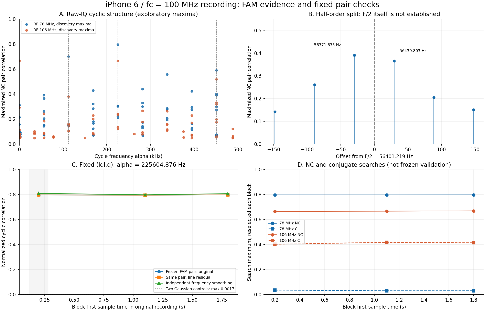
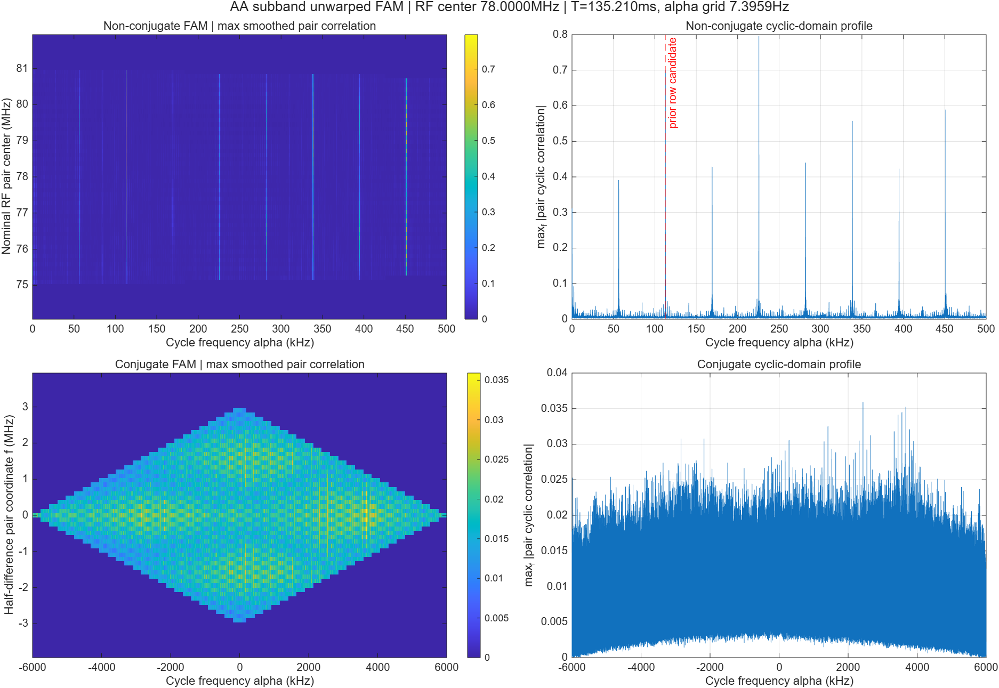
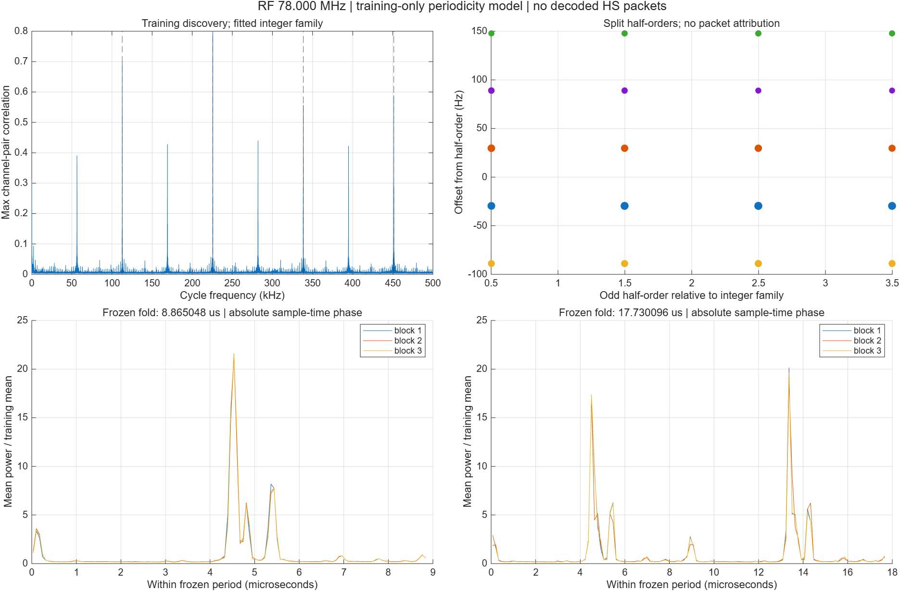

# iPhone 6 · 100 MHz 녹음본 FAM 주기성 분석

100 MHz 중심주파수 녹음본의 연속 IQ에서 FAM으로 약 112.802438 kHz의 정수 고조파군을 찾았다. 대응 방사 주기는 8.865057 µs이다. 이 주기는 HS/row 후보로 사용할 수 있지만 packet 자체를 식별한 결과는 아니다.

RF 78 MHz 주변에서 alpha=225604.875755 Hz의 (k,l,q)를 block 1에서 선택한 뒤 고정했다. 원본 정규화 순환상관은 B1/B2/B3에서 0.796319 / 0.795151 / 0.796854이다. 뒤의 block에서 최대값을 다시 찾은 수치와 구분된다.

## 1. 실제 사용한 데이터와 처리

원본 Fs=124.0828 MS/s, 기록의 nominal fc=100 MHz, 사용자가 보고한 수신 BW=120 MHz. 저장 형식은 big-endian int16 I,Q이며 I−jQ RF 부호 가설을 사용했다. discovery block 평균 DC를 모든 block에 동일하게 빼고, 절대 원본 sample index를 기준으로 DDC했다. 원본 신호에는 CFO 보정·fractional timing warp·frame 정렬을 적용하지 않았다. MATLAB resample(x,1,16,32,8)로 anti-alias 필터링 후 16분주하여 Fs=7.755175 MS/s로 분석했다. 이 단계는 분석 대역을 줄이는 일정 비율 변환이며, 샘플 클록 오차 추정에 의한 fractional timing 보정이 아니다.

native coarse FAM으로 탐색한 뒤 RF 78 MHz 주변을 정밀 분석하고 RF 106 MHz 구간을 비교했다. 각 정밀 분석은 M=32, L=8, P=131072, symmetric Hamming channel window, rectangular slow-time window, zero padding 없음이다. slow-time 관측 길이는 135.209844 ms이고 alpha FFT 간격은 7.395911 Hz다. retained 실제 IQ는 1,048,600 samples, 135.212938 ms이다. block 시작점은 0.2 / 1.1 / 1.8 s이며 filter guard는 소비 구간 밖에서 확보했다. NC와 C는 동일한 결합 규칙이 아니므로 분리해 계산했다.

NC는 D(k)·conj(D(l)), conjugate C는 D(k)·D(l)이다. 표시한 coherence는 유한 window로 평균한 channel-pair cyclic correlation의 정규화 크기이며 점별 population SCF coherence나 SNR이 아니다. discovery 그림은 주파수 쌍을 최대화한 탐색 통계다. 아래 검증표는 block 1에서 고정한 alpha,k,l,q를 block 2·3에서 다시 최적화하지 않고 직접 DTFT로 평가한 결과다.

## 2. 정수 고조파군과 반차수 분할

| order | alpha (Hz) | 1/alpha (µs) | 탐색 최대 NC | RF midpoint (MHz) |
| --- | --- | --- | --- | --- |
| 1 | 112802.437878 | 8.865057 | 0.699455 | 79.211746 |
| 2 | 225604.875755 | 4.432528 | 0.796319 | 79.575270 |
| 3 | 338407.313633 | 2.955019 | 0.557054 | 79.332921 |
| 4 | 451209.751511 | 2.216264 | 0.588612 | 79.454095 |

F/2=56401.218939 Hz 근방의 주요 피크는 56371.635294, 56430.802584 Hz로 분리되어 있다. 즉 F/2 ±29.583645 Hz이고 간격은 59.167290 Hz다. 56.4 kHz를 단독 기본 packet 주파수라고 확정할 수 없다. 약 60 Hz 변조 가능성은 있지만 FFT 간격 7.395911 Hz에서 관측한 59.167290 Hz를 정확한 frame rate로 해석하면 안 된다.

## 3. 고정된 후보의 확인

RF 78 MHz 주변에서 alpha=225604.875755 Hz의 (k,l,q)를 block 1에서 선택한 뒤 고정했다. 원본 정규화 순환상관은 B1/B2/B3에서 0.796319 / 0.795151 / 0.796854이다. 뒤의 block에서 최대값을 다시 찾은 수치와 구분된다.

독립 구현의 frequency-smoothed cyclic periodogram(FSM)은 고정된 physical f,alpha에서 별도 smoothing kernel을 사용한다. FAM과 크기가 같아야 하는 검증은 아니다. line projection은 block 1 DFT의 상위 8개 peak group(±2 bins)을 고정하고 각 block에서 계수만 투영한 진단이다. 유용한 화면의 결정론적 성분도 제거될 수 있으므로 이를 곧바로 clutter 제거 성능으로 부르지 않는다. 두 proper colored Gaussian 대조군은 배경색과 전력을 근사한 sanity reference이며 다중 탐색의 유의수준이나 오경보 확률을 보정한 검정이 아니다.

이번 선 성분 투영으로 제거한 power 비율은 78 MHz에서 0.1580–0.1634%, 106 MHz에서 19.2984–19.7339%다. 78 MHz의 2F 고정 후보는 line 잔차에서 0.796320 / 0.795150 / 0.796853로 유지됐다. 반면 106 MHz의 저주파 후보 59.167290 Hz는 원본 0.665491 / 0.660217 / 0.663330에서 잔차 0.340970 / 0.336513 / 0.317813로 변했다. 이는 선택한 40개 DFT bin에 대한 조건부 진단이며 모든 tone 또는 driver clutter를 제거했다는 뜻은 아니다.

### RF 78 MHz

| # | alpha (Hz) | RF midpoint (MHz) | k,l,q | 원본 B1/B2/B3 | line 잔차 B1/B2/B3 | FSM B1/B2/B3 | Gaussian 최대 | power gate B1/B2/B3 |
| --- | --- | --- | --- | --- | --- | --- | --- | --- |
| 1 | 225604.875755 | 79.575270 | 7,6,-2264 | 0.796319 / 0.795151 / 0.796854 | 0.796320 / 0.795150 / 0.796853 | 0.809049 / 0.797581 / 0.806749 | 0.001668 | yes/yes/yes |
| 2 | 112802.437878 | 79.211746 | 5,5,15252 | 0.699455 / 0.700133 / 0.697242 | 0.699457 / 0.700135 / 0.697243 | 0.783757 / 0.780454 / 0.773718 | 0.005049 | yes/yes/yes |
| 3 | 451209.751511 | 79.454095 | 7,5,-4528 | 0.588612 / 0.593509 / 0.592673 | 0.588613 / 0.593507 / 0.592674 | 0.607717 / 0.599474 / 0.603939 | 0.003368 | yes/yes/yes |
| 4 | 338407.313633 | 79.332921 | 6,5,12988 | 0.557054 / 0.559671 / 0.558292 | 0.557055 / 0.559673 / 0.558292 | 0.599908 / 0.596007 / 0.590045 | 0.002230 | yes/yes/yes |
| 5 | 281976.511049 | 76.424730 | -6,-7,5358 | 0.439918 / 0.433799 / 0.440684 | 0.439914 / 0.433802 / 0.440687 | 0.424191 / 0.414786 / 0.434099 | 0.003041 | yes/yes/yes |
| 6 | 169174.073172 | 76.424730 | -6,-7,-9894 | 0.428048 / 0.423262 / 0.431803 | 0.428049 / 0.423266 / 0.431806 | 0.450943 / 0.437550 / 0.464199 | 0.003688 | yes/yes/yes |

### RF 106 MHz

| # | alpha (Hz) | RF midpoint (MHz) | k,l,q | 원본 B1/B2/B3 | line 잔차 B1/B2/B3 | FSM B1/B2/B3 | Gaussian 최대 | power gate B1/B2/B3 |
| --- | --- | --- | --- | --- | --- | --- | --- | --- |
| 1 | 59.167290 | 103.818857 | -9,-9,8 | 0.665491 / 0.660217 / 0.663330 | 0.340970 / 0.336513 / 0.317813 | 0.647004 / 0.638235 / 0.633929 | 0.007524 | yes/yes/yes |
| 2 | 225604.875755 | 105.636476 | -1,-2,-2264 | 0.664371 / 0.663310 / 0.668824 | 0.664505 / 0.663468 / 0.668967 | 0.666547 / 0.650746 / 0.688196 | 0.005245 | yes/yes/yes |
| 3 | 451209.751511 | 108.665841 | 12,10,-4528 | 0.518130 / 0.521293 / 0.523242 | 0.518206 / 0.521399 / 0.523374 | 0.504550 / 0.502999 / 0.511112 | 0.003361 | yes/yes/yes |
| 4 | 112802.437878 | 106.000000 | 0,0,15252 | 0.379810 / 0.383785 / 0.381087 | 0.379833 / 0.383830 / 0.381111 | 0.413260 / 0.417710 / 0.423842 | 0.003904 | yes/yes/yes |
| 5 | 281976.511049 | 107.332921 | 6,5,5358 | 0.265761 / 0.266535 / 0.271502 | 0.265803 / 0.266584 / 0.271548 | 0.297231 / 0.290393 / 0.291356 | 0.005726 | yes/yes/yes |
| 6 | 338407.313633 | 103.818857 | -8,-10,-19780 | 0.263052 / 0.278690 / 0.262634 | 0.170130 / 0.192530 / 0.165388 | 0.241544 / 0.291736 / 0.305513 | 0.005386 | yes/yes/yes |

### 선 성분 투영 진단

| RF MHz | block | start s | 투영 power % | discovery replay 최대 절대 오차 |
| --- | --- | --- | --- | --- |
| 78 | 1 | 0.2 | 0.1634 | 0.000000000000 |
| 78 | 2 | 1.1 | 0.1596 | 0.000000000000 |
| 78 | 3 | 1.8 | 0.1580 | 0.000000000000 |
| 106 | 1 | 0.2 | 19.2984 | 0.000000000000 |
| 106 | 2 | 1.1 | 19.7339 | 0.000000000000 |
| 106 | 3 | 1.8 | 19.6211 | 0.000000000000 |

## 4. 주기적 파형과 위상

folding 주파수는 block 1에서만 선택했다. 78 MHz 구간은 FAM family seed 112802.437878 Hz 주변 ±0.5 alpha bin에서 mean-subtracted |IQ|²의 Hann-weighted DTFT 크기를 최적화하여 112802.550197 Hz를 사용했다. 이는 cyclic-power가 같은 기본 주기를 공유한다는 가정 아래의 sub-bin 추정이며 통계적 신뢰구간이 아니다. 이후 block은 이 값을 고정하고 원본 absolute sample-time phase로 접었다. F/2의 두 배 길이 folding은 비교 가설이다. display-only circular alignment 그림은 시각 비교용이며 검증에는 사용하지 않았다.

78 MHz의 8.865048 µs power fold는 시간축 재정렬 없이 block 2·3에서 training 파형과 0.997428219, 0.998714016의 상관을 보였다. 두 구간 모두 display-only 최적 shift도 0 bin이었다. 따라서 이 대역은 현재 고정 주기 기반 반복 구간 추출에 유망하다. 106 MHz를 별도로 최적화한 주파수에서는 unaligned 상관이 -0.224586, -0.055537이므로 같은 phase 안정성을 주장하지 않는다. 이후 shift를 맞춰 그림이 유사해지는 것과 원본 시간축에서 일치하는 것은 다른 결과다.

| RF MHz | block | period multiplier | period µs | unaligned fold correlation | fold modulation RMS / mean | display-only shift bins |
| --- | --- | --- | --- | --- | --- | --- |
| 78 | 1 | 1 | 8.865048 | 1.000000 | 2.789335 | 0 |
| 78 | 1 | 2 | 17.730096 | 1.000000 | 2.646834 | 0 |
| 78 | 2 | 1 | 8.865048 | 0.997428 | 2.734318 | 0 |
| 78 | 2 | 2 | 17.730096 | 0.967550 | 2.560876 | 64 |
| 78 | 3 | 1 | 8.865048 | 0.998714 | 2.831914 | 0 |
| 78 | 3 | 2 | 17.730096 | 0.999201 | 2.656094 | 0 |
| 106 | 1 | 1 | 8.865020 | 1.000000 | 0.955571 | 0 |
| 106 | 1 | 2 | 17.730040 | 1.000000 | 0.944299 | 0 |
| 106 | 2 | 1 | 8.865020 | -0.224586 | 0.935607 | -41 |
| 106 | 2 | 2 | 17.730040 | -0.229325 | 0.926083 | 43 |
| 106 | 3 | 1 | 8.865020 | -0.055537 | 0.952250 | 55 |
| 106 | 3 | 2 | 17.730040 | -0.054866 | 0.941792 | -37 |

아래 위상은 고정된 순환계수의 각도다. 순간 IQ carrier phase나 복원 RGB hue가 아니다. local 위상은 각 retained block 첫 sample을 0초로 두며, epoch 위상은 exp(−j2παt_start)를 곱해 원본 녹음 시작을 기준으로 표시했다. alpha의 FFT 양자화 오차만으로도 떨어진 block 사이 위상이 회전할 수 있으므로 위상 변화만으로 CFO 또는 clock drift를 단정하지 않는다.

| RF MHz | block | alpha Hz | local phase rad | epoch phase rad |
| --- | --- | --- | --- | --- |
| 78 | 1 | 225604.875755 | -0.410461 | -0.254330 |
| 78 | 2 | 225604.875755 | -2.980928 | 1.019382 |
| 78 | 3 | 225604.875755 | 0.594654 | 1.999828 |
| 106 | 1 | 225604.875755 | -0.332746 | -0.176615 |
| 106 | 2 | 225604.875755 | -2.906770 | 1.093540 |
| 106 | 3 | 225604.875755 | 0.670016 | 2.075191 |

## 5. 해석 범위와 다음 단계

현재 얻은 것은 실제 녹음에서 재현되는 방사 주기와 고조파·분할 sideband 구조다. 다음 단계에서는 이 주기로 원본 IQ의 반복 구간을 추출해 burst 시작/끝, 반복 header 후보, 패턴 전환 시 변화를 확인해야 한다. 알려진 SoT/packet header/ECC와 맞는 증거가 생기기 전에는 MIPI HS packet clock, lane 수, byte rate, DDR clock 또는 pixel clock으로 이름 붙이지 않는다.

- packet/SoT/header/ECC를 decode하지 않았다. 패널 driver 방사와 DSI packet 방사를 아직 구별하지 않았다.
- 분리된 세 block은 같은 파일 안의 확인 구간이다. 전체 녹음을 전혀 본 적 없는 독립 수집 데이터라는 뜻은 아니다.
- 반복 tone 사이 차주파수도 NC cyclic peak를 만들 수 있다. 강한 peak만으로 AM/PM payload 변조를 증명하지 못한다.
- conjugate peak는 RF 106 MHz 구간에서 강하지만 tone, 비원형성 또는 IQ 불균형도 설명 후보다. NC 후보의 검증을 C에 그대로 적용했다고 주장하지 않는다.
- AA decimation은 정보나 해상도를 생성하지 않는다. 이번 출력은 영상 복원·stitching 성공 판정이 아니다.

## 재현 파일

- 검증 수치: [validation_v2/validation.json](validation_v2/validation.json)
- 주기 모델: [periodicity/summary.json](periodicity/summary.json)
- 수치 요약: [RESULTS_SUMMARY.json](RESULTS_SUMMARY.json)
- 실제 계산: MATLAB R2026b, Signal Processing Toolbox resample/pwelch + 공개된 FAM MATLAB 구현. Wavelet 변환은 이번 FAM 추정에 사용하지 않았다.
- 방법 출처: [CSP Estimators: The FFT Accumulation Method](https://cyclostationary.blog/2018/06/01/csp-estimators-the-fft-accumulation-method/) (알고리즘 참고; 위 숫자는 이 녹음본의 실행 결과).
