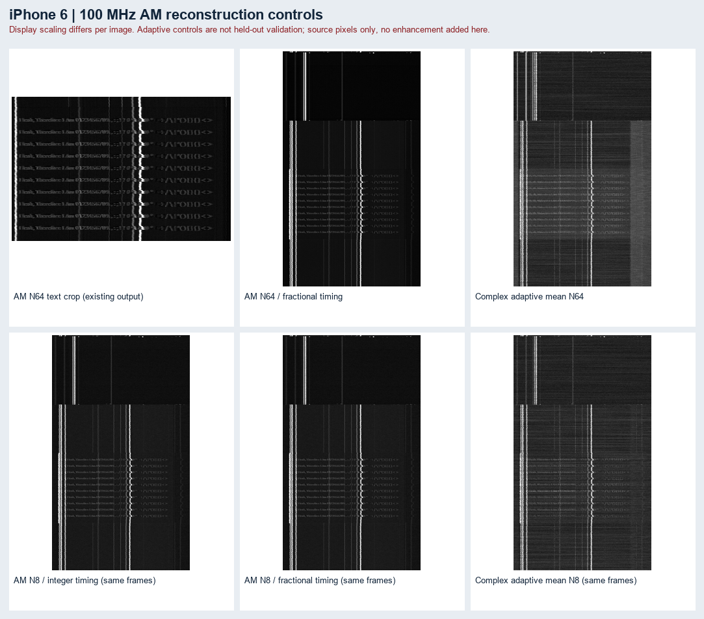
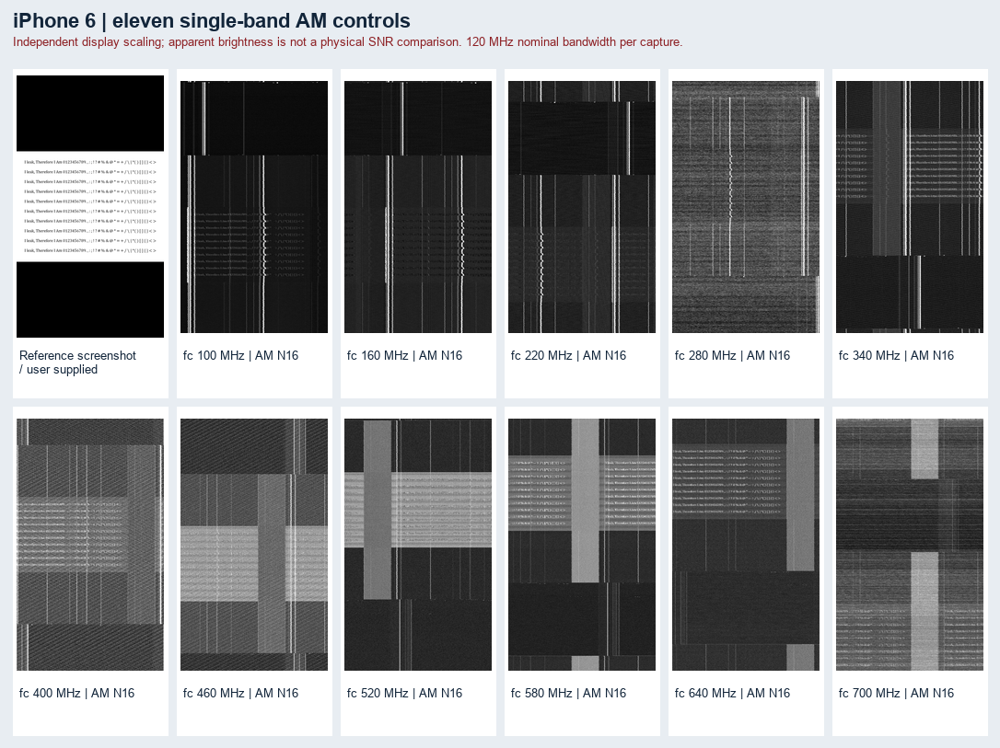
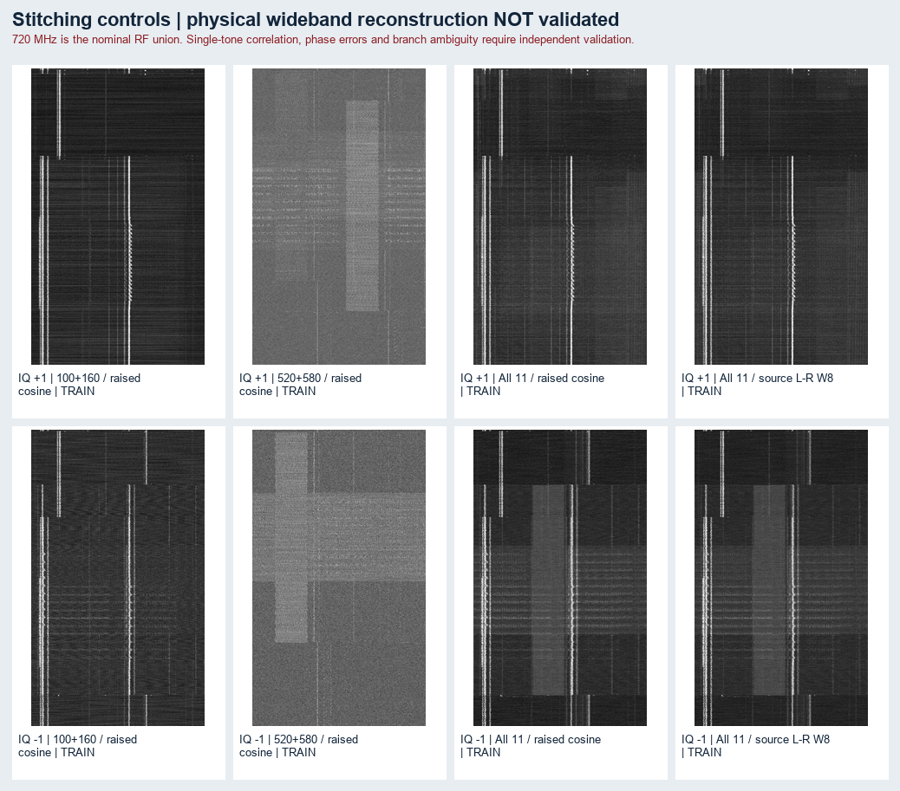
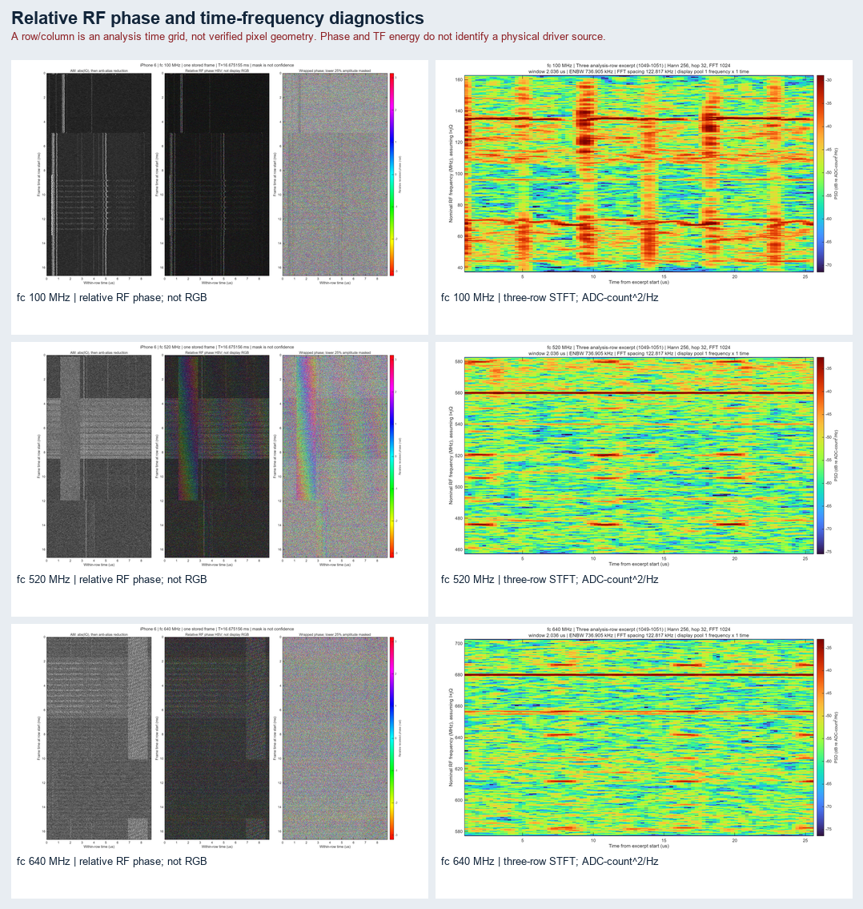

# iPhone 6: 11개 수신 대역의 화면 복원과 stitching 실험

작성일: 2026-10-23. 본문은 완료된 MATLAB 실행과 저장된 수치·이미지에 대한 연구 결과다. 배포·업로드 상태는 마지막 절에 별도로 기록한다.

**[오프라인 갤러리 열기](gallery/index.html) · [Git용 작은 미리보기4장](gallery/README.md)**

갤러리에서 원본, 11개 단일 대역, frame 수의 변화, 같은 N8 비교, 두 IQ 부호·두 crossover의 training/held-out, 단일 frame 대조, 위상·STFT를 선택해 볼 수 있다. 전체 해상도 PNG/MAT는 release bundle 및 로컬 결과 폴더의 자료다. 이 문서에서 전체 해상도 파일을 가리키는 링크는 해당 bundle을 같은 디렉터리 구조로 풀었을 때 사용하며 Git에서는 작은 gallery PNG4장을 미리보기로 제공한다.

## 1. 확인한 결과

- **100 MHz AM64에서 사용자가 표시한 반복 문장·숫자의 형태가 보인다.** 11개 대역의 AM16, 100/340/520 MHz의 N1/4/8/16/32/64 화면을 저장했다. 문자열 전체를 정확하게 판독하거나 pixel을 정량적으로 복원했다고 주장하지 않는다.
- **인접10쌍과 전체11개 등의 합성 출력은 생성했지만, 720 MHz 전체를 잇는 유효한 광대역 위상·지연 정렬은 확인하지 못했다.** 두 IQ 부호와 원문 L-R W8/raised cosine을 모두 계산했다.
- 양의 IQ 520–580 MHz에서 held-out coherence는 **0.901849**였지만, training 상위10 bins와 ±8 neighbors를 고정 제거하자 **0.000865**로 내려갔다. 기존 높은 값은 좁은 spectral 성분에 지배되었다. 이 결과를 광대역 stitching 성공으로 취급할 수 없다.
- 100/520/640 MHz의 상대 RF 위상과 두 시간척도의 STFT를 생성했다. **HSV는 수신 위상 표현이며 원본 RGB 복원이 아니다.** 세로 성분의 회로 기원은 아직 구분되지 않는다.

이번 결과는 현재의 주기 template·단일 delay/phase overlap 모델에 대한 실험이다. 모든 stitching 방법의 가능성을 배제하지 않는다. Raw RF 주파수/clock 보정, 실제 overlap의 주파수별 coherence, 여러 방사원의 분리 및 더 짧은 안정 구간은 후속 검증 대상으로 남는다.

## 2. 수집 조건과 원시 파일

| 항목 | 값과 근거 |
|---|---|
| 장치 / 표시 화면 | iPhone 6 / 사용자 제공 750×1334 screenshot |
| 수신기 | NI USRP-2940R, 사용자 진술 |
| RF 순간 대역폭 | 120 MHz, 사용자 진술; 실제 필터 readback 미확인 |
| 저장 complex IQ sample rate | **124.0828 MS/s**, 사용자 제공 값 |
| 수집 방법 | 프로브, 전화기·프로브 clamp 고정, 외부 LNA/BPF 없음 |
| RF 중심 | 100,160,220,280,340,400,460,520,580,640,700 MHz |
| 중심 이동 / 명목 overlap | 60 MHz / 60 MHz = 50% |
| 명목 합성 RF 구간 | **40–760 MHz**, 폭 **720 MHz** |
| 인접 2개 조합 | 10쌍, 각 명목 폭 **180 MHz** |
| 읽기 형식 | big-endian signed int16, I/Q interleaved, header 0 가정 |
| 분석 complex 부호 | I+jQ와 I−jQ 모두 실행; 하드웨어 spectrum polarity는 미확인 |
| 원본 무결성 | 11개 전체 파일 SHA-256 완료, 합계11,107,800,000 bytes |

| fc (MHz) | 명목 RF 구간 (MHz) | 길이 (s) |
|---:|---:|---:|
| 100 | 40–160 | 2.334 |
| 160 | 100–220 | 2.633 |
| 220 | 160–280 | 2.334 |
| 280 | 220–340 | 1.915 |
| 340 | 280–400 | 2.094 |
| 400 | 340–460 | 1.795 |
| 460 | 400–520 | 1.975 |
| 520 | 460–580 | 1.436 |
| 580 | 520–640 | 1.735 |
| 640 | 580–700 | 2.035 |
| 700 | 640–760 | 2.094 |

위 표의 열은 순서대로 **중심주파수(MHz) / 명목 RF 구간(MHz) / 기록 길이(s)**다. 파일 수정 시각은 다운로드·복사 시각일 수 있어 실제 수집 순서를 대신하지 않는다. 수신 gain, clock reference, overflow/drop count 및 acquisition timestamp는 현재 메타데이터에서 미확인이다.

전체 파일 경로·바이트 수·SHA·Fs 근거: [CAPTURE_INVENTORY.json](../../knowledge/stitching/iphone6_sweep_20261023/CAPTURE_INVENTORY.json).

120 MHz는 RF 폭, 124.0828 MS/s는 저장 IQ률, 600 MHz는 중심 이동 범위, 720 MHz는 명목 합성 폭이다. 서로 다른 수치다. 실제 usable overlap은 수신 passband를 확인한 뒤 더 좁아질 수 있다.

## 3. 원문 검토와 구현 방법

첨부 *Chapter5_Stitching multiple narrowband recording into a single wideband_Exploiting quasiperiodic electromagnetic.pdf*의 **15쪽 전체**를 읽었다. 원본 논문의 **109–123쪽**과 텍스트가 모두 일치한다. §5.2 stitching은 완전하게 포함돼 있고 §5.3은 Eq.5.43 뒤에서 잘린다. 수식·그림 11쪽을 렌더와 대조했다. 첨부 전체 SHA-256은 fa3a41d10f8897d62298a19303829bf5ec406b72fde348765db98e92271f98f0이다.

원문 기본 순서:

1. 필요한 경우 시간/위상 정렬 후 complex periodic averaging.
2. 공통 sample rate로 resampling.
3. RF 상대 위치를 보존해 주파수 이동.
4. overlap의 복소 상관으로 delay와 phase 추정.
5. complementary crossover weighting 후 합산.
6. 최종 합성 신호를 baseband로 이동하고 영상으로 표시.

구현에서 명시한 수정/확장:

- Eq.5.17의 FFT 상관 convention에 맞춰 **양의 lag d는 입력을 n+d에서 읽는 방향**으로 통일했다. 원문 Eq.5.20과 부호를 무비판적으로 섞지 않았다.
- 첫 band는 기준으로 직접 초기화한다. 영 신호와 상관하지 않는다.
- 120 MHz를 보존하기 위해 guard가 있는 4배 FFT 보간과 6-point Lagrange interpolation을 검증했다. 실제 데이터의 512/1024-sample guard 대조도 기록한다.
- fractional delay, frame-period 오차, phase slope 및 modulo-frame-rate integer branch는 원문 §5.2에 없는 추가 검증 항목으로 구분한다.
- 원문 L-R W=8과 overlap 안에 support를 제한한 raised-cosine weighting은 별도 결과로 비교한다. **W=8이라도 비overlap 감쇠가 남을 수 있다.**
- FFT로 한 주기를 처리하는 방법은 complex waveform의 반복성이 확인돼야 유효하다. 주기 template를 만들었다는 사실만으로 실제 coherent 성분을 얻었다고 보지 않는다.

상세: [원문 알고리즘 감사](../../knowledge/stitching/iphone6_sweep_20261023/CHAPTER_ALGORITHM_AUDIT.md) · [주기 template의 harmonic-bin 매핑](../../knowledge/stitching/iphone6_sweep_20261023/PERIODIC_TEMPLATE_HARMONIC_MAP.md) · [구현 검토와 branch 탐색](../../knowledge/stitching/iphone6_sweep_20261023/TEMPLATE_BUILDER_REVIEW.md).

### 완료된 수학·구현 검사 — 단위검사35개와 sampler tone24건 모두 통과

| 검사 | 현재 결과 | 검증 범위 |
|---|---|---|
| fractional sampler | 24개 tone/affine case 통과, unit complex tone 최대 오차 약8.90×10⁻⁴ | ±60 MHz tone, fractional 위치, affine 위치 변화; 임의 실측파형 오차의 보증은 아님 |
| overlap alignment | 11개 test 통과 | 양/음/0 fractional delay, phase, wrap, held-out phase 보존, 단일 tone ambiguity 등 |
| band synthesis | 8개 test 통과 | 정규화, pair/11-band coverage, L-R 감쇠, 비연결 support 거부 등 |
| AM downsampling | 10개 test 통과 | DC/저주파 유지, alias 억제, Nyquist 처리 등 |
| Integer branch 탐색 | 6개 test 통과 | 양/음 branch, held-out 불개입, 경계 경고, nominal 후보 포함 등 |

[Sampler 검사](sampler_verification.json) · [Alignment 검사](alignment_verification.json) · [Synthesis 검사](synthesis_verification.json) · [AM antialias 검사](antialias_verification.json) · [Branch 검사](branch_verification.json).

이는 synthetic 수치 검사다. 실제 스마트폰 stitching의 성공률이나 복원 SNR을 뜻하지 않는다.

## 4. 초기 진단과 raster 시간축

100 MHz envelope 자기상관에서:

- row 후보: **1099.999800 samples**, 약112802.566 Hz.
- frame 후보: **2069099.855411 samples**, 약59.969460 Hz.
- frame/row 비: 약**1881.00021**.

이에 따라 첫 대조에서는 **1100 columns ×1881 rows**, 2,069,100 input samples/frame의 정수 raster를 사용했다. 1/4/16프레임 AM과 프레임별 global phase를 독립적으로 맞춘 complex 평균을 저장했다. 후자는 descriptive control이며 held-out 검증 결과가 아니다.

[진단 CSV](diagnostics/overview.csv) · [진단 상세](diagnostics/overview.json) · [정수 raster 대조 설정](integer_controls/overview.json).

이 격자에서 입력 한 sample은 **8.05913 ns**, 1100 samples는 **8.86505 µs**, 2,069,100 samples는 **16.67516 ms**다. **1100 raster columns가 1100개의 실제 LCD pixel이라는 뜻은 아니다.** 원본 screenshot의 가로750 pixel과 나눠서1100/750을 samples/pixel로 확정할 수 없다. MIPI burst/blanking/packet 시간과 active-pixel mapping이 먼저 확인돼야 한다.

다른 band의 초기 자기상관 최댓값은 서로 다른 row/frame 후보를 선택하기도 했다. 강한 주기 간섭이 포함되므로 각 band의 가장 높은 peak를 물리적인 panel timing으로 자동 채택하지 않는다.

## 5. 실제 프레임 반복성과 시간 모델

동일 기준 raw frame에 대해 복소·AM의 delay를 각각 ±64 samples에서 탐색했다. **0–7번 프레임**으로 delay 대 frame-index 직선을 fit하고, **16–23번 프레임**의 delay에 대해 예측 잔차를 계산했다.

아래 상관값은 평가 프레임에서 delay를 개별 탐색한 값의 평균이다. 모델을 고정한 waveform prediction score와 다르며, 같은 수치를 “검증 상관”으로 혼동하지 않는다.

| fc (MHz) | 평가 AM 상관 | 평가 complex 상관 | complex train delay RMS (samples) | complex test delay 예측 RMS (samples) |
|---:|---:|---:|---:|---:|
| 100 | 0.381 | 0.022 | 14.86 | 24.36 |
| 160 | 0.267 | 0.159 | 29.34 | 46.32 |
| 220 | 0.239 | 0.243 | 16.84 | 39.56 |
| 280 | 0.097 | 0.025 | 7.61 | 10.78 |
| 340 | 0.202 | 0.095 | 27.34 | 175.91 |
| 400 | 0.110 | 0.089 | 16.92 | 24.17 |
| 460 | 0.175 | 0.190 | 12.48 | 31.93 |
| 520 | 0.318 | 0.482 | 22.73 | 41.16 |
| 580 | 0.297 | 0.429 | 19.46 | 27.43 |
| 640 | 0.175 | 0.532 | 21.27 | 43.88 |
| 700 | 0.122 | 0.092 | 8.04 | 9.70 |

[시간 모델 원수치](timing_model/overview.csv) · [100 MHz 상세](timing_model/fc100MHz.json).

100 MHz의 AM delay fit은 훈련 잔차0.227 samples, 평가 예측 잔차0.866 samples였지만, complex fit은 각각14.864와24.361 samples였다. **AM 영상에서 반복 텍스트가 보이는 것과 넓은 대역의 복소 파형을 하나의 위상·지연으로 재현하는 것은 다른 조건**임을 보여준다.

520/580/640 MHz는 이 탐색의 complex 상관이 상대적으로 높지만 지연 회귀 잔차는 여전히 여러 sample이다. 상관 증가만으로 해당 성분이 텍스트를 운반하거나 full-band stitching 기준으로 적합하다고 결론내리지 않는다.

### 고정 모델 template의 100 MHz 결과

완료된100 MHz template에서는 훈련 AM delay로 얻은 period **2069099.867003 samples**를 사용하고, 훈련0–7프레임의 위상 모델을 평가16–23프레임에 그대로 적용했다. 평가 구간의 시간·위상은 다시 fit하지 않았다.

| 지표 | 값 |
|---|---:|
| 훈련 phase residual RMS | 1.412 rad |
| 평가 phase residual RMS | 1.903 rad |
| train/test complex template coherence | 0.006834 |
| 평가 상대 위상 잔차 | −0.7413 rad |
| normalized complex prediction error | 1.41425 |
| 512/1024 guard 대조 relative RMS | 7.44×10⁻⁵ |

[100 MHz template 수치](templates/fc100MHz/metadata.json) · [AM/complex/held-out 비교](templates/fc100MHz/comparison.png).

보간 guard 차이는 작지만 예측된 complex template의 재현성은 낮다. 따라서 이 template를 검증된 coherent wideband 성분으로 취급하지 않는다. 원인 분리가 남아 있으며 이 결과만으로 새로운 주파수·시간 모델의 가능성을 배제하지 않는다.

## 6. 64프레임 AM와 같은 N8 대조

100/340/520 MHz에서 N1/4/8/16/32/64를 계산했다. AM은 frame별 envelope delay를 추정하고, complex adaptive 대조는 그 timing 위에 frame별 global phase를 추정한다. 각 frame은 그 frame의 추정에도 사용되므로 **독립 held-out 평가가 아니다.**

| fc(MHz) | 사용 period(input samples) | 64 frames의 median AM 상관 | median complex 상관 |
|---:|---:|---:|---:|
| 100 | 2069099.867003 | 0.383595 | 0.012608 |
| 340 | 2069100.055899 | 0.206884 | 0.078281 |
| 520 | 2069100.000000 | 0.301822 | 0.430795 |

[AM refinement 설정](am_refinement/overview.json) · [100 MHz frame log](am_refinement/fc100MHz/frame_log.csv) · [Frame 수에 따른 화면](gallery/index.html#growth).

N8 integer AM과 N64 fractional AM만 비교하면 frame 수, timing, 보간, 표시 scaling이 함께 달라진다. 이를 구분하려고 **같은 source frames0–7, 같은 fixed complex DC, 둘 다 명시적 anti-alias reduction**을 적용한 integer N8/fractional N8을 만들었다. Fractional 쪽은 envelope delay 추적도 포함하므로 같은 N8 비교도 보간기 하나만의 효과가 아니라 timing 모델을 포함한 대조다. 별도 N64 high-pass는 표시용 enhancement이며 RF 복원 개선으로 합산하지 않는다.

## 7. 인접 overlap와 전체 합성 결과

훈련0–7 frames의 complex template로 각 인접 쌍의 **integer branch −16…+16 전부**를 complex overlap의 coarse correlation로 탐색했다. 상위 후보와 nominal 후보를 fractional delay로 refine하고 training score로 선택했다. 평가16–23 frames는 branch/delay/phase 선택에 사용하지 않았다. 기하학적 overlap에서는 양쪽 band의3 MHz edge guard를 제외했다.

### 두 IQ 부호의 실제 정렬 지표

| 인접 fc (MHz) | +IQ held-out ρ | +IQ 유효 bins | +IQ phase(rad) | −IQ held-out ρ | −IQ 유효 bins | −IQ phase(rad) |
|---|---:|---:|---:|---:|---:|---:|
| 100–160 | 0.001370 | 23711.81 | 0.845 | 0.002130 | 53206.49 | 2.737 |
| 160–220 | 0.001633 | 276685.65 | 1.146 | 0.750204 | 1.73 | 1.174 |
| 220–280 | 0.001345 | 3175.87 | 2.699 | 0.002580 | 65515.76 | 2.485 |
| 280–340 | 0.010717 | 4117.50 | -1.940 | 0.109095 | 513.80 | 1.434 |
| 340–400 | 0.001395 | 50304.31 | -0.280 | 0.083669 | 1578.01 | -0.276 |
| 400–460 | 0.001259 | 396552.05 | 2.543 | 0.436075 | 7.95 | -2.189 |
| 460–520 | 0.000264 | 115600.94 | -1.150 | 0.016576 | 338.29 | -2.102 |
| 520–580 | 0.901849 | 1.11 | -1.782 | 0.053281 | 1884.27 | -0.567 |
| 580–640 | 0.002363 | 122404.81 | 2.010 | 0.890552 | 1.30 | -1.065 |
| 640–700 | 0.000605 | 11396.80 | -0.717 | 0.087914 | 877.07 | 2.894 |

ρ는 unit-gain complex coherence의 크기, phase는 training 보정을 고정 적용한 held-out 교차 위상이다. 유효 bins는 training cross-magnitude w의 (Σw)²/Σw²다. 낮은 coherence의 phase를 안정적인 물리량으로 해석할 수 없다.

양의 IQ에서는10개 중5개가 integer-branch ambiguity,8개가 competing delay peak,1개가 유효 bins<8 경고를 보였다. 음의 IQ에서는 각각0개,6개,3개였다. 두 부호 모두 선택 branch가 ±16 경계에 도달한 경우는0개다. **경계에 닿지 않았다는 사실은 clock 모델 또는 방사원이 맞다는 검증이 아니다.** [Gallery의20-edge 표](gallery/index.html#quality)와 각 pair의 alignment.json에 모든 수치를 기록했다.

### 약12-bin 오프셋: clock/주파수 보정 후보

음의 IQ에서 많은 선택 결과가 −12 또는 −11 bins에 모인다. 이 격자에서12 bins는 약**719.63 Hz**,60 MHz 이동 대비 크기는 약**11.99 ppm**이다. 이는 LO step·sample-clock scale·Floquet branch convention을 점검할 **보정 후보**다. **실측 sample rate를 새로 측정한 결과가 아니며**, 보고된124.0828 MS/s를 이 값만으로 변경하지 않았다. 오프셋 부호를 clock 보정 부호로 곧바로 바꾸지 않고 수신기의 clock/LO readback과 알려진 RF tone으로 확인해야 한다. 높은 점수를 만든 tone 자체의 잘못된 대응도 먼저 배제해야 한다.

### 합성 출력과 제한

인접10쌍 및100–220/100–400/400–700/100–700 MHz 중심의 연속그룹을 두 IQ 부호·두 weighting으로 생성했다. Training/held-out를 분리했다. **전체11개를 연결하는 검증된 물리적 coherent chain은 없다.** 아래 full11 상관은 생성된 AM 영상의 반복성 수치이며 원본 대비 복원 정확도·SNR·유효720 MHz의 증거가 아니다.

| IQ | Weighting | AM train/test 상관 | 출력 계산 격자(MS/s) | 최소 coefficient weight sum |
|---:|---|---:|---:|---:|
| +1 | raised_cosine | 0.573361 | 2012.241 | 1.000000 |
| +1 | paper_lr_w8 | 0.578517 | 2012.241 | 0.525902 |
| -1 | raised_cosine | 0.550715 | 2012.241 | 1.000000 |
| -1 | paper_lr_w8 | 0.544139 | 2012.241 | 0.702867 |

원문 L-R 응답은 Fs_filter=2B에서 평가하고 power-of-two Fourier 합성 격자에 배치했다. 전체 출력 계산률 약2012.241 MS/s는 **수신률124.0828 MS/s 또는 실제 확보한 정보 대역폭이 아니다.** L-R은 없는 band의 coefficient 감쇠를 보존했다. Raised cosine은 support 안의 weight sum을1로 구성하고3 MHz guards를 적용하므로 두 방식의 support 조건도 다르다.

[부호·weighting·train/held-out 선택](gallery/index.html#stitch). 단일 대역에서 이미 보이던 글자가 합성에도 남는다는 사실만으로 추가 band 정보가 유효하게 결합됐다고 결론내리지 않는다.

## 8. 좁은 tone이 coherence를 지배하는지 확인한 결과

**20개 edge audit 완료, source 미완료0개, 실행 실패0개, masked refit 실패0개.** Training overlap의 abs(A·conj(B)) 상위10 **bins**와 각각±8 neighbors의 합집합을 선택했다. Guarded overlap 내부의 같은 global-bin mask를 양쪽 training/held-out full vectors에 적용했다. 이웃 최고 bins가 겹칠 수 있어 제거 수는170보다 작을 수 있다. Test에서 mask를 다시 선택하지 않았다.

저장된 delay/phase를 고정한 전후 결과를 먼저 비교했다. 이후 **기존 integer branch와 period를 유지한 채 masked training에서 delay/phase만 재fit**하고 held-out에 적용했다. 추가 CFO/branch 탐색이나 test fit은 없다.

| IQ / fc 쌍(MHz) | 원래 held-out ρ | 고정 보정+mask ρ | masked train 재fit→held-out ρ | Held-out 잔여 전력 A/B |
|---|---:|---:|---:|---:|
| +1 / 520–580 | 0.901849 | 0.000865 | 0.001051 | 8.16% / 8.66% |
| −1 / 160–220 | 0.750204 | 0.010046 | 0.004441 | 22.74% / 26.58% |
| −1 / 400–460 | 0.436075 | 0.121725 | 0.121726 | 73.34% / 50.74% |
| −1 / 580–640 | 0.890552 | 0.147592 | 0.227070 | 8.18% / 8.16% |

양의 IQ520–580 MHz에서는 가장 큰 training bin이 cross-magnitude의**94.7785%**를 차지했다. 유효 bins **1.113219**, 에너지5–95% 폭 **0 Hz**, 다른 periodic peak/첫 peak **0.999952**였다. Top10±8의 합집합76 bins를 제거한 뒤 유효 bins는**322648.23**,5–95% 폭은**48.602848 MHz**가 됐지만 held-out coherence는 거의 사라졌다. 원래 held-out phase 잔차**−1.782197 rad**, normalized complex error**1.375630**도 광대역 파형을 예측했다는 근거가 되지 않는다.

음의 IQ580–640 MHz에는 masking 후에도 일부 공통 성분이 남았다. Training 재fit 뒤 held-out coherence**0.227070**, residual phase**0.853721 rad**, normalized error**1.514159**다. 남은 성분을0이라고 단정하지 않으며, 이 결과로 전체11-band chain을 검증했다고도 보지 않는다. Audit은 spectral concentration 민감도 검사이며 제거한 tone의 회로 기원이나 무조건 비영상 clutter인지의 분류가 아니다.

[20-edge audit CSV](clutter_audit/overview.csv) · [설정/실행 JSON](clutter_audit/overview.json) · [전후 수치 표](gallery/index.html#quality).

## 9. Averaging과 θ 모델을 제외한 단일 frame 대조

평균과 fitted Floquet θ derotation이 overlap 정보를 잃게 했는지 확인하려고100–160,280–340,520–580 MHz를 두 부호로 다시 계산했다. SingleTrain frame0과 singleTest frame16을 사용했다. Nominal 상대 RF cycles를 integer+fractional 부분으로 나눠 주파수 이동하고 training의 branch/delay/phase를 test에 고정했다. 기존 timing resampling과 fixed training DC subtraction은 유지했다.

| fc 쌍(MHz) | IQ 부호 | Train ρ | Held-out ρ | 유효 bins | Held-out error |
|---|---:|---:|---:|---:|---:|
| 100–160 | +1 | 0.009266 | 0.001191 | 101346.29 | 1.326440 |
| 100–160 | −1 | 0.025691 | 0.011377 | 19099.84 | 1.345456 |
| 280–340 | +1 | 0.004937 | 0.003189 | 96249.25 | 1.083976 |
| 280–340 | −1 | 0.069526 | 0.080869 | 1170.18 | 1.414090 |
| 520–580 | +1 | 0.522425 | 0.518068 | 2.86 | 1.547535 |
| 520–580 | −1 | 0.297920 | 0.198222 | 440.33 | 1.518356 |

100–160 held-out coherence는 양의 IQ0.001191, 음의 IQ0.011377이다. 양의 IQ520–580은0.518068이지만 유효 bins2.86과 competing-peak ratio0.999849로 여전히 tone/지연 모호성에 취약하다. **현재 모델에서 averaging/θ 제거만으로 문제가 해결됐다는 결과는 없다.** Single-frame SNR, endpoint discontinuity와 finite periodic/circular-delay 근사도 달라져 averaging 하나의 인과효과로 해석하지 않는다.

[단일 frame 대조 CSV](single_frame_controls/overview.csv) · [모든 조건](single_frame_controls/overview.json) · [Training/held-out 화면6쌍](gallery/index.html#single-control).

## 10. 상대 위상, row/column 시간, STFT

100/520/640 MHz의 저장된 첫 training frame을 사용했다. 복소 I/Q를 anti-alias reduction한 뒤 상대 위상을 계산하고 amplitude 하위25%의 hue를 비활성화했다. 위상 기준은 각 band에서 amplitude75th percentile 이상인 첫 sample이다. 이는 **임의의 로컬 RF 위상 원점**이며 band 간 절대 위상 기준이 아니다. Mask 통과율75%는 신뢰도75%를 뜻하지 않는다.

| fc(MHz) | row 시간(µs) | 분석 시간 step(ns) | nearest 대 AA IQ phase 차이 RMS(rad) |
|---:|---:|---:|---:|
| 100 | 8.865048 | 8.059134 | 0.491225 |
| 520 | 8.865048 | 8.059135 | 0.654479 |
| 640 | 8.865048 | 8.059135 | 0.568542 |

위 phase 차이는 동일 위치의 nearest sampling 대조와 anti-aliased I/Q 사이의 wrapped difference RMS다. 필터/보간으로 표현이 변할 수 있다는 수치이며 물리적 위상 정확도·phase-noise 개선량이 아니다. AA(abs(IQ))와 abs(AA(I)+jAA(Q))는 비선형 abs 때문에 같지 않으므로 row1050의 두 amplitude/phase trace를 함께 저장했다.

| STFT 범위 | Hann window / hop / FFT | Window 시간 | ENBW | FFT bin spacing |
|---|---|---:|---:|---:|
| 3개 분석 row(1049–1051) | 256 /32 /1024 | 약2.03554 µs | 약736.905 kHz | 약122.817 kHz |
| 저장된 frame 전체 | 2048 /512 /4096 | 약16.28433 µs | 약92.1131 kHz | 약30.7044 kHz |

복소 IQ의 two-sided PSD를 abs(FFT(x·w))²/(Fs·Σw²)로 정규화했다. 단위는 **ADC-count²/Hz**, calibrated dBm이 아니다. 전체 frame 표시에서는8개 frequency bins와4개 time segments의 **선형 PSD 평균**을 사용했다. Zero padding은 실제 분해능을 개선하지 않는다. Window의 Parseval 정규화 오차도 metadata에 저장했다.

1100×1881 격자의 row는 약8.86505 µs, row 안의 step은 약8.05913 ns다. 같은 column의 다음 row sample은8.86505 µs 뒤에 있으므로 **column 전체를 하나의 연속 시간길이로 해석하면 안 된다.** DSI packet/burst/blanking과 active-pixel 위치를 확인하지 않아 samples/pixel, f_byte, f_DDR, lane bit-rate를 이 raster에서 역산해 확정하지 않았다.

[위상/TF 전체 그림과 row1050 trace](gallery/index.html#phase) · [Metadata](phase_tf/overview.json). 세로선의 원인을 column/row driver, MIPI common mode, 다른 clock 또는 수신기 성분으로 구분하려면 화면 pattern·probe 위치·전원/clock 조건을 바꾼 대조가 필요하다.

## 11. 해석 범위와 재현

완료된 것은 **수집11대역의 단일대역 복원, 위상·시간 진단, 두 부호 overlap/합성, 단일-frame 및 좁은-tone 민감도 대조**다. AM의 반복 문자 구조를 확인했고, 높은 overlap score가 좁은 tone에 지배될 수 있음을 실제 held-out으로 분리했다. 원본 대비 정량적 pixel fidelity, bit/byte 복원, MIPI lane/packet decoding, 방사 회로 식별은 미확인이다.

후속 실험에서는 화면 반복성과 복소 RF 반복성을 각각 확인하고, clock/LO 교정·실측 passband·주파수별 신뢰도·짧은 안정 구간을 반영한 모델을 비교한다. Reference screenshot으로 글자를 삽입하거나 생성/inpainting 결과를 RF 복원으로 사용하지 않는다.

Raw RIS는 수정하지 않았다. 파일 identity, Fs 근거, endian, offset, 모델 설정과 단계별 수치를 보존했다. PDF 추출/렌더는 ignored cache에 보존한다. 실제 DSP는 **base MATLAB 구현**으로 실행했다. 요청한 추가 Toolbox 설치는 HTTP 거부로 완료되지 않았으며 Toolbox 기반 실행으로 표현하지 않는다. Portable preflight에서11개 source 경로와5개 reader 점검이 통과했고, MATLAB source46개의 SHA와 단위검사35개/sampler tone24건 실행은 [EXECUTION_RECORD.json](EXECUTION_RECORD.json)에 기록했다.

MATLAB은 공유 세션의 단일 실행 소유자가 사용했다. 문서/갤러리는 저장 결과를 읽어 작성했다. Gallery 생성기는 Pillow로 기존 PNG를 배치·축소하고 JSON을 읽으며 IQ/MAT 연산이나 추가 enhancement를 수행하지 않는다.

주요 코드:

- inspectIphoneStitchSweep.m, previewIphoneStitchSweep.m, estimateStitchFrameModel.m
- buildIphoneStitchTemplates.m, runIphoneStitchExperiment.m, runIphoneSingleFrameStitchControl.m
- auditIphoneStitchClutter.m, createIphoneStitchPhaseEvidence.m
- stitch/의 sampler, alignment, branch, synthesis, anti-alias 함수와 검증 코드
- tools/make_iphone_stitch_gallery.py

## 12. 배포와 보존 위치

원본 RIS11개와 기준 화면1개(총11,107,905,197 bytes)는 [GitHub data release](https://github.com/whoeen/TempestSDR/releases/tag/mobile-mipi-raw-iq-2026-10-21)에 업로드했고 모든 서버 SHA-256·크기를 확인했다. [원본 업로드 영수증](../../knowledge/stitching/iphone6_sweep_20261023/CLOUD_UPLOAD_RECEIPT.json)에 시각·파일별 검증을 기록했다. 기존 raw manifest에 이번11개를 병합하여 전체31 datasets가 되었다.

결과 배포 위치:

- [화면·수치·보고서·선택한 코드 묶음](https://github.com/whoeen/TempestSDR/releases/download/mobile-mipi-raw-iq-2026-10-21/iphone6_stitch_20261023_v1_views.zip)
- [MAT 수치자료1](https://github.com/whoeen/TempestSDR/releases/download/mobile-mipi-raw-iq-2026-10-21/iphone6_stitch_20261023_v1_numeric_001.zip) · [수치자료2](https://github.com/whoeen/TempestSDR/releases/download/mobile-mipi-raw-iq-2026-10-21/iphone6_stitch_20261023_v1_numeric_002.zip) · [수치자료3](https://github.com/whoeen/TempestSDR/releases/download/mobile-mipi-raw-iq-2026-10-21/iphone6_stitch_20261023_v1_numeric_003.zip)
- [ZIP별·내부 파일별 SHA와 목록](https://github.com/whoeen/TempestSDR/releases/download/mobile-mipi-raw-iq-2026-10-21/iphone6_stitch_20261023_v1_manifest.json)

Views ZIP만 풀어도 전체 해상도 화면을 비교할 수 있다. 모든 ZIP의 경로는 results/iphone6_stitch_20261023/에서 시작하므로 **같은 matlab_agentic_lab 폴더에 풀고 gallery/index.html을 연다.** Numeric3개에는 저장된 MAT106개가 들어간다. Bundle 자체의 최종 서버 검증 기록은 저장소의 RESULT_PUBLICATION_RECEIPT.json에 별도로 기록한다. 원본 RIS는 이 결과 ZIP과 별도 자산이다.

MATLAB 실행은 사용자의 로컬 세션에서 수행했다. GitHub에 자료를 보존한 것이 cloud MATLAB 실행을 뜻하지 않는다. 다른 호스트에서 다시 실행하는 절차는 [IPHONE_SWEEP_REPRODUCTION.md](../../IPHONE_SWEEP_REPRODUCTION.md)를 따른다. 코드와 작은 결과의 배포 branch는 [codex/mipi-coherent-hsv-analysis-2026-10-21](https://github.com/whoeen/TempestSDR/tree/codex/mipi-coherent-hsv-analysis-2026-10-21/research/mobile_mipi_leakage/matlab_agentic_lab)이며, 연산 코드 파일 SHA는 EXECUTION_RECORD.json에 고정했다.

