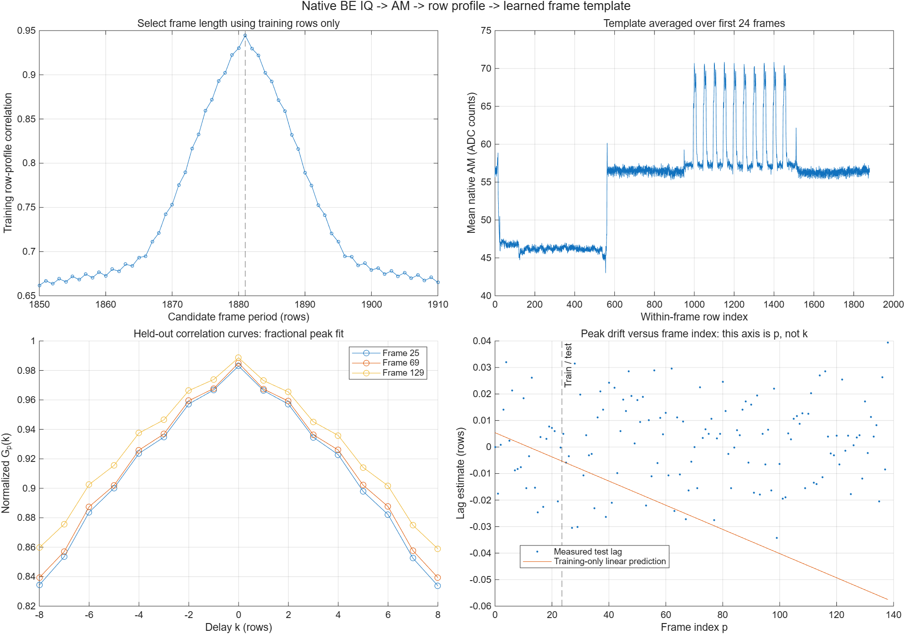
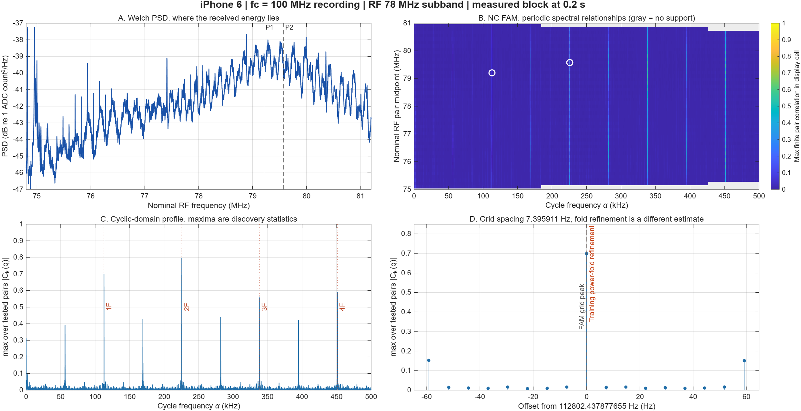
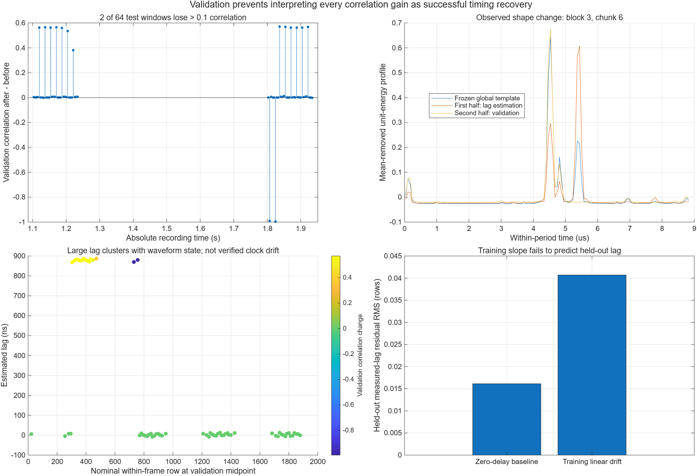

# MATLAB 실측 결과 안내

[MATLAB Live Script](../../GkTemplateFamWalkthrough27.m) · [전체 그래프 갤러리](index.html)

---

# G(k), 실측 템플릿, FAM — 정의와 독립 구간 적용 결과

작성일: 2026-10-27 (Asia/Seoul). 실행: MATLAB R2026b. 대상: iPhone 6, `black글_fc100MHz.rIs`. 이 문서는 실행 결과 JSON·CSV와 MATLAB 코드를 대조한 연구 기록이다. 검출한 반복 구조를 DSI packet으로 확정하지 않으며, 새 시간축 보정은 독립 검증 결과에 따라 채택하지 않는다.

## 1. 결론

- 기존 **G(k)는 시간 지연 k를 바꾸며 구하는 상호상관 함수**다. k는 SVD rank, Fourier 절단 차수, frame 수가 아니다.
- 이번에는 **8.865047805 µs 순환 전력 템플릿**과 **1881-row frame AM 템플릿**을 실제 데이터로 만들었다. 학습 구간을 고정하고 다른 시간 구간에 적용했다.
- 순환 전력 템플릿은 긴 held-out 구간에서 무보정 상관 0.997428·0.998714로 반복 구조를 잘 검출한다. 그러나 짧은 창 64개 중 15개에서 |추정 지연| > 500 ns, 2개에서 상관 손실 > 0.1이 발생했다. 전역 템플릿이 다른 펄스에 맞춰질 수 있으므로 이 지연을 그대로 clock drift로 사용하지 않는다.
- frame 학습 구간의 기울기 −0.000455876 line/frame를 이후 구간으로 외삽하면 지연 오차 RMS가 0.0406954 line이다. **무보정 0-delay 기준 RMS 0.0161274 line보다 나쁘다.** 따라서 새 frame drift 모델을 채택하지 않는다.
- median correlation의 소폭 상승은 시간축 보정 성공의 충분한 증거가 아니다. 보간에 의한 평활화, 상태 변화, 잘못된 피크 선택도 함께 검사해야 한다.
- 이번에 검증된 것은 같은 녹음 내의 반복 구조다. **packet 식별, HS header 복호, CFO 보정, carrier phase 복원, 가로 픽셀 복원은 수행 결과로 주장하지 않는다.**

## 2. 입력과 재현 경로

| 항목 | 값 또는 근거 |
|---|---|
| 원본 | `C:/Users/leechanghoon/Downloads/black글_fc100MHz.rIs` |
| 원본 크기 | 1,158,300,000 bytes; 289,575,000 complex samples |
| 원본 SHA-256 | `32f74cf59e279b72b27fab92949d2a7bf1520a418c3a28e7828fe208df2809fa` |
| Fs | 사용자 제공 124.0828 MS/s |
| RF 중심 | 사용자 제공 100 MHz |
| 수신 대역폭 | 사용자 제공 nominal 120 MHz; 저장 Fs와 구분 |
| 표현 | big-endian `int16 I,Q`; frame 분석에서 `sqrt(I^2+Q^2)` |
| DC 처리 | native frame AM은 평균 제거 없음. RF78 캐시는 기존 학습 블록의 고정 DC 제거·DDC·anti-alias 전처리를 유지 |
| 원본 변경 | 없음 |
| 신호 처리 실행 | MATLAB R2026b, `applyIphoneTemplates27.m` |
| 결과 기준 | `iphone6_templates_fam_20261027_v2`; 이전 run과 구분 |

원본 hash는 2026-10-26T13:01:01.526Z 검증 기록을 참조했다. 이번 실행은 파일 크기도 대조했다. 이를 이번 실행에서 hash를 새로 계산한 것으로 표현하지 않는다.

- [실측 지표 metrics.json](C:/Users/leechanghoon/Documents/Codex/2026-09-21/snr-svd/tempestsdr-cloud/research/mobile_mipi_leakage/matlab_agentic_lab/results/iphone6_templates_fam_20261027_v2/metrics.json)
- [독립 검증 generalization_audit.json](C:/Users/leechanghoon/Documents/Codex/2026-09-21/snr-svd/tempestsdr-cloud/research/mobile_mipi_leakage/matlab_agentic_lab/results/iphone6_templates_fam_20261027_v2/generalization_audit.json)
- [짧은 창별 CSV](C:/Users/leechanghoon/Documents/Codex/2026-09-21/snr-svd/tempestsdr-cloud/research/mobile_mipi_leakage/matlab_agentic_lab/results/iphone6_templates_fam_20261027_v2/short_template_heldout.csv)
- [frame별 CSV](C:/Users/leechanghoon/Documents/Codex/2026-09-21/snr-svd/tempestsdr-cloud/research/mobile_mipi_leakage/matlab_agentic_lab/results/iphone6_templates_fam_20261027_v2/frame_template_heldout.csv)
- [실행 코드](C:/Users/leechanghoon/Documents/Codex/2026-09-21/snr-svd/tempestsdr-cloud/research/mobile_mipi_leakage/matlab_agentic_lab/applyIphoneTemplates27.m:1)

## 3. 기존 G(k)의 정의

기존 frame 방식은 AM raster를 시간 순서로 펼친 벡터에서 평균을 제거하고 에너지를 정규화한다.

\[
v_p[n]=\frac{a_p[n]-\bar a_p}{\sqrt{\sum_n|a_p[n]-\bar a_p|^2}}.
\]

기준 frame을 \(v_0\)라 하면

\[
G_p(k)=\sum_n v_p[n+k]v_0^*[n],\qquad
\hat k_p=\arg\max_k G_p(k).
\]

AM은 실수이므로 기존 코드는 FFT zero-padding으로 선형 상관의 실수부를 계산한다. 이는 복소 IQ의 carrier phase 정렬과 같지 않다. k의 양의 부호는 현재 관측을 더 늦은 위치에서 읽으면 기준과 맞는다는 convention이다.

정수 최대점 주위의 세 점으로 분수 지연을 보정한다.

\[
\delta_p=\frac12\frac{G_p(k-1)-G_p(k+1)}{G_p(k-1)-2G_p(k)+G_p(k+1)},
\qquad \tilde k_p=\hat k_p+\delta_p.
\]

**두 그래프의 축을 구분한다.** G(k) 곡선은 x축이 지연 후보 k, y축이 상관값이다. drift 그래프는 x축이 frame index p, y축이 최대점 위치 \(\tilde k_p\)다. 후자의 직선 기울기가 frame마다 쌓이는 지연 오차다.

원 코드 근거:

- [평균 제거·에너지 정규화·시간 순서 flatten](C:/Users/leechanghoon/Desktop/mobile/0625/analyze_ris_frame_Gk_am_first_v3.m:507)
- [G_p(k) 명시와 FFT 선형 상관](C:/Users/leechanghoon/Desktop/mobile/0625/analyze_ris_frame_Gk_am_first_v3.m:535)
- [lag 기울기와 frame period 환산](C:/Users/leechanghoon/Desktop/mobile/0625/analyze_ris_frame_Gk_am_first_v3.m:622)
- [측정 frame별 lag 적용](C:/Users/leechanghoon/Desktop/mobile/0625/analyze_ris_frame_Gk_am_first_v3.m:639)
- [별도의 row-profile 정규화 상관 방식](C:/Users/leechanghoon/Desktop/mobile/0625/estimate_raster_timing_generic_v1.m:206)

row-profile 방식에서는 k의 단위가 line이다. 이 경우 \(\tilde k_p\simeq ap+b\)를 fit하면 후보 frame 길이는 \(N_V+a\) line, 샘플 단위 후보는 \((N_V+a)N_L\)이다. **a를 실제 보정에 쓰려면 학습에 사용하지 않은 구간에서도 성립해야 한다.**

과거 iPhone 6s 기록에는 약 488.884548 samples/line 간격의 상관 alias가 있어 lag unwrap이 필요했다. [기존 기록](C:/Users/leechanghoon/Desktop/mobile/0625/docs/experiments/2026-07-27_iphone6s_psd_timing_and_vertical_frequency_v4.md:116). 다른 capture의 이 결과를 현재 100 MHz 기록의 교정값으로 옮기지 않는다.

## 4. 이번 두 템플릿

### 4.1 RF78 순환 전력 템플릿

기존 FAM 분석의 AA 처리된 RF78 subband에서 \(p[n]=|x[n]|^2\)를 사용한다. training block에서 고정한 주파수는

\[
\alpha_0=112802.5501974424\ {\rm Hz},\quad
T_0=1/\alpha_0=8.86504780476739\ \mu{\rm s}.
\]

원본 Fs에서는 주기당 1099.999953749391 samples, 분석 Fs에서는 68.749997109337 samples다. 128개 위상 bin의 표시 간격은 69.258185975 ns다. 이 bin 간격을 독립적인 시간 분해능이나 지연 정확도로 해석하지 않는다.

전역 sample 시각으로 계산한 위상은

\[
u_n=\operatorname{frac}(\alpha_0t_n),\qquad
b_n=\lfloor128u_n\rfloor.
\]

training template는 각 bin의 전력 평균이다.

\[
q[b]=\frac{1}{N_b}\sum_{n:b_n=b}p[n].
\]

관측 profile과의 **순환 정규화 상관**으로 지연을 구한다. 기존 frame G(k)의 같은 원리를 한 주기 위상 좌표에 적용한 것이다. 알려진 DSI bit sequence로 만든 matched filter는 아니다.

| 별도 구간 | 보정 전 profile 상관 | 같은 profile에서 fit한 분수 지연 |
|---|---:|---:|
| block 2 | 0.9974282191 | +2.423441 ns |
| block 3 | 0.9987140160 | +3.245772 ns |

위 지연과 보정 후 상관은 같은 profile에서 평가한 수치이므로 독립 검증으로 세지 않는다. 독립 검증은 held-out block 2·3을 각각 32개 창으로 나누고, **각 창의 앞 절반에서 지연을 추정하여 뒤 절반에 적용**했다. training template와 \(\alpha_0\)는 그대로 고정했다.

| 64개 검증 창 지표 | 보정 전 | 보정 후 |
|---|---:|---:|
| 상관 중앙값 | 0.921237590 | 0.924724577 |
| edge 상관 중앙값 | 0.901434522 | 0.909868904 |
| 상관 평균 | 0.783683912 | 0.866085576 |

그러나 56개는 개선되고 8개는 악화했으며, 그중 2개는 0.1보다 큰 상관 손실을 보였다. 최악의 상관 변화는 **−0.994515237**이다. 15/64개 창에서 |추정 지연| > 500 ns가 관측되었다. validation 행 번호 34, 38이 큰 손실에 해당한다.

**해석:** 전역 template와 local waveform의 상태가 달라지면 다른 펄스를 맞춰 큰 lag가 선택될 수 있다. 반복 구조의 존재는 유지되지만, 얻은 모든 lag를 물리적 타이밍 오차로 처리할 근거는 없다. 중앙값만 보면 이 실패가 가려진다.

### 4.2 1881-row frame AM 템플릿

원본 BE IQ에서 AM을 계산하고, \(N_L=F_s/\alpha_0\)라는 분수 row 길이로 sample을 row에 배정해 row mean을 만든다. 첫 24 frame에서 ACF 최대는 **1881 rows**, 상관은 **0.9445602022**였다. 이 24 frame의 평균 row profile이 template다.

1 frame의 guard 뒤에서 114 frame을 검증했다. 테스트 시작은 0-based frame 25다. 학습에서 얻은 지연식은

\[
\hat k_p=-0.0004558755603p+0.0054085753695\quad[\mathrm{line}].
\]

이 fit의 후보 값은 다음과 같으나, 아래 검증에서 채택되지 않았다.

- frame 길이 후보: 1880.99954412444 lines
- frame 샘플 수 후보: 2069099.41153951 samples
- frame rate 후보: 59.9694723743 Hz

| 검증 지표 | 무보정 | 학습식 적용 |
|---|---:|---:|
| profile 상관 중앙값 | 0.9869582874 | 0.9872337631 |
| edge 상관 중앙값 | 0.7443458790 | 0.7461547401 |
| 진단용 측정 lag와 예측값의 RMS | **0.0161273546 line** | **0.0406954338 line** |

held-out 구간에서 진단용으로 측정한 lag 기울기는 **+0.0000155535253 line/frame**로, training 기울기의 외삽을 뒷받침하지 않는다. 이 테스트 기울기를 다시 보정 파라미터로 조정하지 않았다. 검색 경계 피크는 0개였다.

**판정:** 상관 중앙값은 조금 높아졌지만 지연 예측 오차는 무보정보다 크다. 학습식 기반의 새 frame time warp는 적용 대상으로 채택하지 않는다. 반복 frame profile 자체는 template로 검출된다.

## 5. FAM 수식과 그래프를 읽는 법

직접 출처는 [Chad Spooner, CSP Estimators: The FFT Accumulation Method, 2018-06-01](https://cyclostationary.blog/2018/06/01/csp-estimators-the-fft-accumulation-method/)이다. 원 연구의 서지는 [Roberts, Brown, Loomis (1991), DOI 10.1109/79.81008](https://doi.org/10.1109/79.81008)이다. 1991 논문 전체를 이번 작업에서 새로 정독했다는 의미는 아니다. 아래는 공개 설명과 검증된 로컬 구현의 좌표 규약에 맞춘 수식이다.

non-conjugate cyclic autocorrelation은

\[
R_x^\alpha(\tau)=\left\langle x(t+\tau/2)x^*(t-\tau/2)e^{-j2\pi\alpha t}\right\rangle_t,
\qquad
S_x^\alpha(f)=\int R_x^\alpha(\tau)e^{-j2\pi f\tau}\,d\tau.
\]

\(f\)는 두 spectral component의 중심, \(\alpha\)는 두 성분 간 간격과 연결된 반복 주파수다. 이 정의에서 \(\alpha=0\)은 일반 PSD와 연결된다. non-conjugate라는 이름에도 시간 지연 곱에 별표가 하나 있음에 주의한다.

channel FFT 길이 M, hop L, 관측 hop 수 P일 때:

\[
U_k[r]=\sum_{n=0}^{M-1}a[n]x[rL+n]e^{-j2\pi kn/M},
\qquad
D_k[r]=U_k[r]e^{-j2\pi f_krL/F_s}.
\]

첫 번째 FFT는 주파수 channel을 만든다. 이어서 channel pair의 곱을 slow time 방향으로 FFT한다.

\[
Z_{k\ell}[q]=\sum_{r=0}^{P-1}g[r]D_k[r]D_\ell^*[r]e^{-j2\pi qr/P}.
\]

이 값의 좌표는

\[
f=\frac{f_k+f_\ell}{2},\qquad
\alpha=f_k-f_\ell+q\frac{F_s}{PL}.
\]

코드 근거: [channelization와 phase reference](C:/Users/leechanghoon/Documents/Codex/2026-09-21/snr-svd/tempestsdr-cloud/research/mobile_mipi_leakage/matlab_agentic_lab/signal_processing/famCycleScout26.m:90), [좌표·정규화 metadata](C:/Users/leechanghoon/Documents/Codex/2026-09-21/snr-svd/tempestsdr-cloud/research/mobile_mipi_leakage/matlab_agentic_lab/signal_processing/famCycleScout26.m:126).

이번 FAM의 M=32, L=8, P=131072, 분석 Fs=7.755175 MS/s에서는 channel bin spacing이 약 242.349219 kHz, cyclic-frequency spacing이 약 7.395911 Hz다. FFT 관측 시간 PL/Fs는 약 135.209844 ms다. 창의 실제 주엽 폭과 이 FFT bin 간격은 구분한다. \(112802.5501974424\) Hz는 FAM grid 최대점 자체가 아니라 training cyclic-power refinement에서 고정한 값이다.

| 그래프 | 읽는 방법 |
|---|---|
| PSD | 어떤 f에 전력이 있는지; 반복 구조의 동일성까지 보여주지 않음 |
| SCF 또는 cyclic coherence heatmap | 어떤 f와 alpha의 쌍에서 주파수 성분이 상관되는지 |
| CDP(alpha) | 각 alpha에서 f 방향 최대 상관; 주파수 탐색으로 인한 최대 선택 편향이 있음 |
| 고정 channel-pair 검증 | training에서 선택한 위치가 다른 시간 구간에도 유지되는지 |
| 순환 위상 | 시간 원점에 대한 반복 패턴의 위상; RF carrier phase와 구분 |
| G(k) | 이미 정한 template와 관측이 어느 지연에서 가장 잘 맞는지 |

현재 strong RF78 후보에는 약 112.8024, 225.6049, 338.4073, 451.2098 kHz의 계열이 있었다. 이것은 반복 구조를 지지한다. 상관 또는 고조파가 있다는 사실만으로 HS packet 종류·lane 수·byte rate를 결정하지 않는다.

## 6. 위상·CFO·template 오정렬의 구분

순환 전력 계수는

\[
c_h=\left\langle |x(t)|^2e^{-j2\pi h\alpha_0t}\right\rangle_t
\]

로 계산할 수 있다. 동일 waveform의 지연이 \(\tau\)라면 이 계수 위상은 \(-2\pi h\alpha_0\tau\)만큼 바뀐다. 따라서 여러 h에서 일관된 위상 기울기가 보이는지 검증하는 것이 단일 template 피크보다 도움이 될 수 있다. waveform 상태 또는 채널이 달라지면 이 단순 지연 모델 자체가 깨질 수 있다.

\(|x(t)e^{j2\pi\nu t}|^2=|x(t)|^2\)이므로 전력/AM template만으로 일정한 CFO를 추정할 수 없다. 기존 complex SCF, carrier phase, 이번 순환 전력 위상은 서로 다른 관측량이다. 이번 결과의 `carrier_phase_corrected=false`, `packet_identified=false`를 유지한다.

## 7. 다음 검증의 구체적 방향

1. blank/active 및 반복 펄스 상태에 따라 template를 분리하거나, 상태 변화에 덜 민감한 특징을 선정한다. template 수를 늘릴 때에는 새 training/test 분할을 고정한다.
2. 단일 최대값뿐 아니라 두 번째 피크와의 차이, template 자기상관 sidelobe, 지연 연속성 및 여러 고조파 위상 일관성을 기록한다.
3. 미리 고정한 rejection rule로 불안정한 지연을 제외하고, 독립 구간에서 무보정 대비 lag 예측 RMS를 비교한다.
4. frame 전체 profile의 밝기만 맞는 효과와 실제 edge 위치 정렬을 분리한다. 이번 중앙값 개선만으로 fractional resampling 보정을 승인하지 않는다.
5. 알려진 DSI packet template는 실제 lane/rate/HS 구조 검증 이후의 별도 실험으로 구성한다. 현재 empirical template를 packet template라고 이름 붙이지 않는다.

## 8. 상태 표기

- measured: 두 템플릿의 held-out 상관, frame ACF, 진단용 lag, 실패 창 수.
- derived: samples/period, template bin 간격, training slope로부터 환산한 frame period 후보.
- hypothesis: 순환 구조의 row/HS/packet 기원, waveform 상태가 pulse matching ambiguity를 유발한다는 해석.
- not established: DSI packet 복호, 정확한 HS 시작, lane 수, RF CFO, carrier phase 보정, 가로 픽셀 복원.
- rejected for adoption: 이번 training frame slope의 자동 외삽 time warp. 테스트 데이터로 재조정하지 않음.
