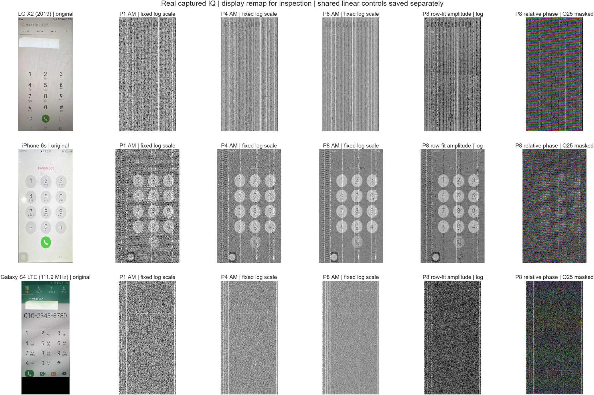
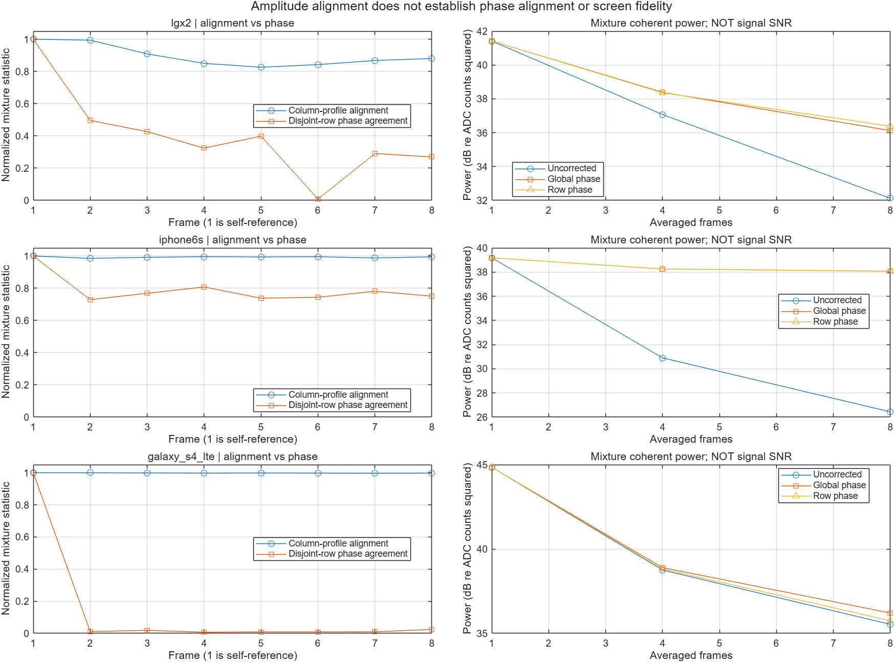

# MATLAB 실제 실행 결과 — 2026-10-22

## 실행 상태

- MATLAB R2026b 로그인 후 공식 MCP로 실제 수치 실행 완료. 현재 설치 제품: MATLAB, MATLAB Copilot.
- **11/11 수치 테스트 통과**, LG X2·iPhone 6s·Galaxy S4 LTE 111.9 MHz 세 캡처 분석 완료.
- run ID: `20261022_041904_607`. 입력은 원본 big-endian signed int16 I,Q. 원본 파일은 수정하지 않았다.
- 첫 2²⁰ 복소 샘플 PSD/STFT, 최대 0.4초 포락선 주기 탐색, 연속 P1/P4/P8 래스터 누적을 수행했다.
- 전체 파일 SHA는 기존 릴리스의 기대값으로 기록했고, 이번 실행에서는 읽은 초기·래스터 구간 바이트의 SHA-256을 계산했다.

## 원본과 누적 결과

위 개요의 AM은 첫 프레임 1/99% 경계에 고정한 log1p 표시다. P1/P4/P8 PNG의 선형 표시값을 remap하므로 이미 clipping/양자화된 표시용 비교다. P8 복소값과 위상은 저장된 MAT 배열에서 직접 표시했다. 선형 공통 스케일 대조군은 각 기기의 P008_comparison.png에 있다. log 표시가 새로운 신호 복원이나 대역폭 증가를 의미하지 않는다.

| 기기 | 관찰 | P4→P8 홀짝 AM 상관 | P2–P8 행 위상 일치도 |
|---|---|---:|---:|
| LG X2 | 숫자 키·통화 버튼과 원본의 위치가 대응. 강한 세로선 잔존 | 0.606→0.729 | 0.0084–0.4962 |
| iPhone 6s | 원형 키패드·숫자·통화 버튼·좌하단 AssistiveTouch 식별 | 0.827→0.899 | 0.7291–0.8076 |
| Galaxy S4 LTE 111.9 MHz | 강한 선과 완만한 명암. P8에서 숫자·전화번호 식별 어려움 | 0.555→0.708 | 0.0072–0.0249 |

상관은 혼합 신호의 반복성이지 화면 복원 정확도가 아니다. Galaxy는 가로 프로파일 정렬 상관이 0.996–0.999인데도 위상 일치도는 매우 낮다. 고정된 선을 잘 맞춘 결과와 원하는 화면 누설의 정합을 구분해야 한다. LG의 frame 6에도 위상 일치도가 0.0084로 떨어진다. 따라서 현재 행 선형 위상 모델은 모든 프레임에서 유효하지 않으며, 8프레임 이후를 무조건 더 누적하는 방식은 정당화되지 않는다.

P8 복소 평균 전력(count²)의 무보정 / global / row 보정 값:

| LG X2 | iPhone 6s | Galaxy S4 LTE |
|---:|---:|---:|
| 1630.81 / 4096.68 / 4349.17 | 440.40 / 6417.67 / 6408.08 | 3575.01 / 4175.65 / 3756.39 |

이 전력 증가는 잡음과 원하는 신호를 분리한 SNR 이득이 아니다. 특히 iPhone은 위상 미보정 평균에서 상쇄가 크고 global 보정이 효과적이다. row 보정은 global보다 항상 낫지 않았다. 행 fit은 훈련행만 unwrap하지만 가로 정렬과 기준 프레임을 공유하므로 완전히 독립적인 검증은 아니다.

## 샘플률·대역폭·행/열 시간

| 기기 | 기록상 RF BW | IQ Fs (MS/s) | 한 행 (μs) | 한 래스터 열 (ns) | 보간 전 samples/column |
|---|---:|---:|---:|---:|---:|
| LG X2 | 60 MHz | 136.565510 | 11.276544 | 11.033800 | 1.506837 |
| iPhone 6s | 20 MHz | 55.054870 | 8.879951 | 11.839935 | 0.651846 |
| Galaxy S4 LTE | 20 MHz | 110.891050 | 8.609316 | 7.971589 | 0.883978 |

Fs/BW는 파일명·기존 수집 기록에서 가져왔으며 headerless RIS에서 새로 읽은 장비 설정이 아니다. 실제 수신기의 유효 필터 통과대역을 이번 실행으로 재측정하지 않았다. 행/열 timing은 기존 래스터 fit을 사용했다.

보간 후 출력은 선택한 래스터 열마다 1점이다. 이에 해당하는 가상 래스터율은 90.630605 / 84.459925 / 125.445500 MS/s이다. 이는 ADC 재측정률이나 검증된 MIPI 픽셀 클록이 아니다. iPhone·Galaxy의 1열당 원시 샘플 수가 1보다 작아도 출력 격자를 보간할 수 있으나 독립적으로 측정된 정보가 늘지는 않는다.

STFT는 약 1/4행·1행·16행 Hann 창을 사용했다. 각 창의 시간 길이·FFT 간격·ENBW는 metrics.json에 있다. 한 행 창의 ENBW는 대략 LG 133.018 kHz / iPhone 168.880 kHz / Galaxy 174.174 kHz 수준이며 정확값은 저장된 결과를 따른다. 이 짧은 창으로 60 Hz 간격을 분해할 수 없다. 열을 세로로 추적하는 시퀀스는 연속 IQ가 아니라 행 간격으로 건너뛴 표본이다.

## 위상·세로선 해석

- HSV의 H는 상대 복소 위상, S는 복소 평균 진폭/진폭 평균, V는 진폭이다. 원래 화면 RGB를 복원한 것이 아니다.
- overview의 위상은 P8 진폭 하위 25%에서 채도를 0으로 표시했다. 기본 P*_phase_hsv.png는 마스크 없는 진단본이며 둘을 구분한다. 원시 인접 위상 그림은 두 샘플 모두 진폭 문턱을 넘는 경우만 표시했다.
- frame_parameters.csv에 가로 이동, 전체 위상, 행당 위상 기울기, 행 fit 조건·일치도를 저장했다. column_phase.csv에는 각 열의 복소 평균 위상/일관성을 저장했다.
- 고정 세로선은 패널 driver, 패킷·blanking, frame 동기 간섭 모두 후보다. 현재 한 안테나 IQ와 rank만으로 common-mode DSI나 LCD column driver를 판별할 수 없다.
- 원형 UI 위의 색 띠는 위상·대역제한 응답·잔류 carrier/타이밍과 HSV 표현이 함께 만든 현상일 수 있다. 실제 패널 밝기 그라데이션 또는 driver 고유 위상으로 확정하지 않았다.

## 이번에 바로잡은 코드

1. JVM 없는 R2026b에서 .NET SHA-256 및 경로 정규화 사용. 빈 구간과 1 MiB를 넘는 다중 블록 hash를 알려진 값으로 검증.
2. 복소 Yule–Walker 공분산을 Toeplitz의 첫 열로 명시. 기존 켤레 방향 오류를 복소 AR 모형으로 재현·수정.
3. 빈 구조체 배열에 첫 record를 저장할 때 발생하던 오류 수정.
4. 행 위상 fit에서 훈련행 선택 후 unwrap, coherence/조건수 검사, 실패시 global fallback. 무보정/global/row 대조 영상 추가.

LG AR4→32의 검증구간 잔차 전력비는 수정 후 0.523→0.381이다. AR 피크가 화면 정보임을 입증하는 값은 아니다.

## 합성 대조실험

알려진 약한 AM/PM + 강한 clutter에서 첫 singular component 에너지 비율은 99.772%, clutter 상관은 0.99977, 원하는 신호 상관은 0.00887이었다. 원하는 carrier를 이미 아는 합성 조건에서는 P1→P32 변조 오차 기준 SNR이 −10.14→4.78 dB였다. 이 값은 스마트폰 측정 성능이 아니다.

## 남은 연구

현재 확인한 것은 MATLAB 연결·수치 실행과 세 캡처의 기준 비교다. 세 기기의 간섭 분리 완료 또는 이전 P200 대비 성능 향상은 주장하지 않는다. RPCA와 matched-subspace 함수의 합성 검증은 통과했지만 실제 DSI/driver 분류에는 독립적인 기준 패턴·배경 캡처가 더 필요하다. 다음 실험은 Galaxy의 선택 대역/CFO/타이밍 모델과 LG frame6 위상 붕괴를 우선 검증해야 한다.

과거 three_devices_big_endian 폴더는 iPhone6 238 MHz·Galaxy171.5 MHz를 포함하므로 이번 6s311 MHz·Galaxy111.9 MHz와 같은 캡처의 전후 비교로 쓰지 않는다. 기존 제공 P200의 little-endian 처리와 log 표시도 별도 조건이다.

## 전체 재현 파일

[전체 실행 ZIP (273 MB)](https://github.com/whoeen/TempestSDR/releases/download/mobile-mipi-raw-iq-2026-10-21/matlab_baseline_20261022_041904_607_full.zip) — MAT 수치 배열·모든 중간 PNG/CSV/JSONL·MATLAB 소스 snapshot·파일별 해시를 포함한다. GitHub 반환 크기와 SHA-256을 로컬 값과 대조했다.

SHA-256: `54eaef92ef8afaa5911ed296f9cb2867eca684bb07f1b3d08edf160f43d48f40`
