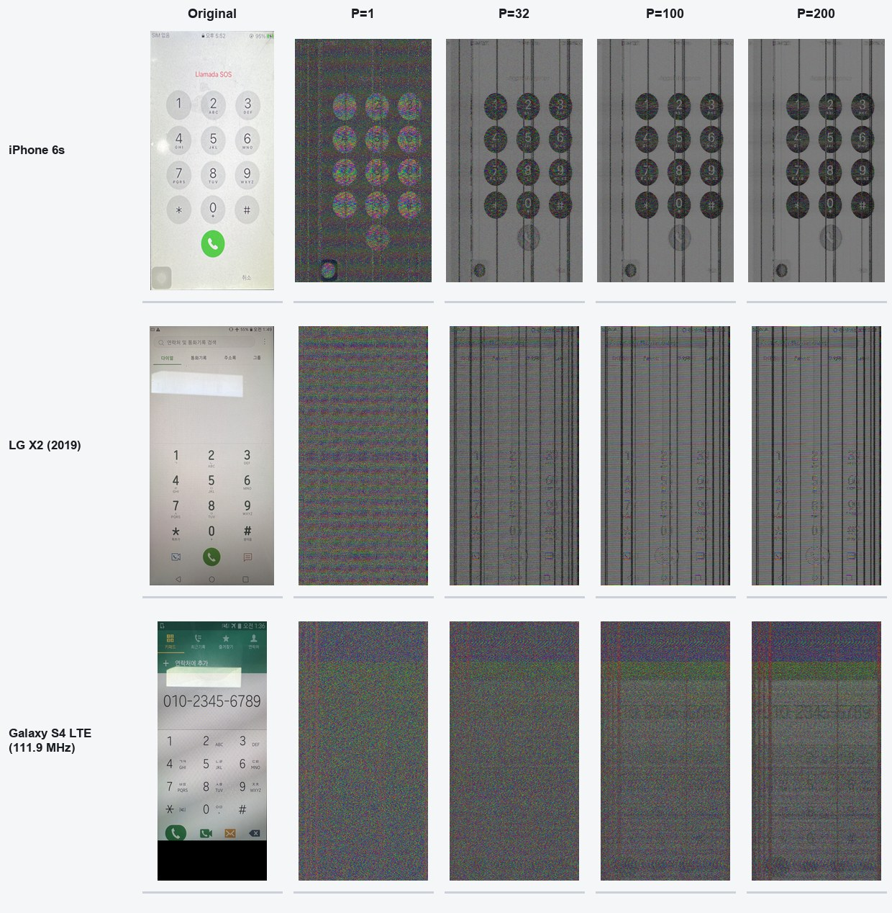
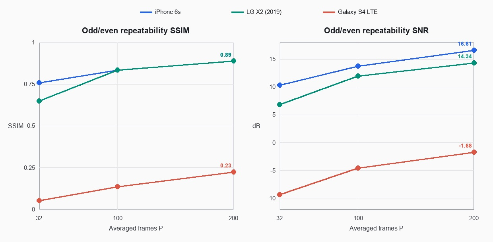
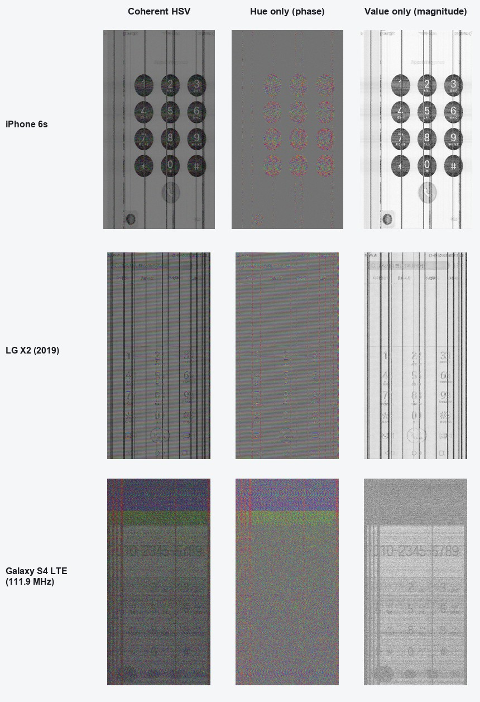
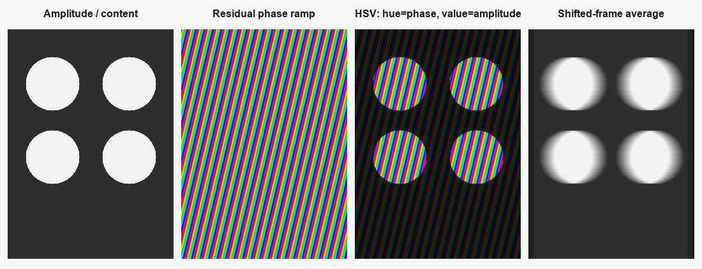

# 첨부 복원 영상 재분석

## 1. 분석 대상부터 바로잡은 결과

첨부한 1–6번은 세 기기의 `Coherent_HSV`, `median_off` 결과를 각각 `P=1`과
`P=200`에서 축소해 붙인 영상이다. 원래 생성 폴더를 역추적하여 중간 단계인
`P=32`, `P=100`도 함께 복원했다.

| 첨부 영상 | 기기 | 실제 단계 |
|---|---|---|
| 1 → 2 | iPhone 6s | P=1 → P=200 |
| 3 → 4 | LG X2 (2019) | P=1 → P=200 |
| 5 → 6 | Galaxy S4 LTE, 111.9 MHz | P=1 → P=200 |
| 7 = 8 | iPhone 원본 | 두 파일은 SHA-256까지 동일 |
| 9 = 10 | LG X2 원본 | 두 파일은 SHA-256까지 동일 |
| 11 | Galaxy 원본 | 단일 원본 |

## 2. 프레임 수가 늘 때 실제로 변하는 것

아래 SSIM과 SNR은 각 P에서 홀수 프레임과 짝수 프레임을 따로 복원해 비교한
**반복 재현성**이다. 원본 화면과의 fidelity 지표는 아니다. 고정 간섭이나 고정
위상 띠도 반복되면 높은 점수를 받을 수 있다.

| 기기 | P=32 SSIM / SNR | P=100 SSIM / SNR | P=200 SSIM / SNR |
|---|---:|---:|---:|
| iPhone 6s | 0.759 / 10.31 dB | 0.834 / 13.75 dB | 0.889 / 16.61 dB |
| LG X2 | 0.649 / 6.84 dB | 0.836 / 11.96 dB | 0.889 / 14.34 dB |
| Galaxy S4 LTE | 0.053 / −9.32 dB | 0.136 / −4.54 dB | 0.226 / −1.68 dB |

### iPhone 6s

- P=1에서도 원형 키의 위치는 보이지만 숫자와 경계는 speckle에 묻혀 있다.
- P=32에서 원형 키와 숫자가 급격히 안정된다. P=100과 P=200에서는 주로 잔여
  잡음만 줄고, 세로의 검은 선은 그대로 남는다.
- Value 영상의 저주파 구조 비율은 0.134에서 0.713으로 증가하고, 3×3 median
  잔차는 0.142에서 0.043으로 감소했다.
- Hue의 선형 위상 띠는 P=32 이후 거의 고정된다. P=200에서 위상 등고선 간격은
  약 4.04 pixel, 선 방향은 x축 기준 약 57.1°이다. 즉 화면 구조와 함께 고정
  위상 램프도 coherent averaging으로 강화되었다.

### LG X2

- P=1은 화면 배열이 거의 보이지 않는다. P=32부터 숫자 배열이 나타나지만 강한
  세로 검은 선과 촘촘한 수평 색 띠가 동시에 선명해진다.
- P=200에서 세로선 성분의 column-profile 비율은 0.980이다. Value 영상이 거의
  column-synchronous 구조에 지배된다는 뜻이다.
- Hue는 약 6.57 row마다 한 바퀴 도는 수평 띠이다. 위상 띠 방향은 약 1.5°로
  거의 수평이다.
- 따라서 첨부 4번의 세로선과 수평 색 띠는 같은 현상이 아니다. 세로선은 주로
  magnitude/Value 성분이고, 수평 rainbow 띠는 phase/Hue 성분이다.

### Galaxy S4 LTE

- P를 늘리면 화면 숫자보다 넓은 밝기 그라데이션과 행 방향 밴딩이 먼저
  안정된다.
- P=200의 odd/even SNR도 −1.68 dB이고 SSIM은 0.226이다. 세 기기 중 coherent
  복원이 가장 불안정하다.
- Hue 띠의 간격은 약 2.70 row, 방향은 −0.5°로 거의 수평이다. 하지만 행 방향
  국소 위상 일치도는 0.431에 그쳐 iPhone과 LG보다 훨씬 낮다.
- 이 결과에서는 P 증가가 원하는 화면보다 stationary banding을 더 강하게 만든다.

## 3. 세로선과 rainbow/gradation 선을 분리해서 봐야 하는 이유

이 복원은 동일한 복소 평균값을 다음과 같이 HSV로 표시한다.

\[
H(x,y)=\frac{\angle \bar Z(x,y)+\pi}{2\pi},\qquad
V(x,y)=\operatorname{robust\ log}|\bar Z(x,y)|.
\]

즉 색은 위상이고 밝기는 복소 평균의 크기다. 채널을 분리하면 현상의 출처가
명확해진다.

- iPhone과 LG에서 화면을 가로지르는 굵은 세로 검은 선은 **Value에도 그대로
  남는다**. 위상 표시 때문에 생긴 색 띠가 아니라, 열 위치에 고정된 magnitude
  성분이다.
- LG와 Galaxy의 촘촘한 수평 rainbow 선은 **Hue에 남는다**. 잔여 주파수/시간
  오차가 raster 좌표에서 선형 위상 램프로 바뀌고, 위상이 2π마다 wrap되면서
  반복되는 색 띠다.
- 따라서 “세로선이 보인다”는 사실만으로 LCD column driver 방사라고 단정할 수는
  없다. column driver, line-synchronous common-mode, raster folding 오차, 고정
  수신기 간섭이 모두 열 위치 고정 성분을 만들 수 있다.

복소 영상의 간단한 모델은 다음과 같다.

\[
\bar Z(x,y)=A(x,y)\exp\{j[\phi_{content}(x,y)+2\pi(f_x x+f_y y)]\}+n(x,y).
\]

`A(x,y)`는 화면과 고정 magnitude 성분을 포함한다. `f_x`, `f_y`는 잔여 carrier,
샘플링 시계, frame registration 오차가 raster 좌표로 투영된 값이다. `f_x`가
크면 세로 계열의 Hue 띠가, `f_y`가 크면 수평 Hue 띠가 나타난다.

## 4. 원형 키 안에서 띠가 더 잘 보이고 경계가 gradation처럼 되는 이유

원 자체가 위상 띠를 만드는 것은 아니다. 세 현상이 겹친다.

1. **진폭 게이팅**  
   원형 키 내부와 경계에서 누설 크기 `A(x,y)`가 배경보다 크다. HSV에서는 Value가
   큰 위치만 Hue가 밝게 보이므로, 화면 전체에 존재하는 같은 위상 램프가 원 안에서
   훨씬 또렷하게 드러난다. 배경의 Hue는 낮은 SNR 때문에 무작위처럼 보인다.

2. **fractional shift 평균의 부분 점유율**  
   프레임마다 수평 위치가 조금씩 달라진 상태에서 평균하면 원 경계의 한 pixel은
   어떤 프레임에서는 원 내부, 다른 프레임에서는 외부가 된다. 그 평균이 0과 1
   사이의 연속값이 되어 경계가 gradation으로 넓어진다. 원은 경계의 x 위치가
   y마다 달라서 이 현상이 곡선 전체에 퍼진다. 직선 경계에서는 좁은 평행 ghost로
   보이기 쉽다.

3. **축소 표시의 aliasing**  
   iPhone P=200의 native Hue 주기는 약 4.04 pixel이다. 750×1334 결과를 첨부
   2번처럼 약 308×645로 축소하면 이 주기가 출력 pixel의 Nyquist 부근에 들어간다.
   RGB 보간은 hue wrap 양쪽 색을 직접 섞기 때문에 rainbow 선이 회색 또는 검은
   gradation/moire 선으로 바뀐다. 첨부 2번에서 세로선이 유난히 굵고 회색으로
   보이는 데에는 이 표시 alias도 포함된다.

따라서 선 방향을 물리적인 row/column driver 방향과 비교할 때는 축소 screenshot이
아니라 native-resolution의 Hue와 Value를 따로 사용해야 한다.

## 5. 현재 자료에서 말할 수 있는 물리적 결론의 범위

- **확인됨:** iPhone과 LG의 일부 선은 프레임 수가 늘어도 사라지지 않는 열 위치
  고정 magnitude 성분이다.
- **확인됨:** LG와 Galaxy의 수평 rainbow 띠는 HSV Hue의 잔여 위상 램프이다.
- **가능성 있음:** LG의 강한 열 고정 성분은 panel column path, DSI 공통모드,
  display timing에 동기된 다른 회로의 방사와 양립한다.
- **아직 미확인:** 그 성분이 LCD column driver에서 직접 방사되었다는 인과관계.
  이를 확인하려면 화면 pattern을 바꾸면서 같은 열 좌표를 따라 움직이는지,
  probe 위치/편파에 따라 panel edge에서 최대가 되는지, line rate와 고조파가 함께
  이동하는지를 봐야 한다.

## 6. 재현성 및 해석상의 주의점

이 문서는 사용자가 첨부한 **기존 복원 영상 자체**를 정확히 분석한 것이다. 원 생성
스크립트 `benchmark_three_device_gatefree_median_v1.py`는 IQ를 little-endian
`<i2`로 읽었다. 현재 확인된 `RIS2IQ.m` 포맷은 big-endian `>i2`이다. 따라서 위의
영상 내 선 방향, HSV 분해, 프레임 증가 현상에 대한 설명은 유효하지만, 이를 원시
RF의 물리적 방사원으로 귀속하려면 동일한 P=1/32/100/200 실험을 `>i2`로 다시
수행해 같은 선이 유지되는지 확인해야 한다.

붙여넣은 두 텍스트 파일은 서로 같은 내용이었다. 그 안의 문장은 작업 지시로
사용하지 않고 배경 설명으로만 대조했다.

## 7. 생성 파일

- `frame_progression.jpg`: 원본과 P=1/32/100/200 비교
- `frame_metrics.jpg`: odd/even 반복 재현성 그래프
- `hsv_channel_decomposition.jpg`: P=200 Hue/Value 분리
- `circle_gradient_explainer.jpg`: 원형 버튼과 gradation 발생 원리
- `image_metrics.csv`, `image_metrics.json`: 영상에서 다시 측정한 수치
- `analyze_images.py`: 분석과 그림 재생성 코드
